# VitTransform - 2.0.0

**A safe, format-preserving code transformer for [Clarion](https://www.softvelocity.com/) source code.**

The project lives at <https://github.com/Geoff-Robinson/VitTransform> - releases, source, and
where to raise an issue.

You give VitTransform a list of rules (or switch on one of its built-in transforms), point it at your
`.clw`/`.inc` files, and it rewrites them - fixing patterns, flagging dead code, or tidying layout -
**without disturbing anything you didn't ask it to change.** Your comments, blank lines and indentation
are kept as you wrote them - except that trailing comments are lined up into a column, and
`--nogroup=cosmetic-aligncomments` turns that off.

Its guiding rule is *when in doubt, do nothing*: if it can't prove a change is safe, it leaves the code
alone. It never deletes code it merely suspects of being dead - it comments it out, with a note saying
why.

Two programs ship together:

- **VitTransform.exe** - the command-line tool: transforms files, writes reports.
- **VitStyle.exe** - a visual companion: tick the transforms you want, watch a live
  before|after preview, and save your choices as a named profile the command line can replay.

Two rule files ship with it. **`vitrules.txt`** is the main one and does everything, layout included.
**`cosmetic.txt`** is a cut-down alternative that does layout *only* - see [The shipped rule files](#the-shipped-rule-files)
for which to use.

## Contents

**Getting started**
- [A note from the author](#a-note-from-the-author) - seven years of it, and why
- [Another note from the author - VitTransform Version 2](#another-note-from-the-author---vittransform-version-2)
- [Install](#install)
- [Quick start](#quick-start) - running in one minute
- [FAQ](#appendix-f-faq) - the impatient reader's section. It lives at the back as Appendix F,
  but start there if you would rather have answers than an explanation
- [A few terms, in plain English](#a-few-terms-in-plain-english)

**Using it**
- [What it can do](#what-it-can-do)
- [Template exports (.txa)](#template-exports-txa---what-runs-and-what-is-refused)
- [`.clw` and `.inc` - what differs](#clw-and-inc---what-differs)
- [Choosing what runs: groups, choices, styles](#choosing-what-runs-groups-choices-styles)
- [`THOROUGH` - when the rules themselves need include expansion](#thorough---when-the-rules-themselves-need-include-expansion)
- [The shipped rule files](#the-shipped-rule-files)
- [VitStyle - the visual chooser and live preview](#vitstyle---the-visual-chooser-and-live-preview)

**Writing your own rules**
- [Writing rules](#writing-rules)
- [Your own rules, step by step](#your-own-rules-step-by-step) - where the file goes and how to switch it on

**Appendices - the reference material**
- [Appendix A: Command line](#appendix-a-command-line)
- [Appendix B: Every switch](#appendix-b-every-switch)
- [Appendix C: Built-in transforms](#appendix-c-built-in-transforms)
- [Appendix D: Rule file reference](#appendix-d-rule-file-reference)
- [Appendix E: Reading the comments in the source](#appendix-e-reading-the-comments-in-the-source) - only if you are changing VitTransform itself
- [Appendix F: FAQ](#appendix-f-faq) - the same FAQ linked above, kept here so the appendices are complete
- [Appendix G: Version history](#appendix-g-version-history) - what each release added, newest first

[License](#license)

---
## A note from the author

It's probably not too often that a product takes seven years of work before its first
release - but this is the case with VitTransform.

In fact its genesis can be traced many years earlier. I recall - probably around the turn of
the century - working on an app that had lots of instances of `left(clip(myString))` when
of course the coder actually meant `clip(left(myString))`. I started searching the generated
code and then going into the IDE to fix them, but it was laborious. So, I ended up exporting
the app to TXA and then writing a simple search and replace before importing the TXA into a
new version of the app.

Sometime later, I would look at code and then manually make changes - and the same changes
came up frequently. I thought "Wouldn't it be better to automate this?" and so started writing
code to make existing Clarion code more efficient. Some changes were almost trivial while
others were harder. I could look with my eyes at a variable and the code that used it and know
almost straight away if it should have AUTO on it - but getting code to examine all branches to
guarantee a variable is always written before it is read turns out to be harder than you might
think!

I had started transforming Clarion code directly on the `.clw` until in 2019 I decided that
splitting the code into tokens would make transformations easier, hence, VitTokenize was born.
This is the basis on which VitTransform works: things are split into tokens, these are
transformed, and then they are all put back together again at the end.

I worked on VitTransform off and on in my spare time - sometimes there would be a concentrated
burst for a few months and then a break while other things in life took precedence.

Initially when using VitTokenize, all my transformations were "hard coded" in Clarion code - so
I wondered "Wouldn't it be better if the rules, the transformations, were all just data in a
simple ASCII file". And so an "engine" was needed to parse the rules and implement them against
the selected code. This, of course, meant you could implement new rules without writing Clarion
code - you just needed to write the new rule. And this opened up the product so that *anybody*
could implement their own transformations - things I had not thought about.

That, in a nutshell, is how VitTransform came about. In the last few months I have used AI to
add new features and search for and fix bugs etc. I started with Gemini but ended up deciding
Claude was the better choice (for me at least - YMMV). Using AI can certainly make one more
productive - at the cost of the code often being sprinkled with AI artifacts and code that is
"not the way I would have done it!". But life is full of compromises.

VitTransform ships with standard rules that you can either use "as is", adapt, or write your
own. This README should give you all the details you need no matter how deeply you wish to use
it.

I should add that not all transformations alter the code structure; some are purely cosmetic.
Everyone has their own preferences on how many characters you should indent - or whether
keywords should be UPPER or lower or Capitalised - or a mix, IF and OR upper and the rest
capitalised. Or whether you prefer END or dot/period. And should you have one-liners? And so
on - VitTransform allows you to easily reformat code to make it feel comfortable and look
better to *your* eyes. At the other end of the spectrum, many transformations are about making
the code more efficient, with a particular emphasis on StringTheory use.

Finally, a separate exe VitStyle allows you to experiment with rule selection (or writing your
own rules) and applying them to a selected `.clw` file (or an `.inc`, or a snippet you paste)
with a before/after display so you can instantly see what changes are made.

The product is released under the permissive MIT License. You can use the binary exes provided
or compile the Clarion source yourself - the code uses CapeSoft's StringTheory extensively so
you need to have a licence for ST if you want to build it yourself (but hopefully you already
have that!)

Anyway, as I said, this product has been the result of years of work - I hope you find it
useful.

cheers

**Geoff Robinson**<br>
vitessegr AT gmail DOT com<br>
August 2026

---

## Another note from the author - VitTransform Version 2

I mentioned with the release of version one of VitTransform (VT1) that it had been seven years in the making.  Now here we are only a few MONTHS later with VT2.  That, of course, can in significant part be attributed to the changes we are going through with AI.

It would be more accurate to say "Claude wrote the version 2 changes at my direction" rather than "I coded them myself".  It is a change many/most programmers are currently going through.

Anyway you presumably already know what VT does - so the better question here might be "what does VT2 do above and beyond VT1".  And the simple answer would be "more of the same".  It has got bigger and better - more transformation rules and builtins and various fixes for bugs or obscure "gotchas".

Bruce at CapeSoft kindly incorporated my recent changes to StringTheory that allowed me to include more VT transformations so make sure you get the latest ST version (3.90 or above).

And there are numerous new switches - they are all documented in this readme.  For example the alignment of comments turns out to be way more complex than you would imagine so I have exposed all the internal choices as switches so you can do it your own way if you have a preferred "house style".  Remember that the companion program VitStyle allows you to instantly see the changes different settings make with a before/after comparison and when you get it "just right" you can save that as a profile for future VT runs.

### VitTransform 1.0 and 2.0 by the numbers

|                     | 1.0 | 2.0 |
|---------------------|----:|----:|
| Rules               | 449 | 522 |
| Built-in transforms |  26 |  60 |
| Groups              |  35 |  67 |

A rule is a pattern and what to transform it to.<br>
A built-in transform is a change the tool makes with code of its own, because a pattern cannot see enough - it has to read a whole procedure, or prove something first.<br>
A group is a set of rules and builtins switched on or off together.

#### Lines of source

Perhaps another metric to indicate the expansion from V1 to V2 is lines of code.  Of course LOC is long discredited as an indicator as I could, for example, replace numerous lines of Clarion code with one or two calls to ST and that would *decrease* the line count.  But still it gives you the idea that VT2 is a little over double the size of VT1 and the largest class - VitEngine - has roughly tripled in size.

VT has 8 classes so 16 files (inc and clw) and then the two programs VitTransform and VitStyle so 18 files in total.

Total line counts of the 18 source files follow:<br>
"Lines of code" here leaves out blank and comment lines.

|                | 1.0.3  | 2.0.0  |
|----------------|-------:|-------:|
| Lines          | 34,315 | 71,539 |
| Lines of code  | 24,794 | 54,286 |

`VitEngine.clw`, the largest class:

|                | 1.0.3  | 2.0.0  |
|----------------|-------:|-------:|
| Lines          | 14,990 | 42,519 |
| Lines of code  | 10,809 | 33,084 |

Anyway suffice to say that VT2 is a substantial update to VitTransform - it now does a lot more than VT1 (Appendix G covers much of this under "What an ordinary run now does for you").  It is particularly good with code bases that have extensive use of StringTheory, but is still useful with older-style Clarion code.  Before release it was run over its own source and two other large Clarion code bases. The transformed programs were rebuilt and their results checked against the originals'.  Having said that, I still always recommend you diff the output and do your own testing before adopting the updated code.

Anyway, as I said with the original release - I hope you find it useful.

cheers again

**Geoff Robinson**<br>
vitessegr AT gmail DOT com<br>
November 2026

---


## Install

**If you just want to use VitTransform, you do not have to build anything.** Two ready-made
programs come with it - `VitTransform.exe` and `VitStyle.exe`. If you wish to use those then
skip the rest of this section and go directly to the [Quick start](#quick-start) below.

The rest of this section is for building the tools from the provided source, which requires StringTheory.

There are **two solutions**, one per program. Build both in **Clarion** (I happen to use Clarion
11.13505 but any recent release should be fine), Release configuration:

| | |
|---|---|
| `VitTransform.sln` | the command-line tool, `VitTransform.exe` |
| `VitStyle.sln` | the visual chooser, `VitStyle.exe` |

Both projects set `<Model>Lib</Model>`, which links the Clarion runtime INTO each exe. That
is deliberate: the two exes are then **self-contained**, with no `ClaRUN.dll` to ship beside
them. It costs about 700 KB per exe.

As mentioned, **building either exe needs [StringTheory](https://www.capesoft.com/accessories/StringTheorySP.htm) 3.90 or later**, from CapeSoft.
VitTransform uses it extensively throughout its own code - it is a great tool and I
wouldn't code without it - so it is required to compile. I am probably biased, having contributed
to ST, but I think it is well worth buying if you don't already have it.

**Your own code and StringTheory.** Use StringTheory 3.90 or later if you can. Two of the changes
VitTransform makes to StringTheory code give the same answer as the code they replace only from
**StringTheory 3.90**: a search that walks the lines backwards with `inLine()`, and a comparison written
as `equals()` with `st:clip`. On an older version the changed code still compiles, but it can give a
different answer. VitTransform assumes 3.90 or later. If your code is built with an older StringTheory,
say which one, written as `StringTheory:Version` writes it: `--stversion=3.84`. Those two changes are
then not made, and the report says so.

---

## Quick start

> **Keep a backup, and test what comes out before you ship it.** This is ordinary good practice
> rather than a warning about VitTransform - the same thing you would do before any bulk edit. The
> tool is built to leave your code alone when it isn't sure, it writes to a separate output
> directory unless you explicitly tell it not to, and `--dry-run` shows you everything first. None
> of that is a substitute for your own source control and your own testing. Read the report, diff
> the output, build it, run your tests.

Three commands. Only the first leaves your code alone completely - and none of the three touches
your originals.

```
VitTransform vitrules.txt src\*.clw --dry-run
```
**See what would change.** Writes only the report and the rule file's parsed form - none of your code. It is often a good idea to start here
on a codebase you haven't run it over before.

```
VitTransform vitrules.txt src\*.clw out
```
**Do it for real, into `out\`.** Your originals are untouched; the transformed copies go in `out\`.
Diff them before you trust anything.

```
VitTransform cosmetic.txt src\*.clw out
```
**Layout only** - it never changes what your code *does*. But "layout" is more than spacing, and
this command does all of it, because `cosmetic.txt`'s default style is `tidy`: it lines up trailing
comments and `CASE` labels, breaks over-long lines at a sensible point, strips trailing whitespace,
**and also upper-cases keywords, re-indents to two spaces, and splits `a = 1 ; b = 2` onto separate
lines.** That is a bigger diff than you may be expecting on a first run. `--style=` picks a
different set, and `--nogroup=` turns any single one off - see [The shipped rule files](#the-shipped-rule-files).

Every run writes a report next to the rule file, and beside it the rule file as the tool read it,
`<rulefile> on <stamp>.ir.txt`. Every change in the report is logged as
`rule <id> line <n>: <before> ==> <after>`, and the header records exactly which groups and styles
were active - so any run can be reproduced later.

Every file it writes starts with a line saying what produced it:

```
! Processed by VitTransform <version> (build <n>) on <yyyymmdd> at <hhmmss> using vitrules.txt --cmtwrap=225 (style optimised)
```

After `using` come the rule file and every switch as you typed them, then the style the run
applied. It is always one line. A file VitTransform has written before keeps its earlier lines
and gets this run's above them, so the top of the file is the record of the runs that changed
it. An include whose first line is `!ABCIncludeFile` keeps that line first, because the IDE looks
for it there. A `.txa` gets no such line. `--nobanner` leaves it out.

Prefer buttons to switches? Run `VitStyle vitrules.txt`. It opens with sample code already in the
preview, so you can tick a transform and watch what it does straight away - see
[the first five minutes](#the-first-five-minutes). Nothing there touches your files.

> **Overwriting your originals.** With no output directory VitTransform would overwrite the files in
> place, so it refuses unless you pass `--in-place` - and even then it writes a timestamped `.bak`
> first, and will not overwrite anything if that backup cannot be written. An output directory that
> is really the source directory is refused for the same reason.

---

## A few terms, in plain English

VitTransform's docs use some standard compiler words. Here's what they mean here:

- **Rule file / DSL** - a plain-text file where you write your find-and-replace rules. "DSL" (domain-specific
  language) just means it's a tiny, purpose-built format for *this one job* - not a general programming
  language. One rule per line: `pattern ==> replacement`.
- **Token / tokenize** - before doing anything, VitTransform splits your source into its smallest pieces
  (words, symbols, punctuation, and the whitespace/comments between them). Working on tokens instead of raw
  text is how it understands structure while leaving the formatting around them alone.
- **Pass / fixpoint** - VitTransform applies your rules to the whole file, top to bottom - that's one *pass*.
  Because one change can expose another, it repeats passes until a full pass changes nothing. That
  "nothing-left-to-do" state is called a **fixpoint**. (It stops there, and there's a safety cap on the
  number of passes.)
- **Receiver** - the thing before the dot in `object.method()`. In `myString.trim()`, the receiver is
  `myString`.
- **`_DataEnd` / `valuePtr`** - two fields inside every StringTheory object, which some of the faster
  spellings read directly instead of calling a method. `valuePtr` is the text the object holds and
  `_DataEnd` is how many characters of it are in use. So `st._DataEnd` is the value's length, and
  `st.valuePtr[1 : st._DataEnd]` is the whole value, read in place with no copy made.
- **Type-safe / symbol table** - VitTransform reads your variable declarations to build a *symbol table*
  (a map of "which name is what type"). A rule tagged for `StringTheory` then fires **only** on a
  StringTheory receiver and is refused on, say, a `CSTRING`. That's what "type-safe" means: the tool checks
  the type before rewriting.
- **Group / choice / style / profile** - the selection system (its own section below). A **group** is a
  named bundle of rules you can switch on or off. A **choice** is a set of groups where only one can be on
  at a time (like radio buttons). A **style** is a named combination of groups shipped in the rule file.
  A **profile** is your own saved combination (VitStyle writes these for you).
- **Format-preserving** - your layout survives a run. Indentation, blank lines and the text of your
  comments are never touched. There are five deliberate exceptions, all small and all listed under
  *Tidy up layout* below: trailing whitespace goes, over-long lines are split, and trailing comments,
  `CASE` labels and declaration types are lined up. Those five run on their own, and they run whether or
  not a rule changed the file - which is what makes a layout-only run worth doing. All but the first can
  be turned off: `--width=0` stops line splitting, and `--nogroup=cosmetic-aligncomments` stops the three
  alignments. Trailing spaces always go. The larger reformatting transforms - re-indenting, keyword case,
  block terminators - are all opt-in, and even then only the specific thing you asked for changes.

---

## What it can do

### 1. Rewrite patterns you describe (rule files)

Write rules like `myString.setValue(myString.getValue() & x) ==> myString.append(x)` and VitTransform
applies them everywhere they safely match. A rule can be limited to one kind of object (a **typed** rule
only fires when the thing before the dot is, say, a StringTheory), given a condition it must meet (a
`WHERE` clause), or told to fire only once in a file (`ONCE`). See [Writing rules](#writing-rules) below.

### 2. Find problems and flag them (analysis - it comments out, never deletes)

These add a `!` in front of the suspect lines and log why, so nothing is lost and you stay in control:

- **UnusedVars** - variable declarations that are never used.
- **DeadTrim** - a `trim()`, `clip()` or bare `setLeft()` or `setRight()` that cannot find anything to strip, because the value is a line of a split on a single space.
- **UnusedRoutines** - `ROUTINE`s that nothing ever `DO`es.
- **UnreachableCode** - statements that can never run (e.g. code after an unconditional `RETURN`).
- **UnusedAssignments** - values written to a variable that are never read before being overwritten
  ("dead stores").
- **CheckDeleteInLoop** - a `deleteLine` inside a forward loop over the same lines, which skips the line
  after each deletion. This one reports and changes nothing: the loop is yours to fix. In `optimised`
  and `extreme`; add `--group=analysis` to get it in `plain` or `readable`.
- **AutoCheck** - checks whether a local variable's `,AUTO` attribute is safe, and adds or removes it
  accordingly. **Expect your loop counters to gain it:** a counted `LOOP i = 1 TO n` assigns `i` on
  entry, before the first limit test and even when the body never runs, so the tool can be sure the
  commonest local in Clarion is safe, and it gets `,AUTO`. A variable assigned only *inside* that
  body does not - the body may run zero times.
  It errs on the side of caution: it only *adds* `,AUTO` when it can be sure the variable is always
  set before it is read.

### 3. Restructure code (motion)

These move or reshape your code rather than annotating it. Each is on by default, and each can be
declined with its `--nogroup=` switch, named in [Appendix C](#appendix-c-built-in-transforms):

- **HoistCommonBranchCode** - if both branches of an `IF`/`ELSE` end (or begin) with the same statement,
  it moves that shared statement out of the branches. The statement is moved exactly as you wrote it,
  not retyped.
- **IfChainToCase** - a chain of `IF`/`ELSIF` tests on one value becomes a `CASE`, so the value is looked
  at once instead of once per branch. A one-line `IF` is taken too when the `CASE` is worth its lines.
  A comment on an `IF` or `ELSIF` line goes on the `of` line made from it - or on the `else` line when
  the test is negated, since that is the code the comment describes.
- **MergeAdjacentCase** - a `CASE` followed by another test of the same value takes that test in as an
  arm, when the tool can show the second test could never have seen a different value.
- **InlineSingleUse** - a variable that only carries a value to the next line is removed and the value
  is used where it was read, when nothing else could see it and its type held the value exactly.
- **KnownRanges** - a test your own code has already settled, such as a second check that a position
  found by `instring` is inside the string, is removed, and the report names the line that settled it.

### 4. Clean up common Clarion idioms

Small, well-tested cleanups, each firing only where the result is provably the same: `x = x + 1` becomes
`x += 1`; a first `+=` on a fresh local becomes `=`; `if len(clip(s)) > 0` becomes `if s`; two string
literals side by side become one; doubled brackets go; `CASE` statements and the arguments of `replace()`,
`remove()` and `split()` take one standard form; a one-character test is spelled as the character or, in
the `optimised` style, as its byte value. **StringTheory code** gets the most: a copy that is only read is
dropped, a copy made only to be split becomes the original split in place, a loop that walks the value
byte by byte becomes one call, a value cut at its first separator becomes one `split`, a `trim` or `clip`
that has nothing to strip is commented out, and more - every one is listed with its group in
[Appendix C.2](#c2-idiom-cleanups).

### 5. Tidy up layout (opt-in cosmetic formatting)

Each of these is **opt-in** - if you don't ask for it, your formatting is untouched. Turn one on by adding a
`BUILTIN <name>` line to your rule file.

> Five layout tidy-ups are **not** in this list, because they are not opt-in: removing trailing spaces
> and tabs from line ends, splitting over-long lines, aligning trailing comments and continuations,
> aligning `CASE` labels, and aligning the type column of a run of declarations. They run on their own,
> after every rule has finished, and they run **whether or not any rule changed the file** - so a
> layout-only run does useful work on code the rules have nothing to say about.
> Trailing-whitespace removal always happens, and line splitting is controlled by `--width=`. The other three
> are one group between them: `--nogroup=cosmetic-aligncomments` turns off comment/continuation
> alignment, `CASE` label alignment and declaration-type alignment together.

- **KeywordCase** - make keyword capitalisation consistent. Three styles: `STYLE('lower')`,
  `STYLE('upper')` and `STYLE('capitalise')`, which puts the first letter in upper case and the rest in
  lower. (`'capitalize'`, `'title'`, `'camel'` and `'pascal'` are accepted spellings of the third.) The bare
  form `BUILTIN KeywordCase, UPPER` works too. To give some keywords a different case from the rest,
  add a list on the same line: `UPPER('IF OR AND ELSE CASE OF OROF')` keeps those seven upper whatever
  the style, and `LOWER(...)` and `CAPITALISE(...)` lists work the same way. On the command line,
  `--kwupper=IF,OR,AND` does the same without editing a rule file.
  It changes four things: keywords, data types, calls to Clarion's own functions, and declaration
  attributes. It never touches your own names.

  ```
  ! before                                      ! after  (STYLE('lower'))
  MyProc  PROCEDURE()                           MyProc  procedure()
  Total     LONG,AUTO                           Total     long,auto
    CODE                                          code
    IF NOT Total AND OrCount = 2                  if not Total and OrCount = 2
      Total = LEN(CLIP(MyText))                     Total = len(clip(MyText))
    END                                           end
  ```

  Note what stayed as you wrote it: `MyProc`, `Total`, `OrCount`, `MyText`. Clarion doesn't care about
  the case of a name, but you do, so the tool leaves names alone.

  The function list covers what people actually write - `CLIP LEN SUB UPPER LOWER LEFT RIGHT FORMAT
  DEFORMAT INSTRING VAL CHR ABS TODAY CLOCK RECORDS POINTER SIZE OMITTED` and about eighty more. A name
  only counts as a function call when a `(` follows it, so a variable of your own called `Size` is
  untouched - and if you have written your own procedure named `Clip`, that is yours and is left alone
  too.
- **SplitStatements** - put `a = 1 ; b = 2 ; c = 3` onto three separate lines. A `;` with nothing
  after it is simply **removed** - it separates the statement from an empty one - and a `|` that
  continues a line next to a split becomes a `!` comment, which is how Clarion was already treating
  it, so anything you wrote after the bar stays where you wrote it. A line that opens or closes a
  block is left alone.
- **ExpandOneLiners** - turn an inline `if C then S. else T.` into a normal multi-line block:

  ```
  ! before                                ! after
  if Name = '' then Name = 'unknown'.     if Name = ''
                                            Name = 'unknown'
                                          end
  ```

- **BlockEndStyle** - change the way a block is closed, between a `.` and the word `END`
  (`STYLE('end')` or `'period'`; `'dot'` is accepted as an alias of `'period'`).
  Works on a terminator standing on its own line *and* on one sharing a line with code,
  so `if x then y.` and `if x then y END` convert both ways.

  It will not touch a line carrying **two or more** terminators - a stacked `. .` closing
  several blocks at once is left exactly as written. Expanding one correctly would mean
  counting how many blocks the run closes, and a wrong count reshapes your block structure
  without failing loudly, so the tool declines rather than guesses. A dot in a method call, a
  decimal point and an `End` label in column 1 are never touched.
- **Reindent** - re-indent executable code consistently. Options:
  - `WIDTH(n)` - spaces per nesting level (default 2).
  - `CASEOF('flush'|'indent')` - whether `OF`/`OROF`/`ELSE` inside a `CASE` line up with the `CASE`
    (flush, the default) or sit one level under it (indent).
  - `CODECOL(n)` - *(optional)* also move the whole body of the procedure so that it starts at column
    `n`, measured from its `CODE` statement. Without it, Reindent fixes the nesting but leaves each
    procedure's existing starting column as it is. That starting column belongs to the procedure: a
    `ROUTINE` uses its procedure's, and the next `PROCEDURE` starts again from its own `CODE`, so a
    data section is left exactly as you wrote it. The inside of a declared structure - a `QUEUE`,
    `GROUP`, `WINDOW`, `REPORT` and the rest - is never re-indented, wherever it appears.

  Reindent never moves a column-1 label, so declarations and data structures are always left alone.

Example - Reindent with `WIDTH(2)`:

```
! before                            ! after
  if Err                             if Err
        Msg = 'save failed'            Msg = 'save failed'
   if Retries < MaxRetries             if Retries < MaxRetries
  Retries += 1                           Retries += 1
      end                              end
  end                                end
```

---

## Template exports (`.txa`) - what runs, and what is refused

VitTransform will transform a `.txa` (a Clarion template export) as well as a `.clw`. It is
recognised by the extension; you do not have to say anything.

```
VitTransform vitrules.txt MyApp.txa out
```

**Only the source you embedded is touched.** A `.txa` is mostly template data - the procedure
list, prompts, window definitions, the `NAME` / `FROM` / `PRIORITY` lines. None of that is
Clarion, so none of it is transformed, and the file comes back with its structure byte-for-byte
as it was. Your code lives in the `[SOURCE]` blocks, and that is the only place anything changes.
The `[SOURCE]` and `[END]` lines, and the `PROPERTY:BEGIN` / `PROPERTY:END` / `PRIORITY` directives inside a
block, are kept out of the way of every rule and every layout tidy-up - even when a block of your code is
left open across one of them - and come back exactly where they were, in column 1.

### What the analyses do differently on a `.txa`

**A template export does not contain the code the template generates**, so a check that
relies on seeing every use of something is only seeing half the story: a variable used
only by generated code looks unused, a routine called only from generated code looks
unused, and a read in generated code is invisible to the check that decides whether
`,AUTO` is safe. Rather than giving up on the whole file, each check does as much as it
honestly can:

| | on a `.txa` |
|---|---|
| `UnusedVars`, `UnusedAssignments`, `AutoCheck` | **Restricted** to a procedure or routine contained **wholly inside one embed**, where every possible reference really is visible. In practice that mostly means routines - a template procedure's code is spread across embeds with generated code between them. Anything spanning embed points is left alone, and the report counts what was withheld and why. |
| `UnusedRoutines` | **Annotates, never removes.** "No `DO` found" is not proof here, so an apparently-unused routine gets a `! possibly not used - ...` comment above its header for you to check - added once, not per pass. |
| `UnreachableCode` | **Stops at the edge of an embed.** A `RETURN` only makes the code after it unreachable *within its own embed*: generated code between two embed points can bring the flow back without this file showing it, so the search for unreachable code never crosses from one embed to the next. |

The report says so rather than quietly finding less:

```
BUILTIN UnusedVars: RESTRICTED on a .txa to procedures/routines wholly inside one
embed - the template's generated code is not in this file, so anything spanning
embed points cannot be decided here. Run on the generated .clw for full coverage.
```

**For full coverage, run the analyses on the generated `.clw`**, where the whole
procedure is visible. Everything else - the rule files, the idiom cleanups, the layout
tidy-ups - runs normally.

### Why it needs pre-processing at all

In a `.txa` your embedded code starts in **column 1**, and in Clarion column 1 is where a label
goes. Read as it stands, every line of your code would look like a label. So the tool prepares
the file before it reads it and restores it afterwards: code inside `CODE` embeds is shifted one
column to the right, a `PROCEDURE` header is added for each procedure so that its declarations
and its code belong together, `WHEN` lines that continue over several rows are joined into one,
and everything that is template data is set aside. Each of those steps leaves a marker saying
how to undo it, and they are undone in reverse order at the end - so a run that changes nothing
gives you your file back exactly as it was.

### The rest of the limits, in one place

- **Only `[SOURCE]` blocks are treated as Clarion.** Rules can only fire there. Everything
  outside one - the procedure list, prompts, window definitions, `NAME` / `FROM` / `PRIORITY`,
  and everything about the application and its templates that comes before the first `[DATA]` -
  is set aside during the run and put back exactly as it was.
- **The checks are limited**, as described above - full coverage needs the generated `.clw`.
- **Column-1 shifting happens in CODE embeds only.** In a DATA embed, column-1 text really is a
  label and is left exactly where it is.
- **The tool assumes byte values 250 to 255 do not appear in your `.txa`.** It uses them as its
  own markers while the file is being prepared. A template export is plain text and the template
  writer never produces those bytes, but the tool does **not** check, so a `.txa` that did contain
  one would be prepared wrongly. Nothing normal produces such a file.
- A `.txa` is recognised **by its extension alone**. Rename a template export to `.clw` and it
  will be parsed as Clarion source, which it is not.

---

## `.clw` and `.inc` - what differs

Name either and it is transformed; there is nothing to switch on. But two things behave
differently on an `.inc`, and both come from the same fact: **an include file is only part of a
program.** The rest is in the files that include it.

**An `.inc` that only declares things turns `UnusedVars` off, and the report says so.** A file of
equates, or any `.inc` with no `CODE` statement in it, never uses what it declares - the uses are
in the programs that include it, and this run cannot see them. Looked at on its own, *every*
declaration in it seems unused, and the check would comment out the whole file. It notices this
and skips the file instead:

```
BUILTIN UnusedVars: no CODE statement in file (include fragment) - skipped
```

It is the same problem as the `.txa` case above: a check that assumes it can see every use.
`UnusedRoutines` protects itself the same way: a routine that belongs to no `PROCEDURE` in the
file is the tail end of a procedure in another file, and every `DO` that calls it is there too, so
such routines are kept and the report says so once. `UnreachableCode`, the rules and the layout
tidy-ups are unaffected and run normally.

**A rule that checks a type needs to see the declaration.** A rule written on `st.method(...)`,
where `st` must be a `StringTheory`, fires only when the tool can be sure of what `st` is. The
common miss is an object reached **through a class field declared in a `.inc`** -
`myObj.buffer.trim()`, where `buffer &StringTheory` is declared in the class's header file.
When Clarion is installed, the tool finds it and reads the `INCLUDE`d files on its own, so that type is
known. Where Clarion is not installed, or a header cannot be found, the type stays unknown and the rule does
nothing rather than guess - so the change quietly does not happen. Three ways round it, in order of preference:

| | |
|---|---|
| `--thorough` | reads the `INCLUDE`d files, and a header that cannot be found is an error: the run exits 1 and says which - so you know the type was found properly. The right answer. |
| `--root=<dir>` | the same, when you would rather name the Clarion install than have it found |
| `ASSUME st* StringTheory` | a rule-file line saying "identifiers named like this are that type". Useful when the declaration is somewhere the tool cannot reach at all. A `CLASS`, `QUEUE` or `GROUP` declared in the file, or in an INCLUDEd file the tool reads, keeps its own type, whatever its name |

`--loose` also makes more rules fire, but it does so by switching the type check off rather than
by working the types out, so it is the blunt option: it will also match things the check was there
to keep out.

---

## Choosing what runs: groups, choices, styles

A rule file can offer *alternatives* - for example, some teams want blank tests spelled
`if ~s` (compact) and others want `if s = ''` (explicit). The selection system lets one
rule file serve both, and lets you pick per run.

### In the rule file

```
! -- an on/off group: these rules run only when the group is selected --
GROUP mystricter, OFF                   ! OFF = opt-in, unselected by default
if st.instring('a') = 0   ==>  if st.containsChar('a') = false
ENDGROUP

! -- a CHOICE: two groups on one axis, only one can be on --
GROUP blank-asis, CHOICE(blank-test), DEFAULT
ENDGROUP
GROUP blank-collapse, CHOICE(blank-test)
if s = ''   ==>  if ~s
ENDGROUP
GROUP blank-explicit, CHOICE(blank-test), REVERSE(blank-collapse)
ENDGROUP

! -- styles: named combinations, shipped with the file --
STYLE optimised = blank-collapse
STYLE quiet     = blank-asis
STYLE readable  = blank-explicit
```

Reading that:

- `GROUP name ... ENDGROUP` wraps rules into a switchable bundle. Rules outside any
  group are always on.
- `OFF` makes a group opt-in (unselected unless you ask for it).
- `CHOICE(axis)` puts groups on a shared axis - selecting one deselects the others,
  like radio buttons. `DEFAULT` marks the file's default pick for that axis.
- `REVERSE(other-group)` is the clever one: it **builds the opposite of another group's rules
  for you**. `blank-explicit` above contains the reversed rules of `blank-collapse`
  (`if ~s ==> if s = ''`) without anyone writing them by hand - so the two spellings can never
  drift apart.
  A rule whose opposite cannot be written as a rule gets no twin: the report warns `REVERSE: rule <id> is not
  reversible, skipped` and says why. Write that one by hand in the reversed group; the rest are still built for you.
- `FINAL` holds a group back. Its rules do nothing while the other rules are being run and
  run again; then, once nothing else has anything left to change, they get exactly one pass
  over the finished text, just before comments are lined up. It is for a rewrite whose output
  the other rules were never written to read - see below.
- `NEEDST(3.90)` marks a group whose rules need that StringTheory version or later. When
  `--stversion=` names an older one, the group is not run, even when it is asked for by name,
  and the report lists it as held back. Write the version as `StringTheory:Version` writes it.
- `STYLE name = group, group, ...` ships a named combination. Members are always
  **names, never line numbers**, and a `-name` member means "explicitly off".

**Why `FINAL` exists.** It looks like a matter of timing, and it is really a matter of getting
the right answer.

**A `FINAL` rule runs once, after everything else has finished, and nothing runs after it.**
That is the whole of it. Some rewrites produce a *finished* spelling - a compact form that no
other rule was written to read. If such a rule ran alongside the others, a rule further down
could see its output, fail to recognise the new shape, and undo work that was already right.
Holding it back is simpler and safer than teaching every other rule about every compact form.

Held-back rules get **one pass only**, so one cannot feed another.

### On the command line

| Switch | Effect |
|---|---|
| `--style=<name>` | Apply a shipped STYLE (or a loaded profile) by name. Overrides the rule file's `DEFAULTSTYLE`, if it has one. |
| `--stylefile=<file>` | Load a profile file (`STYLE`, `LASTUSED` and `SETTINGS` lines) - e.g. the one VitStyle saves; VitStyle writes the `STYLE` and `LASTUSED` lines, and a `SETTINGS` line when you saved with alignment settings changed in its Align panel; you can also add one by hand. A `SETTINGS <style> <key>=<value>...` line sets alignment options for that style; a command-line switch always wins over the profile. |
| `--group=<name>` | Select a group (on top of the style/defaults). **Repeat the switch for several groups.** |
| `--nogroup=<name>` | Deselect a group. Repeatable, same as above. If `--group=` and `--nogroup=` name the same group, the group is off, and the report says so. |
| `--stversion=<n>` | The StringTheory version your code is built with, if it is older than 3.90 - for example `--stversion=3.84`. The groups that need 3.90 are not run, even when asked for by name, and `inLine()` is never written to search backwards. Without it, 3.90 or later is assumed. |
| `--ignoremarks` | **Use with care - read this first.** A StringTheory remembers more than its text. When you call `base64Encode()`, `toUnicode()` or `gzip()` on it, or give it another object's value, it keeps a mark saying so, and its `encoding`, `base64` and `gzipped` properties say what state the text is in. Several clean-ups leave your code alone when they cannot be sure those marks survive the change. For example: a copy made with `tmp.setValue(st.getValue())` takes the text but **not** the marks, so dropping the copy and reading `st` instead could change what `tmp.base64Encode()` does next. This switch tells the tool to **stop guarding those marks**, so more code is changed. Give it ONLY if your code never calls `base64Encode()`, `base64Decode()`, `gzip()`, `toUnicode()`, `toAnsi()` or `setEncodingFromBOM()`, never reads the `encoding`, `base64`, `gzipped`, `base64NoWrap` or `EndOfLastLine` properties, and never gives one StringTheory another one's value expecting the marks to come with it. If it does any of those, the switch can make the tool produce code that encodes a value twice, or reads a mark that is no longer set, and nothing in the report will catch it. It also lets `st.setValue('')` become `st.free()`, and `st.setValue(st.getLine(n))` become `st.setValueFromLine(n)`, on any StringTheory - without it, only on a local that nothing in the procedure marks. Every report of a run that has it says so, on its own line: `[selection] marks: IGNORED`. Off unless you ask for it. A profile can carry it as `ignoremarks=on` (see [Choosing what runs](#choosing-what-runs-groups-choices-styles)). |
| `--batch` | **Unattended.** Never open a modal box; anything that would have been one is appended to `vt-batch.log` instead - not suppressed, since each is something you must see (a rule file refused to load, output that is not on disk). Also makes `--thorough` take the newest Clarion rather than asking. Required by unattended build scripts, which have nobody to click OK |
| `--dumptokens` | A diagnostic for people working on VitTransform itself. Writes the file as the tool sees it after reading its includes to `<file>.tokens.txt` - named after the **transformed file** (with a wildcard source, the last file transformed) - and reports three things it found in that file's block structure: a block opened **inside brackets**, where nothing can open one; a block **opened and never closed**; and a **close that closes nothing**. Needs the included files read - an ordinary run reads them when it finds Clarion; otherwise add `--thorough` or `--root=<dir>` |
| `--acdiag` | **Diagnostic.** Explains why comment alignment left each comment where it is. After the columns have settled, every comment that ends up in a different column from the one above it is reported with the numbers behind the decision, and two marks: `FROZEN` (an anchored comment sets the column) and `OUT-OF-WINDOW` (the nearest comment above it is more than `--cmtrun` lines up - a measurement of how far the look-back could see, not a reason the comment stayed; a gap on its own ends no run). Writes to a `Log on <date> at <time>.txt` in the current folder. Use it when a comment sits where you did not expect - a line reporting a non-zero adjustment that the output does not show has been *decided* but not *applied*, which is a different bug from one that was never decided at all |

> **Comma lists work.** `--group=a,b` and `--group=a --group=b` are equivalent, and comma
> lists are equally fine inside STYLE lines and profile files.
>
> **A path containing a space must be QUOTED** - `VitTransform vitrules.txt "C:\My Source\a.clw" out`.
> The command line splits on spaces, so an unquoted path arrives as two arguments. Quoted
> positionals work everywhere a path is accepted.

A `SETTINGS` line in a profile file names a style declared before it, and then any of the
alignment switches, written without the `--`:

```
SETTINGS mystyle cmtgap=2 cmtlimit=100 cmtop=bar
```

The words allowed are `cmtgap`, `cmtlimit`, `cmtslack`, `cmtoutlier`, `decloutlier`, `cmtwrap`,
`cmtsplit`, `cmtreach`, `cmtinner`, `cmtrun`, `width`, `cmtfloor`, `contindent`, `cmtkeep`,
`cmtop`, `cmtend`, `cmtcont`, `cmtbar` and `ignoremarks` (`on` or `off`; read the warning on `--ignoremarks` in Appendix B before
you set it), with the same values as the switches in
[Appendix B](#appendix-b-every-switch). An unknown word, or a value missing after the `=`, stops the run.

No switches = the file's defaults. Every report starts by listing **which groups ended up on
and why**, so a run can always be repeated exactly.

```
VitTransform vitrules.txt src\*.clw out --style=readable
VitTransform vitrules.txt src\*.clw out --style=optimised --group=and-or-brackets
VitTransform vitrules.txt src\*.clw out --stylefile=VitStyle.profiles.txt --style=mystyle
```

### What the StringTheory rule file offers

> The groups, axes and styles below all live in `vitrules.txt`.

**A run with no `--style=` gets `optimised`.** The rule file carries a file-level line

```
DEFAULTSTYLE optimised
```

which names the style a run with no `--style=` gets. The report says where it came from, so
two runs of the same command line can never differ without saying so:

```
[selection] style: optimised (file default - DEFAULTSTYLE)
```

It is a **default, not a starting point that other styles add to**: it applies only when you
give no `--style=`. An explicit `--style=` **replaces** it - the style you ask for is the
style you get, and anything the default style would have switched on that your style does not
mention is left as the file sets it. A choice your style does not mention falls back to the
member marked `DEFAULT`, and `--group=` and `--nogroup=` are applied on top of whichever style
is in force. Remove the `DEFAULTSTYLE` line and every choice falls back to its `DEFAULT` member
instead, and the report reads `style: (file defaults)` - which is exactly how a rule file with
no `DEFAULTSTYLE` line behaves.

`DEFAULTSTYLE` is refused in a `--userrules=` file, like `STYLE` and `LASTUSED`. A user
file is *added to* the shipped one, so a `DEFAULTSTYLE` there could quietly change every
choice in a rule file it does not own.

**Choice axes** - exactly one member of each is ever active:

| Axis | Members (default first) | Effect of the non-default member |
|---|---|---|
| `choose-test` | `choose-collapse` / `choose-explicit` | `choose(a = b, true, false)` -> `choose(a = b)`, or restore the long form |
| `fastcompare` | `fastcompare-on` / `fastcompare-off` | compare a StringTheory's bytes in place instead of calling `getValue()` for a copy, or leave the call alone. One rule covers the family: `st.getValue() = w` becomes `choose(st._DataEnd < 1, '', st.valuePtr[1 : st._DataEnd]) = w`. The other side can be anything - a literal, a variable, an expression or another StringTheory; `<>` and `~=` keep your spelling; `upper()` and `lower()` around the call are kept; and a `~` in front needs no brackets, because the replacement is a single comparison. Every shipped style picks `fastcompare-off`, so a shipped style leaves the call alone (`extreme` gets the same slice on both sides of a comparison from `st-getvalue-slice-all`). A style of your own that does not mention this axis gets the default member, `fastcompare-on`. `--group=fastcompare-on` selects it on its own |
| `blank-test` | `blank-asis` (default) / `blank-collapse` / `blank-explicit` | leave blank tests as written; or `if s = ''` -> `if ~s`; or the other way |
| `zero-test` | `zero-asis` (default) / `zero-collapse` / `zero-explicit` | leave zero tests as written; or `if n = 0` -> `if ~n`; or the other way |
| `delete-mode` | `delete-remove` / `delete-comment` | a `DELETE` rule removes the statement, or comments it out with the reason beside it |
| `reindent` | *(none)* / `cosmetic-reindent-2` / `-3` / `-4` | selects `BUILTIN Reindent` and its indent width. No default - reindenting is off unless you pick one |
| `findchar-form` | `st-findchar-keep` / `st-findbyte` / `st-findchar` | which spelling a single-character search uses. The default member is **empty** - neither spelling is touched. `st-findbyte` (in `optimised`) converts to the byte methods, `st.findChar('=')` -> `st.findByte(61) ! '='`; `st-findchar` (in `readable`) converts back |
| `getvalue-form` | `st-getvalue-asis` / `st-getvalue-slice` / `st-getvalue-slice-all` | how a procedure returns a StringTheory's value. `st-getvalue-asis` (the default, in `plain`, `optimised` and `readable`) leaves it exactly as written - it is the member that rewrites nothing. `st-getvalue-slice` gives `return choose(st._DataEnd < 1, '', st.valuePtr[1 : st._DataEnd])` - the value read straight from the buffer, with no method call, and `''` rather than an unusable reference when the buffer is empty. In a procedure that returns `*STRING`, where a `choose(...)` would not compile, `return st.getValuePtr()` becomes `if st._DataEnd < 1 then return NULL else return st.valuePtr[1 : st._DataEnd].` instead. Marked **`FINAL`**, so it runs after everything else (see above). `st-getvalue-slice-all` (in `extreme`) is the same rewrite **everywhere, not only in a return** - assignments, arguments, joined strings, both sides of a comparison. Also `FINAL`, and off in `plain` and `optimised`: outside a comparison it saves the call but not the copy, and it makes a lot of lines longer - it changes many more places than the return-only form does. `--nogroup=st-getvalue-slice-all` leaves it out of an `extreme` run, with every `getValue()` as written; add `--group=st-getvalue-slice` for the return form only. This choice has no member that converts back: the rule that would do it cannot be written (see [Appendix D](#appendix-d-rule-file-reference)) |

**Standalone groups** - independent on/off switches. This is all of them. Many have a longer
description, with examples, in the table under [What `vitrules.txt` gives you](#what-vitrulestxt-gives-you). In the
Default column, **ON** means on in every style; *optimised* means on in a run with no `--style=`
(which is `optimised`) and in `extreme`, and off in `plain` and `readable`; off means off unless you
ask for it.

| Group | Default | What it does |
|---|---|---|
| `lenclip-collapse` | **ON** | `if len(clip(s)) > 0` -> `if s` (and the `= 0` / `<> 0` spellings, in `if`/`elsif`/`and`/`or`/`while`/`until`) |
| `known-ranges` | **ON** | remove a test that cannot fail, using what an earlier line established |
| `if-chain-to-case` | **ON** | an `IF`/`ELSIF` chain testing one expression becomes a `CASE` |
| `dead-cleanup` | **ON** | comment out a store nothing reads, and a statement nothing can reach |
| `unused-routines` | **ON** | comment out a routine no `DO` can reach |
| `inline-singleuse` | **ON** | retire a temporary that only carries a value to the very next line. **One of the two passes that MOVE code** (the other is the hoist, `deadcode`) |
| `byte-loop-to-call` | **ON** | `ByteLoopToCall` - a byte-by-byte loop over the value that counts a character, or stops at the first one, becomes one call: `n += st.count('x')`, `if st.containsChar('x') then found = 1.` or, with `pos = 0` before the loop, `pos = st.findChar('x')`. Only when the loop holds that one test on one character, and the index is used nowhere else |
| `line-search-to-inline` | **ON** | `LineSearchToInLine` - a loop that searches the lines for a value, one line at a time, becomes one `inLine()` call: `if st.getLine(i) = x then found = 1 ; break.` over every line is `if st.inLine(x,,,,,st:wholeLine) then found = 1.` Only when the loop holds that one test, the value is a literal, a `getValue()`, or a string variable, and the index is used nowhere else. With or without a `break`, walking forwards or backwards. A loop whose answer is the LAST match becomes a search that walks backwards, `pos = st.inLine(x, -1, st.records(), 1,, true)`, which needs StringTheory 3.90; with `--stversion=` older than that, that loop is left alone |
| `change-before-split` | **ON** | `ChangeBeforeSplit` - a change made to every line of a split in a loop (`upper`, `lower`, or a `replace` of two literals), whether the loop loads-changes-stores or writes it on one line as `setLine(i, upper(getLine(i)))`, is made once to the whole value, before the split, and the loop goes. Only when the loop is exactly load, change and store over every line, nothing reads the value after the loop before writing it, and the loop is sure to follow the split |
| `drop-value-copy` | **ON** | `DropValueCopy` - a StringTheory that only ever holds a copy of another one's value, and only reads it, is dropped: the copy line goes and its reads read the other object. Only when the scratch is only read afterwards, nothing changes the other object in between, neither is handed whole to a call, the copy is sure to run before every read, the scratch is a local not used before the copy, and the copy line has no comment |
| `take-over-value` | **ON** | `TakeOverValue` - a StringTheory loaded with a copy of another one's value, where that other one is never mentioned again, takes it over: the copy line goes and every later mention of the scratch names the source, whatever it does with it. Only when the source is a local of the procedure never mentioned after the copy, the scratch is a local not mentioned before it, the copy runs at most once and before every later mention, and the copy line has no comment |
| `cut-to-split` | **ON** | `CutToSplit` - a value cut at its first separator into a head and a tail, `p = x.findByte(32)` with the two slices, is a split: `x.split(' ')`, the head `x.getLine(1)`, the tail `x.getLines(2, 0, ' ')`, and the test of `p` a test of `x.records()`. Only when every use of `p` is one of those, `x` is a local whose own lines are in use nowhere, and its value does not change between the cut and the last read |
| `split-in-place` | **ON** | `SplitInPlace` - a scratch copied from a local only to be split is that local, split in place; where the local's value is read after the lines were loaded into it, `join(separator)` goes in first and gives the value back byte for byte. Only when the scratch never writes its lines and is not handed to a call, the local's own lines are in use nowhere and it is not mentioned while the scratch is in use, the split is plain, and neither is a parameter or a reference |
| `resplit-to-lines` | **ON** | `ResplitToLines` - a joined range of one object's lines, `rest.setValue(full.getLines(2, 0, ' '))`, split again on the same separator, is those lines: the copy folds into the object, `full.deleteLine(1)` where the copy was and `full` everywhere `rest` was. A `trim()`, `clip()` or bare `setLeft()` or `setRight()` of the copy between the two only changes empty pieces at the ends, so it may stand there, and it moves to after the join - but only when every loop over the lines skips an empty piece first, and only as part of a fold that goes through |
| `merge-adjacent-case` | **ON** | `MergeAdjacentCase` - two tests of one expression, one after the other, become one `CASE`: after a `CASE` with no `ELSE`, a second `CASE` on the same expression or an `IF` on it joins as arms, when every arm of the first jumps out or shares no value with the second and leaves the expression alone. |
| `trim-at-split` | **ON** | `TrimAtSplit` - when every line read from a split is trimmed as it is loaded, the split trims them (`st:clip`, `st:left`) and the trims go. |
| `merge-disjoint-locals` | **ON** | `MergeDisjointLocals` - two StringTheory locals never in use at once, one only inside an `IF` that returns and one only after it, become one. |
| `clip-absorb` | **ON** | absorb a redundant `clip()` into the call's own flag - `st.setValue(clip(s))` -> `st.setValue(s,st:clip)`, letting the method do the trimming. **One-way: no style puts it back**, because `st.setValue(s, st:clip)` reads as plainly as the `clip()` did and saves the call. Only a variable declared `STRING`, `CSTRING` or `PSTRING` converts |
| `merge-guards` | **ON** | enables `BUILTIN MergeGuardChain`: consecutive single-line `IF`s that set the *same* thing are merged into one. Three `if p.containsByte(...) then f = 1.` lines against one receiver become a single `if p.containsA('\/.') then f = 1.`; anything less uniform becomes one OR-joined `IF` written a condition to a line, so each keeps its own comment. **A `FINAL` group**: it runs once, after everything else has finished, because it has to read the finished chain |
| `cosmetic-aligncomments` | **ON** | enables `BUILTIN AlignComments`, and with it `CASE` label and declaration type alignment - `--nogroup=` it to leave all three alone and keep your columns exactly as written |
| `deadcode` | **ON** | `HoistCommonBranchCode` - lifts a statement out of both halves of an `IF` |
| `analysis` | *optimised* | `TrailingSpaces`, which inserts a `clip()` and removes the code that no longer needs it, and `CheckDeleteInLoop`, which only reports |
| `st-instring` | off | `instring(...)` becomes a StringTheory call on an object already in scope - off in every style, as which of the two is faster depends on where the match falls |
| `st-instring-onechar` | *optimised* | a one-character `instring(...)` over a STRING variable becomes `findByte` on an object already in scope - in `optimised` and `extreme`, as `findByte` is several times faster there |
| `st-instring-literal` | off | the same, for a string literal to search - off in every style, as `instring()` is the faster of the two there |
| `st-equals` | *optimised* | `st.getValue() = st2.getValue()` becomes `st.equals(st2, st:clip)` - one comparison, no copy of either value. A side read straight from the buffer, `choose(st._DataEnd < 1, '', st.valuePtr[1 : st._DataEnd])`, is compared the same way. Needs StringTheory 3.90 |
| `general-compound-assign` | *optimised* | `tot = tot + 1` -> `tot += 1`, for all six operating assignments |
| `and-or-brackets` | off | where one condition mixes AND with OR or XOR, each AND run is bracketed - `a = 1 or (b = 2 and c = 3)` - the order Clarion already uses, shown for a reader |
| `casevalue` | *optimised* | the `val()` spelling of a `CASE` - faster, and harder to read; anywhere else, `val('A')` becomes `65` with the character kept as a comment |
| `cosmetic-rejoin` | off | join a wrapped statement back onto one line when it now fits |
| `cosmetic-splitstatements` | off | enables `BUILTIN SplitStatements` |
| `cosmetic-expandoneliners` | off | enables `BUILTIN ExpandOneLiners` |
| `dead-value-write` | *optimised* | `DeadValueWrite` - a value written to a StringTheory that nothing reads before the next write is dropped: `st.setValue('')` or `st.free()` straight before another `st.setValue(...)`, `free()` or `join(...)`. In `optimised` and `extreme`; off on its own because a clearing write before a build is sometimes there for the reader |
| `dead-lines-write` | *optimised* | `DeadLinesWrite` - a split whose lines nothing reads before the next split or `freeLines` is dropped: `st.split(a)` straight before another `st.split(b)` or `st.freeLines()`, with nothing reading the lines between. The sibling of `dead-value-write` for the lines queue. In `optimised` and `extreme`, off in `plain` |
| `loop-blank-records` | *optimised* | four small steps that tidy a loop over the lines of a split, in `optimised` and `extreme`: the backwards walk that skips blank lines at the end of the split becomes one `clip('<32,10>')` before it, so the blank lines are never made; a `clip` that every read of the lines applies moves onto the split, and the reads give theirs up; and a scratch object that only ever holds one line is dropped, the object being read holding the line itself; and a comparison of two such lines tests their lengths before their bytes. Each step refuses, and says why, unless it can see the change is safe - see [Appendix C.2](#c2-idiom-cleanups) |
| `repair-notes` | off | a note VitTransform wrote onto the end of your comment with no `!` of its own gets one. The `replace all <x> with <y>` and `remove all <x>` notes can sit after a comment with one space and no `!`, reading as more words of the comment; this puts `  ! ` in front of each, so it stands as a comment of its own. Comment text only, and the one group that edits a comment at all - text the tool itself wrote |
| `deadchoose` | off | enables `BUILTIN DeadGuard` and `BUILTIN DeadLeft` - they clean up after `st-getvalue-slice-all`, so they only earn their keep when that is on. **A `FINAL` group**: it runs in the same last pass as the other `FINAL` groups, after everything else has finished, because what it reads is what those groups wrote. `--style=extreme` selects it |

**Cosmetic axes** - pick at most one from each. Nothing is selected unless you ask, with one
exception: `contop` has a default member, and that member leaves every operator where it is.

| Axis | Members |
|---|---|
| `keywordcase` | `cosmetic-keywordcase-lower`, `cosmetic-keywordcase-upper`, `cosmetic-keywordcase-title` - first letter upper, the rest lower; you can also write it `-capitalise` or `-capitalize`, and the report shows `-title` |
| `reindent` | `cosmetic-reindent-2`, `cosmetic-reindent-3`, `cosmetic-reindent-4` |
| `blockend` | `cosmetic-blockend-end`, `cosmetic-blockend-dot` |
| `contop` | `contop-keep` (the default - nothing moves), `contop-end`, `contop-front`, `contop-front-flush` |

`cosmetic.txt` has the first three of these axes - `keywordcase`, `reindent` and `blockend` - with
the same group names, so a choice you make in one file names the same group in the other.
`contop`, and `cosmetic-rejoin`, are in `vitrules.txt` only.

`contop` decides where the operator sits when a long condition is carried on to the next line
with a bar. `contop-end` puts it at the end of the first line, `contop-front` at the start of the
second, and both mean the same thing to the compiler:

```
--group=contop-end       if ~p1 or |        --group=contop-front    if ~p1 |
                            ln[1 : 4]                                  or ln[1 : 4]

--group=contop-front-flush              if ~p1 |
                                        or ln[1 : 4]
```

`contop-front-flush` is `contop-front` with the operator lined up under the word that opens
the statement instead of sitting in from it. It sets that column on every wrapped operator,
including ones already at the start of a line, so the result does not depend on how the file
was written. Note that it REPLACES the indent your continuation lines had: if you later switch
to `contop-end`, the operator moves back but the old indent is not restored.

The tool breaks its own over-wide lines the same way, so a file comes out the same way
throughout. An operator is left where it is when moving it would change what the code says or
which line a comment belongs to - a comment between the operator and the bar, a bar inside a
string, and a bar in column one, which marks a commented-out row rather than a continuation.

**Shipped styles:**

Five ship. The first four are `vitrules.txt`'s and `optimised` is what a run of it with no
`--style=` gets; `tidy` belongs to `cosmetic.txt` and is what a run of *that* with none gets.

| Style | In | Selects |
|---|---|---|
| `plain` | `vitrules.txt` | The quiet style. `blank-asis`, `zero-asis`, `choose-collapse`, `lenclip-collapse`, `fastcompare-off`, `st-findchar-keep`, `st-getvalue-asis` - the cleanups that remove redundancy from what you wrote, and none of the optional respellings. The changes that are always on still happen |
| `optimised` | `vitrules.txt` | **The default.** `blank-asis`, `zero-asis`, `fastcompare-off`, `choose-collapse`, `lenclip-collapse`, `st-findbyte`, `st-getvalue-asis`, `analysis`, `casevalue`, `st-instring-onechar`, `general-compound-assign`, `loop-blank-records`, `dead-value-write`, `dead-lines-write`, `st-equals` - the cleanups, plus the faster spellings that read as easily as what they replace |
| `readable` | `vitrules.txt` | `blank-explicit`, `zero-explicit`, `fastcompare-off`, `choose-explicit`, `lenclip-collapse`, `st-findchar`, `st-getvalue-asis` |
| `extreme` | `vitrules.txt` | **Everything that changes what the code does**, and nothing that changes its layout. `optimised`'s list, plus `st-getvalue-slice-all` and `deadchoose`, and the short spellings of two tests: `if s = ''` becomes `if ~s`, and `if n <> 0` becomes `if n`. Much the biggest diff the tool produces: `--dry-run` and read it first. Spelled out below the table. |
| `tidy` | `cosmetic.txt` | `cosmetic-aligncomments`, `cosmetic-keywordcase-upper`, `cosmetic-reindent-2`, `cosmetic-splitstatements` - this is why a plain `cosmetic.txt` run upper-cases keywords and re-indents |

**`extreme`, spelled out.** It is `optimised`'s list with these changes: `st-getvalue-slice-all`,
which reads a StringTheory's buffer directly wherever `getValue()` is read; `deadchoose`
(`DeadGuard` and `DeadLeft`), which clears up after that slice; and the short spellings of two tests:
`blank-collapse` writes `if s = ''` as `if ~s`, and `zero-collapse` writes `if n <> 0` as `if n`. `analysis` and
`general-compound-assign` are part of `optimised`, so both styles run them, and `plain` and `readable` do not.

**`deadcode` is the hoist.** Unused routines, unreachable statements and dead stores are commented
out by every run, `plain` included: each leaves the text where it is with a note saying why, and
the report lists them all. The hoist is different, and worth knowing because it runs in every
style: when both halves of an IF start or finish with the same statement, the hoist moves that
statement outside the IF and removes the second copy, so that one line goes rather than being
marked. The cosmetic axes deliberately stay out, because they are *choices*: including one would
pick your keyword case and indent width for you.

Expect a diff that is harder to review than `optimised`'s, because the hoist moves and removes
rather than respelling, so `--dry-run` and a diff really are not optional here.

A note on the byte conversion, because it is easy to get wrong by hand: a **boolean**
test keeps a boolean method. `if s.findChar('<10>')` becomes `if s.containsByte(10)`,
never `findByte` - only a genuine **position** use becomes `findByte`. The two are
not interchangeable: `containsByte` returns true/false, `findByte` returns a
position.

Neither style picks a keyword case or an indent width, or reindents - that layout stays your
business unless you ask for it. Comment alignment, on in every style, is the one layout tidy-up
they run.

#### What `optimised` turns on

`optimised` is the cleanups and the faster spellings listed under
[What `vitrules.txt` gives you](#what-vitrulestxt-gives-you). Among the faster spellings are
`st-findbyte`, which turns `st.findChar('=')` into `st.findByte(61) ! '='`; `analysis`, the check
that reads furthest into your code and removes work rather than respelling it - for example a
`clipLength()` that no longer needs to ask becomes `_DataEnd`; and `loop-blank-records`, four
small steps that tidy a loop over the lines of a split. What it holds back is the one rewrite
that makes a line much longer: `st-getvalue-slice-all`, which reads a StringTheory's buffer
directly wherever `getValue()` is read - a return, an assignment, an argument, either side of a
comparison - and that is `--style=extreme`'s. A chain of `IF`s that test the same thing becomes
one `CASE`, and a test the tool can prove will never fail is removed, on every ordinary run.
`--style=plain` is the cleanups alone, and `--style=readable` is the one that goes the other way.

## `THOROUGH` - when the rules themselves need include expansion

A rule file can ask for the included files to be read by carrying this line on its own:

```
THOROUGH
```

It does what `--thorough` does, **on behalf of the rule file**. Neither shipped file has it - a
run of either already reads the included files whenever a Clarion install can be found (see the
last row of the table below). Add it to a rule file of your own whose rules only work when they
can see the declarations in `.inc` files: a rule that only fires on a StringTheory cannot tell
what is one when the class is declared in an `.inc` file. The command line can still say no,
with `--nothorough`.

**It asks; the command line decides.** In order:

| | |
|---|---|
| `--nothorough` | the explicit **no**, and it beats everything - including an explicit `--root=` |
| `--thorough` / `--root=<dir>` | the command line decides |
| `THOROUGH` in the rule file | travels with the rules that need it |
| *(nothing)* | the included files are read if a Clarion install can be found, and a header that cannot be found is a note in the report, not an error. With no Clarion installed, the file is read on its own |

The report says which of those applied. For example, with the `THOROUGH` line at line 17 of
the rule file:

```
[THOROUGH: requested by the rule file, line 17 - --nothorough turns it off]
[--nothorough: include expansion OFF for this run - the rule file asked for it at line 17]
```

**It fails loudly.** If it asks and no Clarion installation can be found, the run stops, and
the message names the `THOROUGH` line. As with `--thorough`, a header that cannot be found is
an error, and the run exits 1.

`THOROUGH` is refused in a `--userrules=` file, like `DEFAULTSTYLE`, `STYLE` and `LASTUSED`:
a user file is *appended* to the shipped one, and it must not reach out and change how the
whole run reads your source tree.

---

## The shipped rule files

Two files ship, and they are **not** two separate sets of rules - the second is a narrower view of
the same ones.

| | |
|---|---|
| **`vitrules.txt`** | The main rule file. Everything: the StringTheory and general rewrites, the analyses, **and all the layout builtins**. |
| **`cosmetic.txt`** | Layout only. **No rewrite rules at all** - it cannot change what your code does. |

**Most layout builtins are in both files.** The difference is what is switched on and what choices you
are offered:

| | in `vitrules.txt` | in `cosmetic.txt` |
|---|---|---|
| `AlignComments` | on | on |
| `KeywordCase` | off, lower/upper/capitalise (`title` is the same), plus an exception list for some keywords | **on (upper)**, lower/upper/capitalise, plus the exception list |
| `Reindent` | off, widths 2/3/4 | **on (2)**, widths 2/3/4 |
| `SplitStatements` | off | **on** |
| `ExpandOneLiners` | off | off |
| `BlockEndStyle` | off, `end`/`dot` | off, `end`/`dot` |
| `ContOp` | `keep` (moves nothing); `end`/`front`/`front-flush` | not in this file |
| `RejoinWrapped` | off | not in this file |

So `cosmetic.txt` is for when you want your layout tidied and nothing else touched - it is safe to
run on code you are not ready to have rewritten. Use `vitrules.txt` for everything else; if you want
its layout builtins on as well, switch them on with `--group=`.

> **Five layout tidy-ups run whichever of the two you use**: trailing whitespace removal, over-long
> line splitting, comment/continuation alignment, `CASE` label alignment and declaration-type
> alignment. Trailing-space removal always runs, and line splitting unless `--width=0`; the other three come with the
> `BUILTIN AlignComments` line, which both shipped files carry. See [Appendix C.3](#c3-layout).

### What `vitrules.txt` gives you

A run with no switches gets the default style, `optimised`. It does two kinds of thing.

The **cleanups** take the shorter form wherever that only removes something redundant you wrote:

- a one-character test spelled as the character: `val(s[i]) = 10` -> `s[i] = '<10>'`
- `setValue(sub(...))` -> `Crop`, and `setValue(valuePtr[x : _DataEnd])` -> `removeFromPosition(1, x-1)`
- a first `+=` on a local that starts at zero -> `=`, with the local made `,auto`
- a value wrapped on both sides - a `prepend` and an `append`, or `setValue(a & st.getValue() & b)` -> one
  `Enclose`
- `st.setValue('')` with an append of a literal or a STRING variable straight after -> one `setValue` of that
  text: `st.setValue('')` then `st.append('abc')` becomes `st.setValue('abc')`. A `setValue('')` on its own is
  left as written: `free()` would empty the value too, but it would keep the base64 and encoding markings that
  `setValue()` clears
- the respellings of `setValue()` as a call that works in place - `Crop`, `removeFromPosition`, `adjustLength`,
  `setBefore`, `setAfter`, `setBetween`, `append`, `prepend`, `Enclose`, `upper()`, `lower()` - only on a StringTheory
  that is the procedure's own plain local, and that nothing in the procedure marks, streams or hands on.
  `setValue()` clears the base64 and encoding markings and these calls do not, and on an object streamed to a
  file they change what reaches it. So on a parameter, a `STATIC`, a reference, or an object given
  `base64Encode()`, `toUnicode()`, `Stream()` or another object's value, or handed to a procedure, the line
  is left as written
- a redundant `clip()` absorbed into the call's own flag, or dropped from a comparison
- `if clip(s)` -> `if s`, on a variable the tool can see is declared STRING, CSTRING or PSTRING. A bare
  string in a condition is already the non-blank test; the check on the type matters because on a number
  the two spellings mean different things. On a number, `if clip(n)` is always true - a number never
  turns into blank text - so it is marked as a possible bug instead: the `IF`, its `ELSE` side and its `END`
  are commented out with `! #Possible bug - always true:`, and the code it always ran is kept. `if clip(n) <> ''` is
  always true too, and `if clip(n) = ''` never true: then the test and the code it guards are commented out
  with `! #Possible bug - never true:`, and the `ELSE` code is kept
- `if st.isAll('0123456789')` -> `if st._DataEnd and st.isAllDigits()`, only where the call is a condition: on
  an empty value `isAllDigits()` alone answers true, where `isAll()` answers false. Assigned, returned or
  compared, it is left as written
- the two or three statements that change a value's line endings -> one `lineEndings()` call
- an object set to its own value upper- or lower-cased -> `st.upper()` or `st.lower()`, done in place; with
  `st:clip` the clip comes first: `st.clip()` on a line of its own, then `st.upper()` on the next. The value
  keeps its encoding marking, where `setValue()` would have marked it plain ANSI text
- `instring`/`findChars` -> `findChar`/`containsChar`, with the text to search carried over when the call
  names one; and an `instring` over a StringTheory's own buffer, `st.valuePtr[1 : st._DataEnd]`, -> `st.findChars()`,
  the slice's end the search's end - from another first byte only where it is tested for found or not
- `cat` -> `Append`; adjacent literals combined; doubled brackets removed
- **UnusedVars** and **AutoCheck**

The **faster spellings** replace a call, or a loop, with the one that does the same work and reads as easily:

- a single-character search by byte value (`st-findbyte`)
- a single-character `CASE` on `val()` (`casevalue`)
- a one-character `instring` over a STRING variable, done as `findByte` by a StringTheory already in scope (`st-instring-onechar`)
- `tot = tot + 1` -> `tot += 1` (`general-compound-assign`)
- a loop over the lines of a split tidied (`loop-blank-records`)
- a value nothing reads before the next write dropped (`dead-value-write`), and a split whose lines nothing
  reads before the next split dropped (`dead-lines-write`)
- two StringTheorys compared with `equals()` rather than through two copies of their text (`st-equals`)
- the `analysis` pass, which removes repeated work

It also runs **`MergeGuardChain`** (the `merge-guards` group, on by default): consecutive single-line
`IF`s that set the same thing become one guard. That is a structural change, so it is called out here
rather than left to the group table. The StringTheory rules only touch objects the tool can see are
StringTheory; when Clarion is installed, the included files are read too, so it also sees the declarations there.

| Turn it on with | What you get |
|---|---|
| *(nothing)* | The default style, `optimised`: the cleanups and the faster spellings listed above. |
| `--style=plain` | The quiet style: the cleanups in the row above and nothing respelled - no `findByte`, no `val()` `CASE`, no `+=`, no `analysis`, no loop tidy, no dropped write. The changes that are always on still happen - `st.sub(5, st._DataEnd)` still becomes `st.slice(5)`. |
| `--style=readable` | The conservative alternative - the longer, more explicit form rather than the compact one. |
| `--style=extreme` | Every group that changes what the code does, layout excepted: `optimised`, plus `st-getvalue-slice-all` (a StringTheory's text read straight from its buffer wherever `getValue()` is read) and `deadchoose`, and the short spellings of a blank or zero test - `if s = ''` becomes `if ~s`, and `if n <> 0` becomes `if n`. Like every style, it also comments dead code out and moves a statement repeated in both halves of an `IF` out of it. Much the biggest diff the tool produces; `--dry-run` and read it. |
| `--group=casevalue` | The `val()` spelling of a `CASE`: `case ch` \/ `of 'a'` becomes `case val(ch)` \/ `of 97 ! 'a'`. Faster - an integer compare rather than a string one - and harder to read, so it is in `optimised` and `extreme` and not in `plain`. It also writes `val(chr(x))` as `x` - only where `x` is a number from 0 to 255 or a `BYTE`: `chr()` keeps one byte, so `val(chr(300))` is 44. Anywhere else in the file, `val()` of one quoted character or digit becomes that character's number, with the character kept as a comment: `n = val('A')` becomes `n = 65 ! 65='A'`. |
| `--group=st-instring` | `instring(needle, hay, 1)` becomes `st.findChars(needle,,, hay)` and `instring(needle, hay, 1, start)` becomes `st.findChars(needle, start,, hay)`, using a StringTheory object that is already in scope. The object's own contents are untouched: it only lends its method. If there is no such object, nothing changes - the tool never declares one for this. The haystack must be a STRING variable and the step must be 1; a start of 1 is left out, as it is the default. A string literal to search is left alone - see `--group=st-instring-literal`. Off in every style: `findChars` costs a little more per call than `instring()`, and makes up for it only on a search of two or more characters that runs past about a hundred bytes before it stops, so a one-character search, or one that finds its match early, is faster as `instring()`. Turn it on where your searches are long. A one-character search is `--group=st-instring-onechar`'s, which is on in `optimised` and `extreme`. |
| `--group=st-instring-onechar` | A one-character search of a STRING variable - `instring('.', nm, 1, 1)`, or a needle that is a `STRING(1)` or one character `s[i]` - becomes `st.findByte(46,,, nm)`, or `st.findByte(val(c),,, nm)`, on a StringTheory object already in scope; a start is carried over. In `optimised` and `extreme`, not `plain`. `findByte` is several times faster than `instring()` when the match comes early or the text is short, and no slower on a long search. A longer needle, a literal to search and an expression to search are left as they are. |
| `--group=st-instring-literal` | The same for a string literal to search: `if instring(c, '<<>~=', 1, 1)` becomes `if st.findChars(c,,, '<<>~=')`. The answer is the same, but on a text as short as a literal `instring()` is the faster of the two, so it is off in every style - turn it on only if you prefer the StringTheory spelling. Needs StringTheory 3.84 or later. |
| `--group=st-equals` | Two StringTheorys compared through `getValue()` are compared with `equals()`: `if st.getValue() = st2.getValue()` becomes `if st.equals(st2, st:clip)`, and `<>` becomes `~st.equals(st2, st:clip)`. The answer is the same - `st:clip` makes `equals()` ignore trailing spaces, as `=` does - and neither value is copied. It changes a comparison only where it stands on its own, so `'x' & st.getValue() = st2.getValue()` is left alone - the rule says so with `EXPRSTART` and `EXPREND`. A side read straight from the buffer, `choose(st._DataEnd < 1, '', st.valuePtr[1 : st._DataEnd])`, is taken the same way, with the same limits (`DirectReadEquals`). `equals()` answers 1 or 0, so a `choose()` round it with nothing else inside goes: `x = choose(st.getValue() = st2.getValue())` becomes `x = st.equals(st2, st:clip)`. In `optimised` and `extreme`, not `plain`. Needs StringTheory 3.90 - before it, `equals()` ignored `st:clip` and the answer could change - so `--stversion=` with an older version leaves it out. |
| `--group=and-or-brackets` | Where one level of a condition mixes `AND` with `OR` or `XOR`, each run joined by `AND` is bracketed: `if a = 1 or b = 2 and c = 3` becomes `if a = 1 or (b = 2 and c = 3)`. Clarion already works out `AND` before `OR` and `XOR`, so the code does exactly what it did; the brackets are for whoever reads it next. Off in every style. |
| `--group=analysis` | The deeper analysis: `TrailingSpaces` and `CheckDeleteInLoop`. In `optimised` (the default) and `extreme`; not in `plain` or `readable`, because `TrailingSpaces` adds a `clip()` line of its own. `KnownRanges` and `IfChainToCase` are **on by default** - each only ever makes a change it can show is safe from the code it has read. |
| `--nogroup=known-ranges` | Leave `KnownRanges` out of a run. |
| `--nogroup=if-chain-to-case` | Leave `IfChainToCase` out of a run - your `IF`/`ELSIF` chains stay as you wrote them. |
| `--nogroup=unused-routines` | `UnusedRoutines` is **on by default**, in a group of its own. It comments out whole routines on one assumption - that every `DO` that calls them is in the file - and keeps a routine, saying so in the report, where the file shows it cannot be sure (a routine no `PROCEDURE` owns, a procedure that `INCLUDE`s a file after its `CODE`; on a `.txa` it only annotates). A routine it wrongly commented out fails the next build on its `DO`, so a mistake is loud, never hidden. `--nogroup=unused-routines` leaves it out. |
| `--nogroup=deadcode` | `HoistCommonBranchCode` is **on by default**. It MOVES a statement common to both halves of an `IF` out past the `END` and drops the duplicate - a move, not a comment-out, so it is the one default that does more than mark. Where the move leaves both halves empty, the `IF` itself is commented out - never deleted - and only when its test simply reads a value. |
| `--nogroup=byte-loop-to-call` | `ByteLoopToCall` - a byte-by-byte loop over the value becomes one call. **On by default**; this leaves it out. |
| `--nogroup=line-search-to-inline` | `LineSearchToInLine` - a loop that searches the lines for a value becomes one `inLine()` call. **On by default**; this leaves it out. |
| `--nogroup=change-before-split` | `ChangeBeforeSplit` - a change made to every line of a split in a loop is made once to the value, before the split. **On by default**; this leaves it out. |
| `--nogroup=drop-value-copy` | `DropValueCopy` - a StringTheory that only ever holds a copy of another one's value, and only reads it, is dropped and its reads read the other object. **On by default**; this leaves it out. |
| `--nogroup=take-over-value` | `TakeOverValue` - a StringTheory loaded with a copy of another one's value, where that other one is never mentioned again, takes it over: the copy line goes and the scratch's later mentions name the source. **On by default**; this leaves it out. |
| `--nogroup=cut-to-split` | `CutToSplit` - a value cut at its first separator into a head and a tail is a split: line 1 and the lines after it. **On by default**; this leaves it out. |
| `--nogroup=split-in-place` | `SplitInPlace` - a scratch copied from a local only to be split is that local split in place, joined back before the local is read again. **On by default**; this leaves it out. |
| `--nogroup=resplit-to-lines` | `ResplitToLines` - a joined range of lines split again on the same separator is those lines, and the copy folds into the object. **On by default**; this leaves it out. |
| `--nogroup=merge-adjacent-case` | `MergeAdjacentCase` - two tests of one expression, one after the other, become one `CASE`. **On by default**; this leaves it out. |
| `--nogroup=trim-at-split` | `TrimAtSplit` - the trim on every line read from a split moves onto the split. **On by default**; this leaves it out. |
| `--nogroup=merge-disjoint-locals` | `MergeDisjointLocals` - two StringTheory locals never in use at once become one. **On by default**; this leaves it out. |
| `--nogroup=inline-singleuse` | `InlineSingleUse` - retire a temporary that only carries a value to the next line. With it, `HoistNeutralTest`: a test against a literal with no letters (`if u = '.' then return 1.`) moves above the `upper()` or `lower()` it does not need, so a temporary that is read by that test and by one other statement becomes a case it can handle. The test moves only when nothing can read the temporary on the way out: a local with a `RETURN`, a routine's own local with an `EXIT`, or a temporary that only the next line reads. **On by default, and it MOVES your code** rather than respelling it, as the hoist (`deadcode`) does - so if you would rather nothing moved, decline both: `--nogroup=inline-singleuse --nogroup=deadcode`. |
| `--nogroup=dead-cleanup` | `UnreachableCode` and `UnusedAssignments` are **on by default** - a store nothing reads and a statement nothing can reach. Both only **comment out**, with a note saying why, and neither moves anything. Switch them off with `--nogroup=dead-cleanup`. |
| `--group=general-compound-assign` | `tot = tot + 1` -> `tot += 1`, for all six of Clarion's operating assignments: `+=` `-=` `*=` `/=` `^=` `%=`. In `optimised` and `extreme`, not `plain`: a house-style choice, not a correctness fix. Both sides have to be a single name or constant and the statement has to end there, so `tot = tot * 2 + 1` is left alone - a compound assignment brackets its whole right-hand side, so folding that one would turn `(tot*2)+1` into `tot*3`. There is no rule for `&`, and there cannot be: in Clarion `&=` is reference assignment, so `s = s & 'x'` folded that way would repoint `s` rather than add to it. |
| `--group=dead-value-write` | `DeadValueWrite` - a value written to a StringTheory that nothing reads before the next write is dropped. In `optimised` (the default) and `extreme`, not `plain`. |
| `--group=dead-lines-write` | `DeadLinesWrite` - a split whose lines nothing reads before the next split or `freeLines` is dropped. In `optimised` (the default) and `extreme`, not `plain`. |
| `--group=loop-blank-records` | The four steps that tidy a loop over the lines of a split - `LoopBlankRecords`, `ClipAtSplit`, `DropLineBuffer` and `ClippedCompare` in [Appendix C.2](#c2-idiom-cleanups) - on their own. In `optimised` and `extreme`, not `plain`. |
| `--group=repair-notes` | `RepairNotes` - a note VitTransform wrote onto the end of your comment with no `!` of its own gets one. Off by default; it edits comment text, the only group that does, and only text the tool itself wrote. |
| `--group=st-getvalue-slice-all` | Every `st.getValue()` becomes the direct slice, not just the ones in a `return` or a comparison. In `extreme` only, and `FINAL` - it runs once, after everything else has settled. Expect a lot of changes and wider lines; outside a comparison it saves the call, not the copy. `--nogroup=st-getvalue-slice-all` leaves it out of an `extreme` run. |
| `--nogroup=cosmetic-aligncomments` | Leave trailing comments, `CASE` labels and declaration types where you put them. |
| `--group=cosmetic-rejoin` | `RejoinWrapped` - a statement you wrapped over two lines that now fits on one is joined back up. Off by default, because it rewrites a wrap you chose. It joins only when the result fits the same width the splitter breaks at, so the two cannot fight each other, and it does not join a pair whose first line carries a comment, or words written after its `\|`. A comment on the second line stays, at the end of the joined line. |

It is plain text - open it, read the comments, delete or `SKIP` any rule you don't want. First run
on a new codebase: use an `<outdir>` (or `--dry-run`) and diff before trusting.

> **A note on rule ids and names.** A rule's id - the number in reports - is its **line
> number in the rule file**. Add a comment or a blank line and every id below it moves. Quote
> the rule file's version along with the id when reporting anything.
>
> `--only=` and `--skip=` take **either an id or a rule's name**. A name is written on the
> rule as `NAME(x)`, it is optional, and it does **not** move when the file is edited - so it
> is the one to use in a `.bat` you intend to keep. Most rules have no name; those are still
> selected by id in the usual way.
>
> **A `BUILTIN` needs no name - its own name is one.** `--only=UnreachableCode` works as it
> stands. The exception is a builtin listed more than once with different settings, like
> `Reindent`: there the name picks out several lines, so the tool refuses rather than guess,
> tells you which lines they are, and asks for an id or a `NAME(x)` on the one you meant.
>
> Two things stop a wrong selection going unnoticed: VitTransform **refuses** an id or name
> that matches no rule rather than silently doing nothing, and every run **prints the rule it
> resolved to**, so an id that has drifted onto a different rule shows itself immediately.

---

## VitStyle - the visual chooser and live preview

### The first five minutes

Start it from the folder holding your rule file:

```
VitStyle vitrules.txt
```

**It opens ready to use** - a small piece of sample code is already loaded, so the *Before* pane
shows it and *After (live)* shows what the current selection does to it. You can start clicking
straight away and watch the right-hand side change.

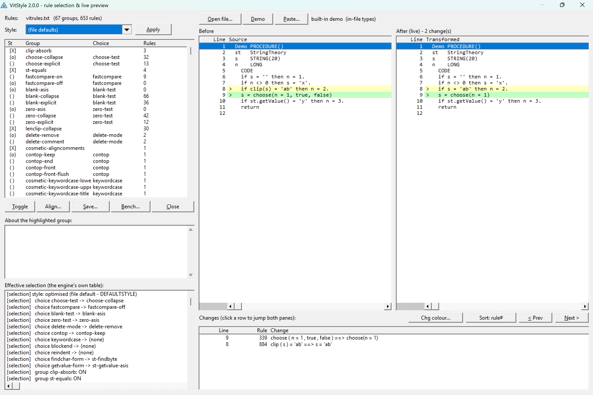

A good order for a first look:

1. **Pick a style** from the `Style:` droplist at the top left and press **`Apply`**. The *After*
   pane redraws. This is the quickest way to see the difference between `plain`, `optimised`,
   `readable` and `extreme`.

   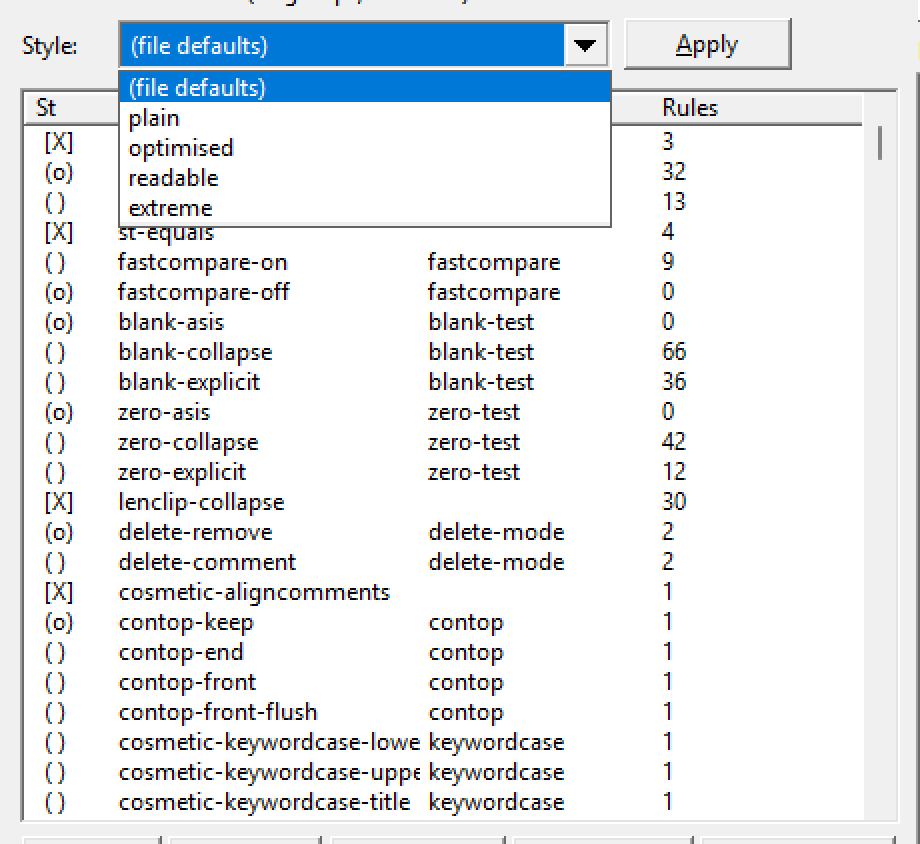
2. **Turn individual transforms on and off** in the left-hand list - double-click a row, or select it
   and press **`Toggle`**. The preview redraws on every click, so you can see exactly what each one
   does to real code before you commit to it.
3. **Read what a transform does** in the *About the highlighted group* panel below the list - the
   description comes from the rule file itself, so it always matches the rules you actually have.

   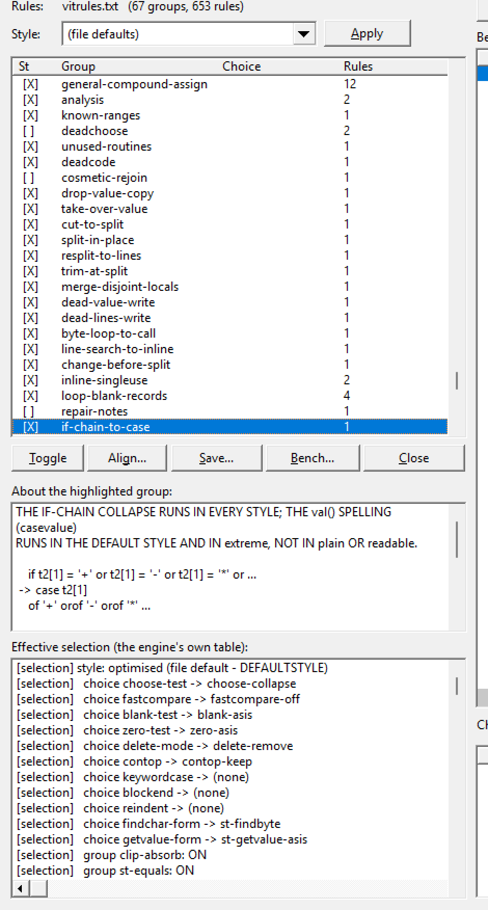
4. **Find the changes.** Every changed line is marked `>`. The *Changes* list at the bottom right
   names each rule that fired; click a row and both panes jump to that line. A line that was only
   lined up, wrapped or trimmed has a `layout` row of its own, with no rule number, and the count
   above the *After* pane is the number of rows in the list. `<< Prev` and `Next >`
   step through them, `Sort: rule#` / `Sort: line#` orders the list by rule or by line, and
   `Chg colour...` changes the highlight if it is hard to read.

   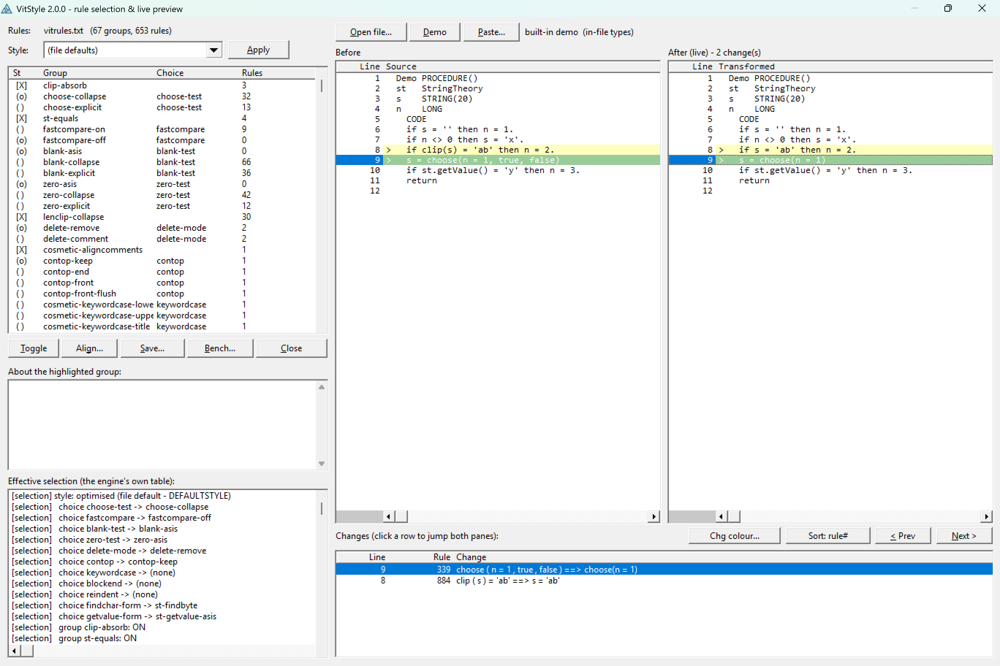

   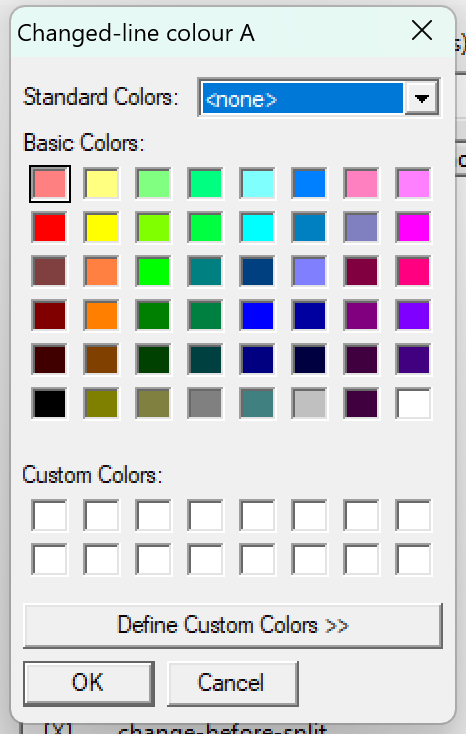
5. **Try it on your own code.** `Open file...` (top right) loads one of your `.clw` or `.inc` files
   into the preview; `Paste...` takes a snippet you type or paste in; and `Demo` puts the sample
   code back. Everything above works the same way on it.

   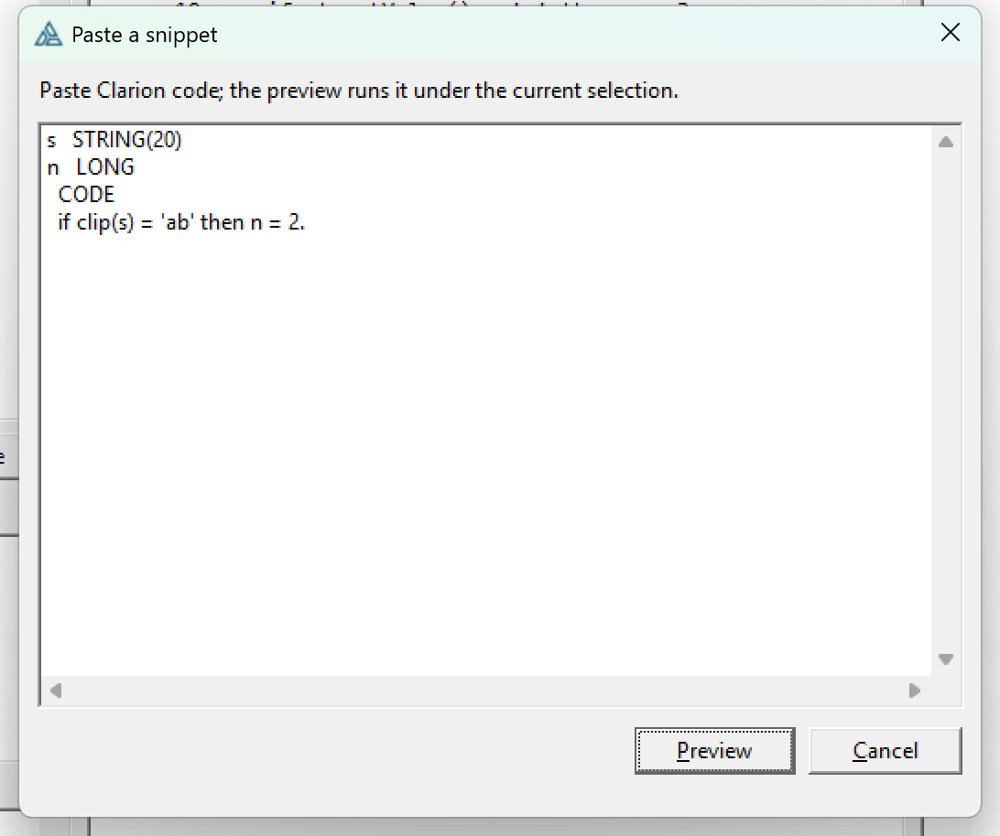

   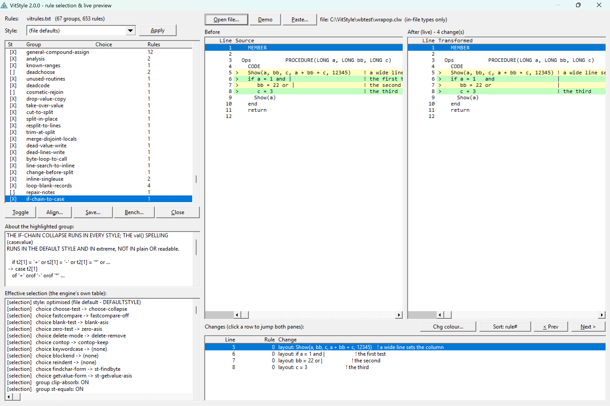
6. **Keep the combination** with **`Save...`** (under the list). It asks for a name, writes the
   combination under that name into `VitStyle.profiles.txt` beside the exe, and *shows you the command line that reproduces it* so you
   can use the same selection in a batch run.

   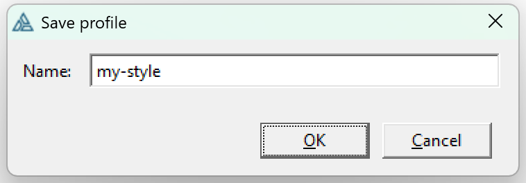

   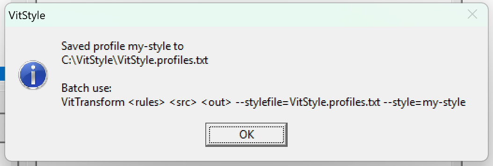

**Nothing you do in this window changes your source.** The preview transforms a copy for display
only. The only files VitStyle writes are its own three, all beside the exe: `VitStyle.profiles.txt`
when you save a profile, `VitStyle.rules.txt` when you save from the Workbench, and
`VitStyle.ui.txt` remembering your changed-line colour.

### The window itself

`VitStyle [rulefile]` opens a window with two halves:

**Left - the chooser.** Every group and choice in the rule file, with its current state, a
description taken from the comments above each GROUP line, and the same list of what is on that
the report shows. Double-click (or Toggle) to flip a group; pick a shipped style from the
droplist.

**The shape of the bracket tells you what a click will do**, and the two are not interchangeable:

| marker | meaning | what clicking it does |
|---|---|---|
| `[X]` / `[ ]` | an **independent** group - a check box | turns just that group on or off |
| `(o)` / `( )` | one member of a **CHOICE axis** - a radio button | turns that one on **and its siblings off** |

A choice axis is a decision the rule file says can only be made one way at a time: how a blank
test is spelt, whether `getValue()` becomes a slice, and so on. Turning one member on necessarily
turns the others off, so a `( )` click changes something you did not click. An `[ ]` never does.

The eleven axes are `blank-test`, `blockend`, `choose-test`, `contop`, `delete-mode`,
`fastcompare`, `findchar-form`, `getvalue-form`, `keywordcase`, `reindent` and `zero-test`.
Every other group is independent - a check box - for example `analysis`, `deadcode` and
`lenclip-collapse`. The full list, with what each does, is the *Standalone groups* table under
[What the StringTheory rule file offers](#what-the-stringtheory-rule-file-offers). Of the
`cosmetic-` groups, `cosmetic-aligncomments`, `cosmetic-splitstatements`,
`cosmetic-expandoneliners` and `cosmetic-rejoin` are check boxes; the keyword-case, indent and
block-end ones are radio buttons.

VitStyle uses the same code as the command line, so the rules and settings you pick do the
same thing. One difference: the preview reads only the file you opened, never the files it
`INCLUDE`s, so a rule that needs a type declared in an `.inc` file does not fire in the preview,
though it does in a batch run that reads the included files. The note beside the `Paste...` button says which kind of preview you
are looking at.

**Right - the live preview.** A before|after view of real code (a built-in demo, any
`.clw`/`.inc` you open, or a pasted snippet), transformed again on every click by the
same code. Changed lines are marked `>`; clicking a line in either pane scrolls the
other pane to its counterpart (the tool records exactly which source line became which
output line, so this stays right when lines are split, merged or expanded). A Changes
list at the bottom names every rule that fired with its source line, and has a `layout` row for
each line that was only lined up, wrapped or trimmed - click one and both panes jump there. Code is shown in a fixed-width font, so what lines up in
your file lines up on screen. A line wider than its pane scrolls sideways with the bar under its
column; a line longer than 253 characters ends in `...`, to say it was cut to fit.

**Save...** writes your current selection as a named STYLE line to
`VitStyle.profiles.txt` (next to the exe), a SETTINGS line when you have changed any alignment setting in the Align panel, plus a LASTUSED marker so VitStyle reopens
where you left off. The save dialog shows the exact command line to replay it in
batch:

```
VitTransform <rules> <src> <out> --stylefile=VitStyle.profiles.txt --style=<yourname>
```

The profile file is plain text and safe to hand-edit. If you give a profile the name of a shipped
style (`optimised`, say), VitStyle asks first. The profile then takes that style's place - in the
Style list, where it is marked `(profile, hides shipped)`, and in any batch run given your profiles
file.

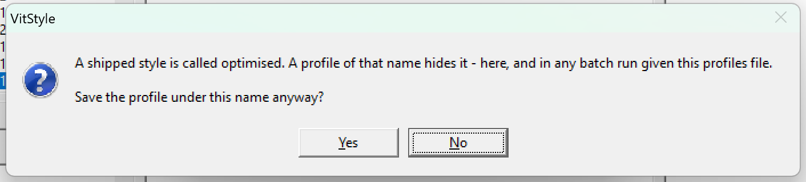

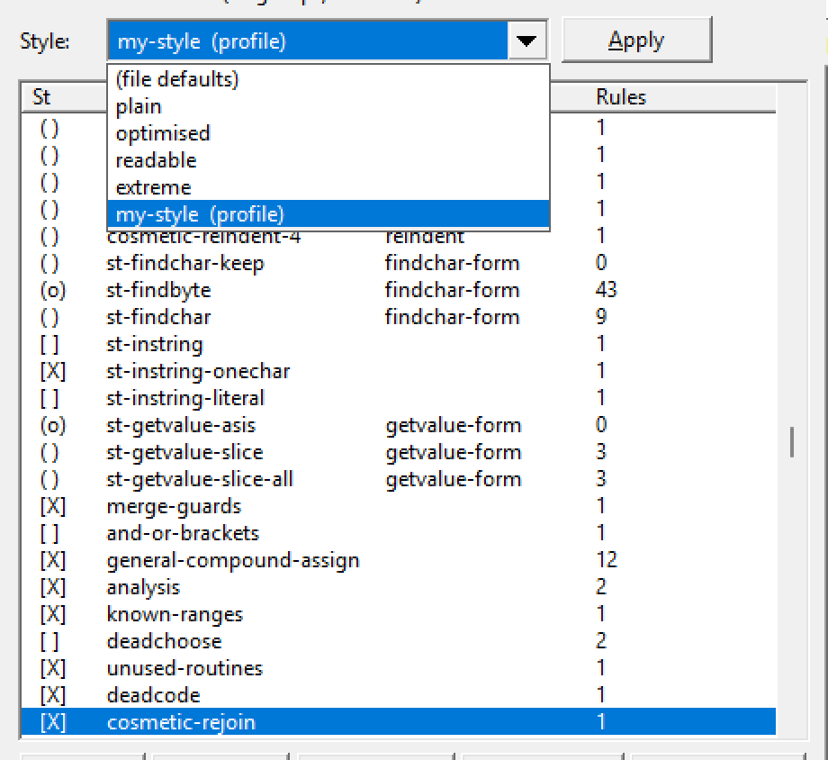

**Align...** opens the Alignment settings panel: the comment gap, limit, slack and outliers, the
wrap and split widths, the reach and run, the code width (with a **Never split** box beside it, the same as `--width=0`), and six choices made by clicking a
button - which lines set the column (**Floor**), where the `AND`/`OR` sits (**Operator**), how an
`END` row counts (**End row**), what an indented comment line means (**Continuation**), and whether
the bar or the comment lines up (**Bar + comment**), and whether comments you have already lined up
are left as they are (**Keep lined up**) - each prefilled from the current run. OK applies
them to the live preview at once. They are the same settings as the `--cmt...` switches and
`--width=`, all but `--cmtinner=` and `--contindent=`, which the panel does not have; so what you see
in the preview is what a batch run with those switches would do.

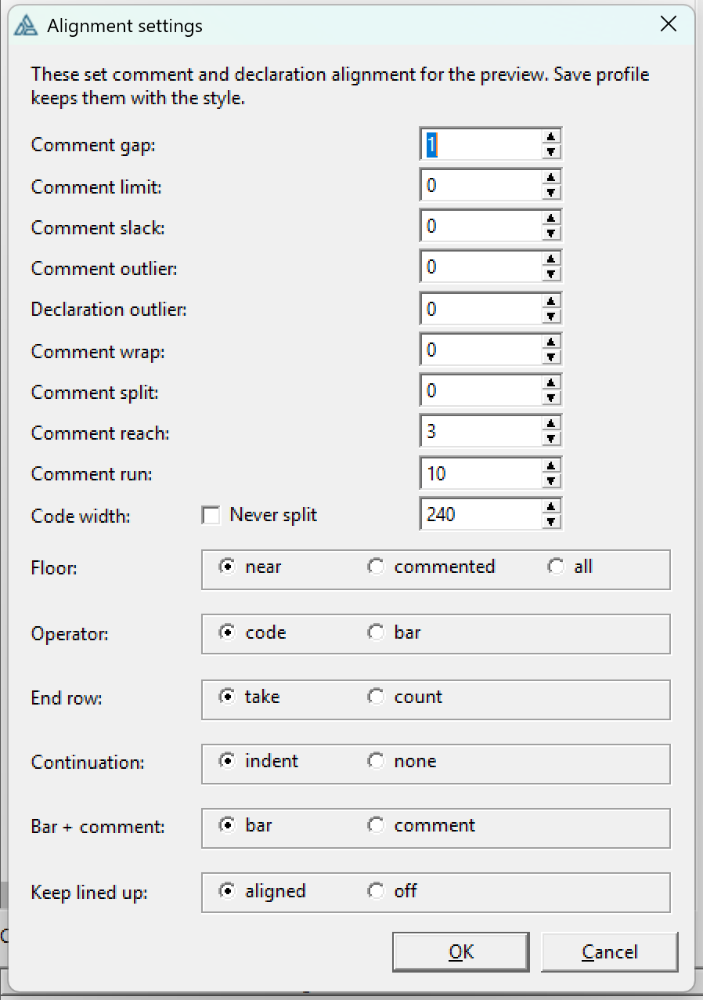

**Bench...** opens the rule workbench, an editor window for **your own rules**, kept in `VitStyle.rules.txt`
next to the exe. VitStyle loads that file at startup if it is there, and a mistake in it does
not stop it: a file with an error gives a warning and is skipped, the workbench still opens,
and you can fix it in place rather than being locked out by your own typo.

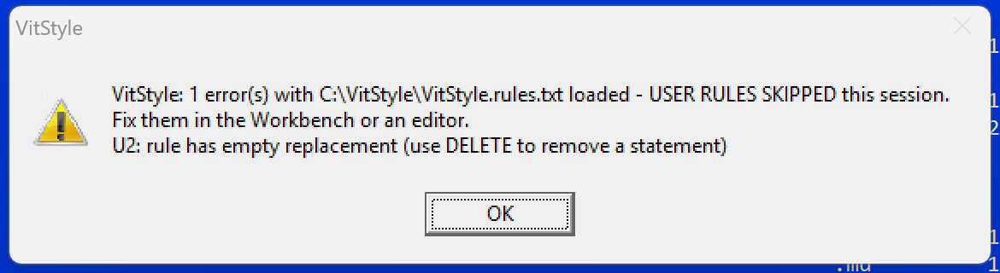

Pick one of your rules from the droplist to edit it, or type a new one. A rule is
`pattern ==> replacement` followed by the optional `WHERE` / `NOTE(...)` / `SKIP` / `ONCE`
parts described under [Writing rules](#writing-rules).

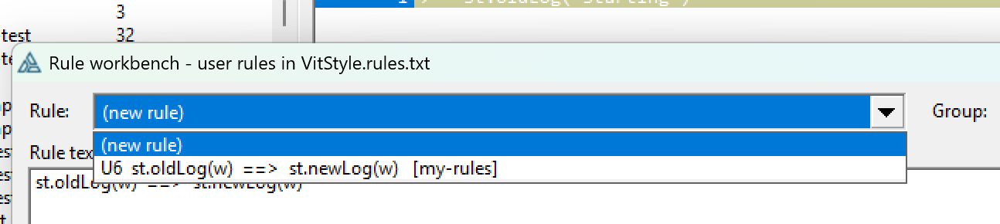

The `Group:` box names the group the rule is saved into - `my-rules` unless you type another
name. VitStyle switches that group on for the rest of the session, so you see the rule work in
the preview. In a batch run your groups arrive switched off, so add `--group=my-rules` (or your
own group's name) to the command line; the message after **Save** shows the whole command. That
command carries every group you switched on or off and every Align setting you changed since you
picked the style, so running it gives what the preview shows.

| Button | |
|---|---|
| **Lint** | Checks the file you are about to write - shipped rules, your existing ones and the draft, all together. **Zero errors is the condition for saving**, so a rule file that would not load cannot be written in the first place. |
| **Test** | Runs the draft against whatever is in the live preview and shows exactly which lines it fires on, before and after, on top of your current selection. You see what a rule does before you keep it. |
| **Save** | Writes `VitStyle.rules.txt` and refreshes the main window. |

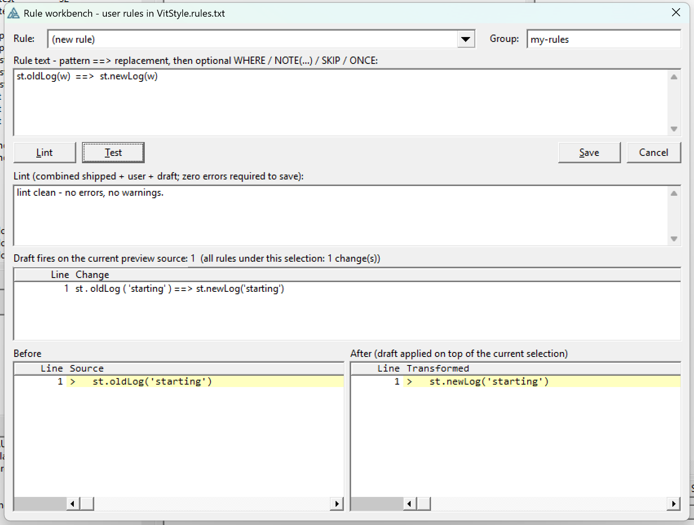

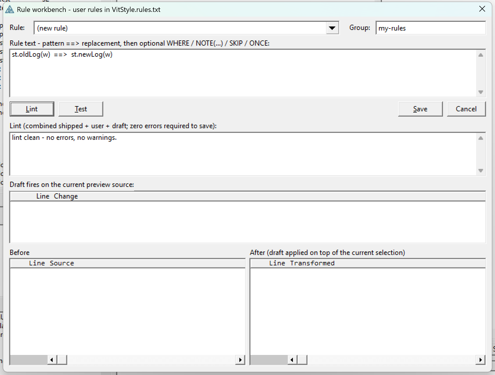

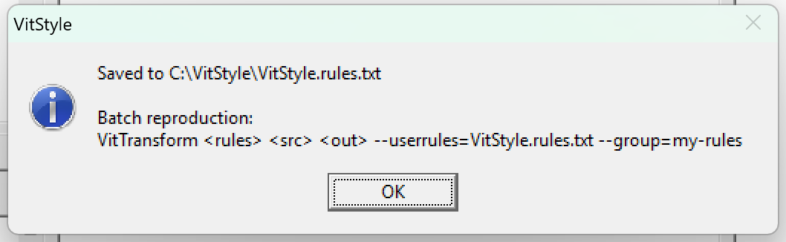

**A GROUP you declare in your own file arrives switched OFF**, so wrapping your rules in one
means they can never quietly change a run - you turn it on in the chooser, or with `--group=`,
exactly like a shipped group. (A rule *not* inside a group is ungrouped, and ungrouped rules
always run. See [Your own rules, step by step](#your-own-rules-step-by-step).) Groups from your
file are marked `(user)` in the group list and in the resolved-selection table, so a report always says where a rule
came from.

For batch runs the same file goes in with `--userrules=<file>`, appended after the shipped
rule file. It is **off unless you ask for it**, so a run without it is exactly the same as a
run on a machine that has no user rules at all. Your rule ids are offset by 500000 - rule
`500096` in a report is line 96 of your file - so they can never collide with shipped ids in
a log.

---

## Writing rules

Rules live in a plain-text file, **one rule per line**, as `pattern ==> replacement`. A rule's id is its
line number. A `METAVARS` block at the top declares your placeholders - the names that stand for "any
expression here", "any StringTheory here" and so on. Any other word in a pattern is text the source must
contain. Plain words match **whatever their case** (`getvalue` matches `GetValue`); a **quoted** literal
(`'abc'`) must match exactly. The replacement is written the way the rule spells it, and whatever a
placeholder matched is copied from your source exactly as you wrote it.

**Operators with more than one spelling match each other.** Clarion documents `<=` and `=<` (and `~>`)
as the same operator, likewise `>=`, `=>` and `~<`, and `<>` with `~=`. A rule written one way matches
source written any of them, so you do not have to write the rule three times. The two-word forms
`NOT =`, `NOT <` and `NOT >` are matched the same way: a rule written `<>` also finds `NOT =`.

A **metavar** (short for metavariable) is a named placeholder: it matches any code of a given kind, and if
you use the same name twice it must match the *same* code both times - compared the way Clarion compares
that kind of thing, so with `w` declared `EXPR`, `foo(w, w)` accepts `foo(Name, NAME)` (the case of a name does not matter in
Clarion) but **not** `foo('Yes','YES')`, because the text inside quotes is what it is.

### A first rule, end to end

```
METAVARS
st              StringTheory    ! typed: only fires when the receiver is a StringTheory
w               EXPR            ! any single balanced expression

st.setValue(st.getValue() & w)  ==>  st.append(w)
```

What it does to your code:

```
! before                                      ! after
buf.setValue(buf.getValue() & name)           buf.append(name)
log.setValue(log.getValue() & ' at ' & tm)    log.append(' at ' & tm)
line.setValue(other.getValue() & x)           (no change - receivers differ: line vs other)
cs.setValue(cs.getValue() & x)                (no change if cs is a CSTRING - wrong type)
```

Note the last two: `st` used twice means *the same variable* both times, and the
type check refuses anything the tool cannot see is a StringTheory.

**Your spacing is kept.** When a rule changes part of a line, the rest of the line keeps the spacing you
wrote, and only the part that changes is spaced the way the rule spells it. Both of these come from the
same rule:

```
! before                                      ! after
p = st.findChars(c, 1,, hay)                  p = st.findChar(c, 1,, hay)
p = st.findChars(c,1,,hay)                    p = st.findChar(c,1,,hay)
```

Two things are spaced by the rule instead. A rule whose only change is the spacing - `zz+1 ==> zz + 1` -
writes its own spacing, since that is what it is for. And where your code runs two things together that
the rule writes apart, the rule's space is used, so `qq-1` under `qq-1 ==> qq minus 1` becomes
`qq minus 1`, never `qqminus 1`.

### Your own rules, step by step

The section above shows how to *write* a rule. This is where you put it and how you run it.

**1. Put it in a file.** Any name will do. A complete, working one is this short:

```
GROUP my-rename-rule
st.oldLog(w)  ==>  st.newLog(w)
ENDGROUP
```

That is the whole file. **No `METAVARS` block** - and that is not laziness, it is required:

> ### The first thing that goes wrong
> Your file is **added to** `vitrules.txt`, not loaded instead of it, so the shipped
> metavars are **already declared** and you must not declare them again. `vitrules.txt`
> already gives you `st st2` (StringTheory), `w w1 w2 w3 w4 w5` (EXPR), `lit`, `nm`, `a`, `c`, `v`
> and more - see its `METAVARS` block, or run `VitTransform vitrules.txt` on its own: it writes an `.ir.txt` beside the rule file that lists every one. (`--summary` prints the run box, which gives the metavar COUNT, not the names.)
>
> Re-declaring one is a hard error and the run stops before it changes anything:
>
> ```
> line 500003 ERROR duplicate metavar declaration: st
> ```
>
> Only add a `METAVARS` block for a **new** name of your own. Everything already declared is
> yours to use for free.

**2. Decide whether it should run immediately.**

- **Inside a `GROUP`, it arrives switched OFF.** Nothing happens until you ask for it by name.
  This is the safer habit and the one to use for anything you mean to keep.
- **On its own, with no `GROUP`, it runs straight away** - an ungrouped rule is always active.
  Fine for a one-off; surprising if you were not expecting it.

**3. Run it.** Your file is loaded *after* the shipped rule file, so it adds to `vitrules.txt`
rather than replacing it:

```
VitTransform vitrules.txt src\*.clw out --userrules=myrules.txt --group=my-rename-rule
```

Drop the `--group=` if you did not wrap it in one. Add `--dry-run` first if you want to see the
report before anything is written.

Leave `--userrules=` off and the run is exactly what it would be on a machine that has no
rules of yours at all - so a shared build never behaves differently because of a file sitting on
your disk.

**4. Or let VitStyle do it.** Name the file `VitStyle.rules.txt` and put it next to the exe;
VitStyle loads it at startup and the **Bench...** button edits it, lints it and shows you
what it fires on before you save. See
[VitStyle](#vitstyle---the-visual-chooser-and-live-preview).

**5. Find it in the report.** Your rule ids are offset by **500000**, so the id is 500000 plus
the line number in *your* file. The rule above sits on line 2, and the report reads:

```
rule 500002 line 7: buf . oldLog ( name ) ==> buf.newLog(name)
```

`line 7` is the line in the **source file** it changed. Shipped rules keep their own numbers, so
yours can never be confused with them.

**What a user rule file may not contain:** `STYLE`, `DEFAULTSTYLE`, `THOROUGH` and `LASTUSED` are refused -
those decide what a *plain* run does, and that is the shipped rule file's job, not an add-on's.
Everything else in [Appendix D](#appendix-d-rule-file-reference) is available to you.

### More worked examples

This is a rule file of its own, run in place of `vitrules.txt`:
`VitTransform examples.txt src\*.clw out`. To add these rules to `vitrules.txt` with
`--userrules=` instead, leave out the `TYPESET` line and the whole `METAVARS` block, and write
`nm` wherever these rules have `n`: `vitrules.txt` already declares `st`, `st2`, `w`, `w1` and
`lit` the same way, and `nm` as any numeric type.

```
TYPESET NUM = BYTE + SHORT + USHORT + LONG + ULONG + DECIMAL + PDECIMAL + REAL + SREAL

METAVARS
st st2          StringTheory
w w1            EXPR
lit             LITERAL         ! a quoted string literal
n               NUM             ! any numeric type - the TYPESET line above says which

! 1. A guard: only fire when the matched literal is not blank once trailing spaces go
st.append(clip(lit))  ==>  st.append(trimr(lit))  WHERE lit <> ''

!    before:  st.append(clip('abc  '))        after:  st.append('abc')
!    before:  st.append(clip('   '))          after:  (unchanged - guard refused)

! 2. Two statements collapsed into one (the ; matches a statement boundary)
st.prepend(w) ; st.append(w1)  ==>  st.Enclose(w,w1)

!    before:  s.prepend('<<')                 after:  s.Enclose('<<','>')
!             s.append('>')

! 3. Delete a do-nothing statement outright (indent + trailing comment survive)
st.crop()  ==>  DELETE

! 4. Leave a breadcrumb in the code where you changed it
n = n + 1  ==>  n += 1   NOTE('modernised by rules')

!    before:  tot = tot + 1                   after:  tot += 1  ! modernised by rules
```

---

# Appendix A: Command line

```
VitTransform <rulefile>
      Check the rule file for mistakes and write out its parsed form
      -> <rulefile> on <yyyymmdd> at <hhmmssth>.ir.txt

VitTransform <rulefile> <source> [outdir] [switches]
      Transform mode. <source> may use wildcards (e.g. src\*.clw).
      Give an <outdir> to write transformed copies there.
      With no <outdir> VitTransform would overwrite the originals, so it
      refuses unless you pass --in-place (see below). --dry-run is exempt:
      it writes no code, so it needs no <outdir> and no --in-place.
      A run report is written to <rulefile> on <yyyymmdd> at <hhmmssth>.report.txt

      Every report, test result and IR dump carries the run's date-time stamp (th =
      hundredths) in its name, computed once per run - so repeated runs keep separate
      ones instead of overwriting each other. Open the NEWEST one. The transformed files
      keep their own names unless you ask for `--outsuffix=` or `--outstamp` (B.1).

      Only three arguments are positional - <rulefile> <source> [outdir].
      A fourth is refused rather than ignored, because it is a PATH WITH A
      SPACE in it that was not quoted. QUOTE any path containing a space:

          VitTransform vitrules.txt "C:\My Source\a.clw" out

      Quoted positionals work. Unquoted, C:\My Source\a.clw
      arrives as two arguments and the run is refused - which is the good
      case; give one fewer argument and it would instead try to read
      "C:\My" and write into "Source\a.clw".
      A switch VitTransform does not recognise also stops the run before
      anything is read or written. A near miss such as --dry-runn would
      otherwise make a DIFFERENT run from the one asked for.

      --batch is read BEFORE any of this, in a pass of its own, so a refusal
      raised while the command line is still being parsed is written to
      vt-batch.log rather than opening a modal box on an unattended run.
      Write it anywhere on the line; last is fine.

      EXITS 1 if a source you asked for could not be read. The summary line
      of the report says NOT LOADED: n. A script that runs it over many
      files must not be told all is well when nothing was read. An empty
      file is not an error: it is skipped, and the report names it.

VitTransform <testfile>
      Run a file of test cases, to check that your rules do what you expect
      -> <testfile> on <yyyymmdd> at <hhmmssth>.result.txt
```

> **Safety:** VitTransform never overwrites your originals by accident. If you
> omit `<outdir>` it stops and reminds you to either give an output directory or
> pass `--in-place`. An `<outdir>` that is really the **source directory itself** -
> spelled `.`, relative, or absolute - is refused the same way: writing there would
> overwrite the originals, and the `<outdir>` path keeps no `.bak`. The exception is a run with
> `--outsuffix=` or `--outstamp`, whose copies take a different name and so go in beside them. Only files that
> actually change are ever written.

> **Exit code:** a clean run exits **0**. Anything a calling script must see exits
> **1** - a refused switch or rule file, rule-file errors, a save that failed, a wildcard
> that matched no files, a test case that failed, or, when you asked for the included files to
> be read (`--thorough`, `--root=`, or a `THOROUGH` line in the rule file), an included file
> that could not be found (the tool then knows only part of your program, so rules that check
> types may have missed places) - so a batch file can test `ERRORLEVEL` instead of reading the
> report. In an ordinary run a missing header is only a note in the report.

> **Line endings:** output is always **CRLF**. A file VitTransform does not change is not
> rewritten at all, so it keeps whatever it had; a file it *does* change comes back CRLF even
> if it arrived LF-only. Nothing is lost by that: a file with LF-only line endings is not valid
> Clarion source, so giving it back with CRLF endings is more useful than faithfully reproducing
> something the compiler would reject.

Example - apply rules from `myrules.txt` to every `.clw` in `src\`, writing results to `out\`:

```
VitTransform myrules.txt src\*.clw out
```

**A file of test cases.** A file whose first line - not counting blank lines and lines that
start with `!` or `|` - starts with `=== case` is read as a set of test cases, not as a rule
file. Each case is a few rules, a piece of code, and what that code should become:

```
=== case drop-the-default-start
--- rules
METAVARS
st              StringTheory
w               EXPR
st.findChar(w, 1)   ==>  st.findChar(w)
--- input
st    StringTheory
p     LONG
  code
  p = st.findChar('=', 1)
--- output
st    StringTheory
p     LONG
  code
  p = st.findChar('=')
```

A case uses only the rules in its own `--- rules` block, not `vitrules.txt`. Each rule is tried
once, in order, on the `--- input` code - built-in transforms do not run - and the result is
compared, line by line, with the `--- output` block; spaces at the end of a line do not count.
A case may also have a `--- select` block, whose lines `style <name>`, `group <name>` and
`nogroup <name>` choose what runs, as the switches do; a `--- userrules` block, loaded on top of its
`--- rules` block the way `--userrules=` is loaded on top of `vitrules.txt`; and a line `--- width <n>`, the line
width for that case. The next `=== case` line starts the next case.

The results go beside the test file: `PASS <name>` or `FAIL <name>` for each case - a failure
shows the expected and the actual code - and a last line with the totals,
`cases: 9  pass: 9  fail: 0`. The run exits **1** if any case fails.

---

# Appendix B: Every switch

A switch name can be typed in any case: `--BATCH` and `--batch` are the same switch. What comes after the `=`
keeps its case.

A switch that takes one value, such as `--width=`, can be given more than once: the last one given is used, and
the report says so. The switches that build a list - `--group=`, `--nogroup=`, `--define=` and the keyword lists
such as `--kwupper=` - keep every value instead.

| Switch | Effect |
|---|---|
| `--summary` | Show the end-of-run message box. **Off by default**, so a batch of runs goes straight through without anyone clicking OK - every number in that box is in the report file anyway. The box still opens when the run fails - a save that failed, a source that was never read, or an include that was not found when you asked for the included files to be read (`--thorough`, `--root=` or a `THOROUGH` line). In a `.bat`, add `--batch` and those go to `vt-batch.log` instead. |
| `--dry-run` | Analyse and write the report (and the rule file's parsed form, the `.ir.txt`), but write no code. |
| `--nobanner` | Leave out the `! Processed by VitTransform ...` line that every output file otherwise starts with. |
| `--in-place` | Overwrite the source files (only needed when you give no `<outdir>`). Before overwriting a changed file, its original is saved alongside as a timestamped `.bak` (e.g. `Foo on 20260714 at 14302547.clw.bak`), so nothing is ever lost. If the backup can't be written, that file is left untouched. Give either `--in-place` or an `<outdir>`, not both: together they name two places for the result, and the run is refused. |
| `--verbose` | Detailed per-rule, per-file logging. |
| `--timing` | Extra report lines per file saying where the run spent its time. First a summary: the rule scans, the built-in passes, and the bookkeeping inside them (the rebuilds of the word index, the line renumbers, the symbol-table rebuilds, the full re-lexes), each in seconds with a count. Then one line per built-in transform that ran, slowest first, and the ten slowest rules, each with its seconds, how many times it ran and how many changes it made. For finding out what is slow; it changes nothing in the output. |
| `--postcheck` | A self-check for people working on VitTransform itself. It makes the run slower and never changes the output; it adds one line to the report with the result. Leave it off. |
| `--dispatch=<word>` | How the rules walk a file. `classic` (the **default**): each rule walks the whole file in its turn, every pass. `grouped`: rules that look for the same word walk the file together, and a rule is not walked again until the file has changed. The result is the same either way, byte for byte; `grouped` saves some of the time a large file spends in rule scans. |
| `--colseq=<word>` | The order your program compares text in. `standard` (the **default**): the plain order of the character codes, which is what a Clarion program uses unless it says otherwise. `custom`: your program sets its own order, with `CLACOLSEQ` in its `.ENV` file or with `LOCALE()`. In such an order `'A' to 'Z'` can take in the small letters too, so with `custom` a `CASE` with a range of characters, `of 'A' to 'Z'`, is left as it is instead of becoming `of 65 to 90`. Use `custom` only if your program changes the order. |
| `--loose` | Skip the type check - apply rules that normally need a known type to any object. For comparison or diagnosis only. |
| `--only=<name-or-id>` | Run only one rule, given either its `NAME(x)` if it has one or its id. A rule's id is its **line number in the rule file**, so open the file at that line to see which rule you are naming. **Prefer the name in anything you save**, because ids move when lines are added above them and a name does not. Whichever you give, the run prints the rule it resolved to, so a stale id shows itself instead of quietly selecting a different rule. Built-in transforms are suppressed too, so what you see is that rule alone. A `BUILTIN` line's id is also its line number, so `--only=<its line>` runs just that builtin - that is how you try one analysis on its own. |
| `--skip=<name-or-id>` | Skip one rule. Takes a name or an id, exactly as above. Do not name the rule `--only=` names: together they would run nothing, and the run is refused. |
| `--passes=<n>` | Cap the number of passes (see *Pass / fixpoint* in [A few terms](#a-few-terms-in-plain-english) above). **Default 20.** |
| `--receiver=<mode>` | What to do when a built-in cannot identify a receiver: `assume` rewrites it as a StringTheory, `check` refuses it when another use of the same object is not a StringTheory method (**default**), `strict` refuses it unless the tool can be sure what it is. See [D.4](#d4---receiver---when-the-tool-cannot-tell-what-an-object-is). |
| `--width=<n>` | The longest line to allow before VitTransform splits it. **Default 240.** Use `--width=120` to set your own, or **`--width=0` to switch line splitting off completely**. Minimum 40. It splits code only. Where a comment sits is `--cmtlimit`'s business, and a long comment is `--cmtwrap`'s. |
| `--cmtgap=<n>` | How many spaces to leave between a line of code and the comment that follows it. **Default 1**, and it must be at least 1. |
| `--cmtlimit=<n>` | **How far right the comment column may go.** In each block (one PROCEDURE, ROUTINE or CODE line to the next) the comments share one column, set by the widest line that still ends before this number. A line whose code runs past it keeps its comment at its own end, so it never pushes the others out. **90 if not given**, and 0 also means 90. |
| `--cmtslack=<n>` | Only matters in a block where every line runs past the limit: the column is then set by the widest line within `n` of the narrowest. **60 if not given**, and 0 also means 60. You will probably never need it. |
| `--cmtoutlier=<n>` | **Stops one very wide line dragging a whole block's comments out to meet it.** A line whose code ends more than `n` past the middle of its block keeps its comment at its own end, and the other lines keep the column they had. Measured against the *middle* rather than the next line down, so two wide lines cannot shield each other. **Off unless you give it a number**, and 0 turns it off. Try 20. |
| `--decloutlier=<n>` | The same idea for a run of declarations, where what lines up is the TYPE column and what is measured is the NAME. A label more than `n` past the middle name of its block keeps the gap you wrote it with, instead of pushing every type out to clear it. A name is a different measure from a line of code, so it has its own number. **Off unless you give it a number**, and 0 turns it off. Try 20. |
| `--cmtbar=<word>` | **On a line that carries BOTH a continuation bar and a comment, which of the two lines up with the column.** `bar` (the default) puts the `\|` in the column and the comment after it. `comment` puts the `!` in the column and the `\|` in front of it, so a lone comment and a commented bar start in the same place. A run of bars moves together: the whole run steps back by its widest gap, so bars that carry a comment and bars that do not stay in one column. With `bar`, when several lines of one wrapped statement have a comment after the bar, those comments line up with each other, as close to the bars as the closest of them already is - but never closer than the comment gap. |
| `--cmtwrap=<n>` | **No line with a trailing comment is left wider than `n`.** A long comment is split onto continuation rows in the same column, two characters further in, in pieces of about the same length, the first a little longer. Short pieces are joined back together. A row that is a bullet, a number, a `name = value` item or a blank `!` is left alone. Running it twice changes nothing. Off until you give it a number; try 225. |
| `--cmtsplit=<n>` | **Like `--cmtwrap=`, except it only ever cuts.** A comment that would make its line wider than `n` is split onto continuation rows, and short rows are left exactly as they were written instead of being joined back together. Use it when you want long comments brought under control but your own line breaks kept. Give this or `--cmtwrap=`, not both. |
| `--cmtreach=<n>` | **How much a line with no comment of its own may widen the shared column.** The comments in a block line up together; a line that carries no comment still has a say if its code ends within `n` characters of that column, so one slightly longer line among them nudges the comments right rather than being ignored. Code that ends further out than that is left out of the reckoning and keeps its own length. The same number decides when a wrapped line that has no `AND` or `OR` of its own joins the others. **Default 3.** |
| `--contindent=bracket\|indent` | **Where a line the tool breaks picks up again.** `bracket` (the default): under the first argument, one past the bracket the break happened inside, so wrapped arguments line up with each other. `indent`: the line's own indent plus two. The bracket choice is made once for the whole statement: every continuation goes under the bracket when they all fit there, each line as long as it can be, and when one of them would not fit - an argument wider than the room under the bracket, or a bracket that opens far to the right - the whole statement uses the indent instead, so a statement never comes back with its continuations in two columns. Lines you wrapped yourself are not touched either way: the tool joins the continuations you already placed. |
| `--cmtinner=<n>` | **How far the column may move right to clear a line with no comment that sits BETWEEN two commented lines.** 12 by default. Those lines are inside the column the comments share, so a column that lands left of one of them is a stagger rather than alignment. `--cmtreach` still governs a line at the edge of the group, and stays at 3. Set `--cmtinner=0` to leave the middle lines out of it. |
| `--cmtkeep=off\|aligned` | **Whether comments that already line up are left alone.** `aligned` (the default): a group of neighbouring comments that is ALREADY in one column, and whose column still leaves room for every line of code under it, is left exactly as you wrote it - so the tool only tidies comments that are actually ragged. `off`: every comment is put where the code says, whether or not it was tidy to begin with. A group is comments close to one another - the same nearness `--cmtrun` sets - so a tidy block is kept even when another block further down the same procedure is ragged. It takes two or more comments to count as lined up, and a group holding a `\|` continuation is not covered, since those follow the bars. |
| `--cmtfloor=near\|commented\|all` | **Whether lines that have no comment help decide where the comment column goes.** `near` (the default): only a line sitting directly beside a commented one, and then only within `--cmtreach`. `commented`: never - only lines that actually carry a comment count. `all`: every line in the block counts, so the column clears the widest code there is. The last line of a wrapped statement always counts, whichever you pick. |
| `--cmtop=code\|bar` | **Where the `AND`, `OR` or `&` at the end of a wrapped line sits.** `code` (the default): they line up with each other, two spaces past the widest piece of code in the group, making a column of their own. `bar`: each one ends one space before its `\|`, so they line up against the bars instead. |
| `--cmtend=take\|count` | **Whether a comment on an `END` helps decide the column.** `take` (the default): the comment moves to the column the other lines settled on, but the short `END` line itself does not drag that column left. `count`: it counts like any other line - and because `END` lines are short, that can pull a block's comments in a long way. |
| `--cmtcont=indent\|none` | **What an indented comment line means.** When a line is nothing but a comment and its text is indented after the `!`, `indent` (the default) reads it as more of the comment above, so the two stay together. `none` reads it as a comment in its own right. |
| `--cmtrun=<n>` | **How far up the file a group of comments looks for a column to come back to.** When a group of comments starts, the tool looks up to `n` lines above it for comments whose column it should rejoin; anything further up is not looked at. The same distance decides when comments that already line up count as one group for `--cmtkeep=aligned`: a gap of more than `n` lines starts a new group. It does not split a procedure's comments apart - the comments from one `PROCEDURE`, `ROUTINE` or `CODE` line to the next are aligned together however far apart they are. `--cmtrun=0` means no looking back at all. **Default 10.** |
| `--kwupper=A,B,C` | With a keyword-case group on: the keywords listed here stay UPPER whatever the style, for the shop that capitalises keywords but wants `IF`, `OR`, `AND`, `ELSE`, `CASE`, `OF` and `OROF` to stand out. `--kwlower=` and `--kwcapitalise=` (or `--kwcapitalize=`, or `--kwtitle=`) do the same for the other two cases. Repeat the switch as often as you like, and separate the words with commas. Spaces work too, but only inside quotation marks - `--kwupper="IF, OR, AND"` - because the command line itself is split on spaces, so an unquoted word after a comma arrives as an argument of its own. |
| `--userrules=<file>` | Load your own extra rule file on top of `vitrules.txt`. Its **groups** arrive **off** - select them with `--group=` - so loading a file can never change a run on its own. An **ungrouped** line in that file (a plain rule, or a `BUILTIN`) is active immediately. Your file **inherits** the shipped file's metavars and typesets, so do not redeclare them - a `METAVARS` block naming `st` again is an error, not an override. Ids in a user file are offset by 500000, so `--only=` on one of your own rules takes `500000 + <its line number>`. |
| `--style=` `--stylefile=` `--group=` `--nogroup=` | Selection - see [Choosing what runs](#choosing-what-runs-groups-choices-styles) above. |
| `--stversion=<n>` | The StringTheory version your code is built with, when it is older than 3.90 - see [Install](#install). |
| `--batch` | **Unattended mode.** No modal boxes - anything that would have been one is appended to `vt-batch.log` instead - and `--thorough` takes the newest Clarion rather than asking. Full description in the table under *Choosing what runs* above. |
| `--dumptokens` | **Diagnostic**, for people working on VitTransform itself. Writes the file as the tool sees it after reading its includes to `<file>.tokens.txt`, and reports any block it found opened but not closed, closed but never opened, or opened inside brackets. Needs the included files read - an ordinary run reads them when it finds Clarion; otherwise add `--thorough` or `--root=<dir>`. Full description under *Choosing what runs* above. |
| `--acdiag` | **Diagnostic.** Explain why comment alignment left each comment where it is. Full description under *Choosing what runs* above. |

## B.1 Naming the output files

By default the output keeps the source's name (`src\Foo.clw` -> `out\Foo.clw`). To keep several runs side by
side, insert a suffix before the extension:

| Switch | Effect |
|---|---|
| `--outsuffix=<text>` | Insert `<text>` before the extension, e.g. `--outsuffix=Width2` -> `FooWidth2.clw`. When the copies go into the same folder as the originals, a copy must not take the name of a file already there: if `Order.clw` would be written as an existing `OrderOld.clw`, the run stops before writing anything and names each clash. |
| `--outstamp` | Append ` on yyyymmdd at hhmmssth` (date + time to hundredths), e.g. `Foo on 20260714 at 14302547.clw`. |

They combine, and the timestamp is computed once per run so every file in a batch shares it.

## B.2 Overloaded methods

Clarion lets a class declare the same method name more than once, and the forms often
differ in what they return - one builds and returns a value, another fills something you
pass in:

```clarion
GetTok   Procedure(LONG pTokNumber),STRING,proc,virtual
GetTok   Procedure(LONG pTokNumber, StringTheory pStrBefore, StringTheory pTok),virtual
```

What a method returns depends on **which form** was called, not on the name alone, so
VitTransform works out which form a call uses from the **number of arguments** it passes.
`GetTok(n)` passes one argument and only the first form can take it, so its result is a
`STRING`; `GetTok(n, a, b)` passes three and returns nothing. Defaults and `<omittable>`
parameters are counted properly - a form declared `(LONG pStart=1, LONG pEnd=0, <STRING pFormat>)`
accepts anywhere from **zero to three** arguments.

Where the count alone cannot decide - two forms that both accept it and disagree about what
they return - the **types of the arguments** decide. The parameter types of every prototype
are recorded position by position, and each argument whose type the tool can work out is
tested against its own position:

```clarion
JoinToks Procedure(LONG pStart=1, LONG pEnd=0, <STRING pFormat>),STRING     ! 0 to 3 args
JoinToks Procedure(StringTheory st, LONG pStart=1, LONG pEnd=0, <STRING>)   ! 1 to 4 args
```

Both accept three arguments, so `JoinToks(st, 1, 0)` is settled by `st` being a
StringTheory - it selects the second form, which returns nothing. `JoinToks(1, 5)` selects
the first, which returns a `STRING`. The test is not limited to the first position: a call
that is undecided at argument one can be settled by any later argument whose type the tool
knows.

VitTransform rules a form out **only when it is sure**: from an argument whose type it has
worked out, or from a literal, which cannot be an object. An argument it cannot type - a name
it could not find, or an expression like `a + b` - rules nothing out, and the call stays
undecided. A name the tool could not find might be the object, and ruling that form out on a
guess could pick the form that returns a string and rewrite a call that never returns one.

When nothing settles it, the call's type stays unknown and rules that need it do not fire on
it. A missed rewrite is a small cost; a wrong one changes your code.

## B.3 Thorough mode (cross-file type resolution)

By default, when a Clarion install can be found, VitTransform reads the **included headers** as well as the file
it is transforming, so a receiver whose type is declared in one (e.g. `self.buffer`, where `buffer &StringTheory`
lives in a `.inc`) is known too. The report's first lines say so:

```
[includes read: Clarion11 (C:) found at C:\Clarion11 - --nothorough turns this off]
[include expansion ON  root=C:\Clarion11  red=Clarion110.red  version=110  config=Release]
```

A header it cannot find is noted in the report and the run carries on. With no Clarion installed, the tool works
from the declarations in the file alone. The switches below make the reading strict, point it somewhere else, or
turn it off:

| Switch | Effect |
|---|---|
| `--thorough` | Turn on thorough mode and **find your Clarion install automatically** - first from the Windows uninstall registry, then by probing `<drive>:\Clarion*` (covers installs copied over from a backup, which never registered). One install found: used silently. Several: you pick from a dialog (so unattended batch runs should use `--root` instead). A header it cannot find is then an error, and the run exits 1. |
| `--nothorough` | The explicit **no**. Turns include expansion off for this run, and beats both a `THOROUGH` directive in the rule file and an explicit `--root=` - it is the escape hatch, so nothing outranks it. |
| `--root=<dir>` | Your Clarion install directory (e.g. `c:\Clarion11`). Providing this also turns on thorough mode, and always overrides `--thorough` discovery. |
| `--red=<file>` | The `.red` redirection file. Default: the newest `Clarion*.red` in the working directory, otherwise the newest in `<root>\bin` (its normal home). Newest means the highest version number in the name, so `Clarion120.red` is picked before `Clarion90.red`. The report header names the file used and the version it gives. A redirection file may chain to another with `{include %REDDIR%\other.red}`, as Clarion's own do: `%REDDIR%` is the directory of the file being read. A file in the chain that cannot be opened is reported. A file that is there but empty simply has no entries, and is not reported; nor is an empty include file. |
| `--define=<flags>` | Extra Clarion project flags for the `OMIT`/`COMPILE` reading done when the included files are read, comma-separated, each `NAME` or `NAME=value` (repeats add). The version flags `_C110_`, `_C60_` and the like are already seeded from the `.red` file's version, cumulatively; `_WIDTH32_` is 1 from Clarion 6 on, which builds 32-bit only. Use this for the ones a `.red` cannot tell, such as `_Unicode_` or `_ABCDllMode_`, which read as 0 without it. A flag named here wins over one the tool sets, so `--define=_WIDTH32_=0` turns that one off. |
| `--config=<name>` | Build configuration macro (default `Release`). |

```
VitTransform myrules.txt src\MyClass.clw out --thorough
VitTransform myrules.txt src\MyClass.clw out --root=c:\Clarion11
```

**It does more than identify objects.** Reading the included files also fills in the list of which
names are classes, and two more things depend on that:

- **Picking between overloads.** Where several methods share a name, VitTransform chooses by argument
  count and then by the type of each argument it can work out. One of those tests is *a numeric or
  quoted literal cannot be a class instance*, which needs to know whether a parameter's declared type
  **is** a class. Without the included files that list holds only the classes declared in the file
  itself, so that test cannot rule anything out and a call that could have been decided is left alone.
- **Return types.** What a method returns comes from the same list, so a rule that needs "this call
  returns a STRING" is more often satisfied.

So reading the included files does not only identify *more objects*; it also lets rules fire on
calls that would otherwise be left alone. If a rule you expected to fire did not, look at the
report's first lines: if the included files were not read, `--root=<dir>` points the tool at your
Clarion, and `--thorough` makes a header it cannot find an error.

When it reads the included files, the tool also sets Clarion's own project flags, so `OMIT` and `COMPILE` regions come out
the way the compiler builds them. The version flags come from the `.red` file: `Clarion110.red` sets `_C110_`
and every earlier `_Cnn_` to 1, and leaves `_C111_` at 0, since 11.1 is later than 11.0. Anything you name on
`--define=` is set as well, and wins over a flag the tool sets. `_WIDTH32_` is 1, as Clarion 6 and later build
32-bit only. A flag a `.red` cannot know, such as `_Unicode_` or `_ABCDllMode_`, reads as 0 unless you
`--define=` it. The report header shows the version, for example `red=Clarion110.red  version=110`.
A project `.red` with no number in its name takes the version of the Clarion `.red` it chains to.
A condition may name an equate whose value is another name - `Demo EQUATE(False)` - and it is read
through that name, and through the next if that is a name too. `TRUE` reads 1; `FALSE`, and a name
nothing defines, read 0. A TAB in a condition counts as a space, an end marker that starts or ends
with a space ends its region where the compiler ends it, and an `INCLUDE`, `OMIT` or `COMPILE`
written after a `;` is read as a directive.

> **One limit worth knowing:** your **included** declarations are read once, at the
> start of each file, and decisions about types for the rest of that file use that picture. A rule set
> that *rewrites declarations in an include* - retypes a field, renames a class or a prototype -
> therefore doesn't mix with reading the included files in a single run: later rules would still see the old
> types. The supported shape is two runs - the declaration pass first, then everything else
> against the updated files.

---

# Appendix C: Built-in transforms

Some jobs can't be expressed as a pattern - "is this variable read before it is written?"
needs an analysis, not a rewrite. Those ship as **builtins**, switched on by naming them in
the rule file. Parameters follow the name, comma-separated. A builtin can live inside a
`GROUP` like any rule, which is how the cosmetic suite is kept opt-in.

If a rule file names a builtin the tool does not have - a typo such as `BUILTIN Reindnet` - the
run stops before any file is read. Nothing is changed, and the message names the line and lists
every builtin there is. This holds inside a group that is switched off too.

A builtin looks inside every procedure, method and routine, and in a PROGRAM's own `CODE`, the
part before its first procedure. A program-level object is treated as the main code's own only
when no other code can reach it, since it lives for the whole program. No procedure in the file may
mention it. The file must INCLUDE nothing and have no `MODULE`: either can bring in code from another
of the program's source files, and that code can read program-level data. And the object must not be
declared `EXTERNAL`, `DLL` or `EXPORT`, or sit inside a structure that is. In practice that means a
program of one file.

A class declared inside a procedure - the ABC `ThisWindow` is one - has methods that share the procedure's
data, so before a clean-up changes a local it also looks in those methods. A method asks this only when it
declares a class of its own or INCLUDEs a file. So in a file that holds one class's methods, another method's
local of the same name is another variable, and does not hold a clean-up back.

```
BUILTIN UnusedVars, PREFIX('! #Removed as not used: '), EXCLUDE(procname pn)
BUILTIN AutoCheck, NOTE('no AUTO: may be read before it is set')
BUILTIN Reindent, WIDTH(4), CASEOF('indent')
```

## C.1 Analysis - the deep reads, and what each is allowed to remove

**Your code is only ever commented out, never deleted** - that is the rule for the four that
judge whether something is used at all (`UnusedVars`, `UnusedRoutines`, `UnreachableCode`,
`UnusedAssignments`), and every line they touch keeps its text behind a marker you can grep
back. The rest of the table is the other kind: they remove code that **can be shown to do
nothing** - a test that cannot fail, a `clip()` with nothing to strip, a `left()` with nothing
to its left - and those do go. Each writes its reasoning into the report, which is the thing to
read before you accept one.

| Builtin | What it does | Parameters |
|---|---|---|
| `UnusedVars` | Comments out declarations nothing references. A procedure that INCLUDEs code after its `CODE` keeps all its declarations - the included code may be what uses them. An object of a class other than StringTheory is kept too: its `CONSTRUCT` and `DESTRUCT` run whether or not its name is used again, and they may be why it is there. | `PREFIX('text')` - the comment marker written in front of the line. `EXCLUDE(a b c)` - names never to touch. |
| `UnusedRoutines` | Comments out `ROUTINE`s that no `DO` ever reaches, whole body included. One removal can lead to another: a routine only called from a removed routine goes on the next pass. Kept, with a line in the report, where the file cannot show every `DO`: a routine no `PROCEDURE` in the file owns (part of a file that is included elsewhere), and a routine whose procedure `INCLUDE`s a file after its `CODE`. On a `.txa` it only annotates. | `PREFIX`, `EXCLUDE` as above. |
| `UnreachableCode` | Comments out statements that can never run - anything after an unconditional `RETURN`/`EXIT`/`BREAK`/`CYCLE`/`GOTO`, up to the next rejoin point. A label inside a block in that dead code keeps the block's opening line and its `END` in use only when a `GOTO` in the same code names it - above the label or below it, since a `GOTO` further down can jump back up. Such a label that no `GOTO` names cannot be reached, and is commented out with the rest. | `PREFIX('text')` - the comment marker written in front of the line. |
| `UnusedAssignments` | Comments out dead stores: assignments to a local that is written but never read. A local read where the code does not name it is never one: shown by a window or report control's `USE()`, named in a file's `NAME()`, read through a reference (`r &= v`), handed to `BIND` or `ADDRESS()`, or used in code the procedure INCLUDEs. The value stored must be a plain read too - `Ticket = NextTicketNo` calls a procedure, and stays. Feeds `UnusedVars` - once the writes are gone the declaration is unused too. A name reached over a `\|` line continuation is a *comparison*, not a store (`IF a = 1 AND \|` / `x = 5`), and is never counted as a write. A line inside an `EXECUTE` is left alone: an `EXECUTE` runs one of the statements between it and its `END`, picked by the value it is given, so the statements are alternatives - none of them overwrites the one above it, and taking one away would change which line each value runs. | `PREFIX('text')` - the comment marker written in front of the line. |
| `AutoCheck` | Adds `,AUTO` to locals it can **prove** are written before every read, and removes it from ones that are read first. `,AUTO` means the variable is not set to zero when the procedure starts, so adding it wrongly is a real bug - the check refuses whenever it cannot be sure. It never adds `,AUTO` to a local that something can read without the code naming it - a control's `USE()`, which `DISPLAY` reads, a reference, `BIND`, or an INCLUDEd file. A starting value written in the declaration, such as `LONG(0)`, goes when `,AUTO` is added - the variable is set before it is read, so that value is never used - and a note on the line says what it was. A string declared with a literal, `STRING('abc')`, is left alone: the literal sets its length too. A line that starts with a `?` in column 1 runs only in a debug build, so a variable set there does not count as set for the lines after it. A branch that ends by returning from the procedure never reaches the code after its `IF`, so it counts as having assigned the local there. | `SAFE` - removals only, never add (the zero-risk direction). `NOTE('text')` - the comment left on a removal. `WHY` - explain every declaration that did *not* get `,AUTO`, one line each. |
| `KnownRanges` | Removes a test, or a `choose()`, that cannot go the other way, by following where a local's value came from. After `p = st.findChar('=')` and `if ~p then break.`, `p` must be between 1 and `_DataEnd`, so `if p - 1 < st._DataEnd then ...` can never fail and the test goes. With the same knowledge it rewrites several string-building shapes into the one call that does the same work - the list is under *What `KnownRanges` rewrites* below. When it stops trusting what it knows is listed under *`KnownRanges`, in detail* below. | `PURE(a b c)` - extra call names to treat as side-effect free. |
| `DeadGuard` | Removes a test **this tool wrote** when an earlier one shows it cannot fire. The slice rewrite writes `choose(st._DataEnd < 1, '', st.valuePtr[1 : st._DataEnd])`, and the test matters in general - `valuePtr` cannot be read on an empty StringTheory - but not in a procedure that has already returned when the string is empty: `if st._DataEnd < 1 then return.` a few lines above settles it, so only the slice is left. The tool walks back up the code to check, and gives up at any call that could change the object; passing the object **bare** to anything at all counts as a change, and so does a reference pointed at it anywhere in the procedure, which could change it under another name. In group `deadchoose` (off, `FINAL`) | - |
| `DeadLeft` | Drops a `left()` that can be shown to have nothing to strip: the object was trimmed above it - by `Trim()`, or by a `setLeft()` whose flags can be **seen** to include `st:spaces` - and the read starts at a literal `1`, so there is no leading space to remove. `left(st.sub(1, p - 1))` -> `st.sub(1, p - 1)`. `Trim('*')` strips something else and proves nothing; a read starting at `2` proves nothing about character 2. The read must be the whole argument: in `left(st.sub(1, p - 1) & rest)` the read can be empty, and then `left()` strips `rest`. Runs after `DeadGuard` in the same group, and takes the `left()` that `DeadGuard`'s work uncovers | - |
| `TrailingSpaces` | Where nothing below a point can see **or create** a trailing space, inserts one `clip()` and then removes the code that asked about them - `clipLength()` becomes `_DataEnd`, a redundant `clip()` around `getValue()` goes. The only transform that INSERTS a statement; it logs insertions separately from rewrites. It can also use a fact established in **another procedure in the same file** (see procedure summaries below), and names that procedure in the log line. A routine with data of its own is judged like a procedure: its StringTheory exists only for that call. A comment written above the statement that gets the `clip()` stays above both lines. | - |
| `CheckDeleteInLoop` | Reports, and changes nothing: a `st.deleteLine(i)` inside a forward loop over the same lines skips the line after each deletion, because the lines above the cursor close up. The report names the line so you can walk the loop backwards or count the deletion. Group `analysis`. | - |

**Where the checks deliberately stand back.** Each of these judges a file by what that file
can see, so they step back wherever that is not enough: a file with no `CODE` statement is
part of a file included elsewhere, and its uses are in the *including* programs, so
`UnusedVars` skips it entirely; data declared at the top of a module is private only in a
`MEMBER` module, so in a `PROGRAM` (where globals are visible to every module) it is left
alone, as is anything declared `EXPORT`, `EXTERNAL` or `DLL`; and `,AUTO` is never added to
module-level data, which is not on the stack. The report says how many declarations were
left alone and why.

#### `KnownRanges`, in detail

A fact is dropped as soon as anything could change its variable or string without naming it:

- a write through a reference to it;
- a method of a class the procedure declares;
- a write into one character of a string (`x[5] = 'z'`);
- a call on the object that holds a string (`self.Shrink()` ends what was known about `self.buf`);
- any other call that may change things;
- a procedure called by its name alone, when the string is a member of `SELF` (`Refresh()` may empty
  `self.buf` too);
- another call of the procedure, when the string is `STATIC`.

It also knows nothing, and leaves the code as it is, in these cases:

- A string reached through another object - `hold.buf` - is followed only when that object is `SELF` or
  the procedure's own local, and nothing on the way to the string is a reference.
- A `choose()` decided by a fact must be a real condition: `choose(p, 'first', 'second')` with a number
  picks by position, and stays.
- A counted loop's counter has no range when the body writes the counter, changes the string that bounds
  it, or calls a routine - the next pass runs the lines above that change with the changed values.
- Only a `LONG`-sized local holds a position or a length: a `SHORT` holding 40,000 is negative.

#### What `KnownRanges` rewrites

Every rewrite here needs a position the tool has followed back to its source and found to be
inside the string. Where it cannot show that, the line is left as written.

- `sub(q, x - q + 1)` becomes `slice(q, x)` when both positions are known to be 1 or more.
- A **span copied around a gap** is removed - see *Removing a span* below.
- `st.setValue(st.sub(1, w) & X & st.slice(w + 1))` becomes `st.insert(w + 1, X)` when `w` is known
  to be inside the string.
- `st.setValue(st.sub(1, w) & X)` becomes `st.setLength(w)` followed by `st.append(X)` on the next
  line, and `st.setValue(X & st.slice(w + 1))` becomes `st.RemoveFromPosition(1, w)` followed by
  `st.prepend(X)`, when `w` is known to be inside the string and `X` does not read `st`.
- The gap-removal shape with something kept in the gap, `st.setValue(st.sub(1, p - 1) & X & st.slice(q))`,
  becomes `st.RemoveFromPosition(p, q - p)` followed by `st.insert(p, X)`, under the same condition as
  gap removal.
- One character is read in place - `st.valuePtr[q]` for `st.sub(q, 1)` or `st.slice(q, q)` - and so is
  a run of characters, `st.valuePtr[q : x]` for `st.slice(q, x)`, when the positions are known to be
  inside the string and the result is not passed whole to a call that could take it by reference.
  Clarion's own string functions take a copy, and StringTheory's methods of the same names only read
  what they are given, so `st2.Instring(st.sub(p, 1))` is read in place; a method of that name on any
  other object may write what it is given, so `Util.Instring(st.sub(p, 1))` is left as written.
- A length taken as `len(clip(x))` is remembered, so a later `instring(lit, clip(x), 1, 1)` reads
  `x[1 : v]` in place of the `clip()` once `v` is known to be 1 or more (an `if ~v then return.` above
  does that). A slice costs no copy, and a slice whose end could come before its start is never written.

How it works a position out:

- A condition may add a constant to the tracked value (`w + 1 < 0`), compare it with its object's
  `_DataEnd`, or test it against zero once it is known to be 1 or more. Comparisons joined by `AND`
  alone, or by `OR` alone, are decided together.
- Inside `loop i = 1 to st._DataEnd` the counter is known to be inside the string, so the in-place
  reads apply to it too.
- A routine with data of its own is checked for those locals.

What happens to the line:

- A test that can never fire is removed with its line, unless a comment would go with it.
- A `|` continuation inside a rewritten statement is joined back up when the result fits the width
  limit. A comment on it is carried to the end of the line and joined with the line's own comment, in
  the order they were written.

#### Removing a span

Rebuilding a string around a gap allocates memory four times and copies four times:

```clarion
st.SetValue(st.sub(1, p - 1) & st.slice(q))       ! keep 1..p-1, keep q..end
st.RemoveFromPosition(p, q - p)                  ! the same thing, one move
```

Either piece may be written `sub(...)`, `slice(...)` or `valuePtr[a : b]`, on a plain
object or a dotted one - all nine combinations are recognised.

The condition is `q >= p`, and it comes from the search itself: `FindByte(ch, pStart)` looks
from `pStart` onwards, so a non-zero result is at or after it. Without that fact the rewrite
would be a **different program** - when `q` is less than `p` the original repeats characters
while `RemoveFromPosition` does nothing - so a line of the right shape whose condition cannot
be established is refused, and the report says which test failed:

```
BUILTIN KnownRanges line NN: span-removal REFUSED on st.setValue(...) - nothing says Q >= P
```

The only length it accepts for the first part is `w - 1`.

#### Procedure summaries

`KnownRanges` and `TrailingSpaces` look at one procedure at a time, so a fact established
inside a helper procedure would be lost where it is called. To keep it, the tool makes one
pass over the file first and records, for each procedure, a single fact about what it
returns - "never negative", "at least 1 and within the string", or "the string it hands back
has no trailing spaces". A call to it can then use that fact.

The same pass records, for each procedure, which of its parameters the body only reads. A copy or a line buffer
that the tool would otherwise leave alone because its source is "handed whole to a call, which could change it"
goes when that call is to a procedure of the same file that only reads the parameter - `DropValueCopy`, `DeadTrim`
and `DropLineBuffer` ask. A parameter counts as written by an assignment of any kind, a subscript write, a method
that is not a plain reader, or by being passed on to another call that is not a plain reader. For a method the
prototype must be visible - inside the file, or in an included file that was read - and not `VIRTUAL`.

StringTheory's own `append`, given an object whole - `log.append(st)` - only copies it and keeps nothing, so it is no
obstacle either. `setValue` given an object - `out.setValue(st)` - copies its encoding and code page as well, so it is
no obstacle where the question is whether a call could keep hold of the object, but it still is for `DropLineBuffer`
and `DropValueCopy`, which put another object in its place. Both hold only when the object they are called on is a
plain StringTheory declared in the procedure - not a parameter or a reference, which could be a class of your own
built on StringTheory, not `STATIC` or `THREAD`, and not the object itself.

Such a fact is deliberately hard to earn, because a wrong one is a silent bug in the caller.
It is only recorded when every `RETURN` in the body agrees, and the body's last statement is a
`RETURN` with a value - a body whose only `RETURN` with a value sits inside an `IF` compiles
without complaint, and a caller then receives whatever happens to be left over; a name that
appears twice in the file (two forms of one method) counts as unknown, since a call cannot
tell which one it reached; a method counts only when called as `SELF.Method()`, its
prototype is visible and it is **not** `VIRTUAL` - a virtual call may end up in a derived
class this file never sees; and any `DO` of a routine, or any bare mention of the string that
could hand out a reference to it, cancels the fact.
A call to `len()`, `size()`, `records()` or `instring()` is taken to be Clarion's built-in, unless the
file declares a procedure of that name - its body, or a prototype in a `MAP`. Then the call may be yours,
and nothing is taken from it.

#### The one thing to know about `setLength`

StringTheory's `SetLength` **grows as well as shortens, filling the new space with
spaces** - so `st.setLength(n)` where `n` is more than the current length puts trailing
spaces *into* the string. `TrailingSpaces` therefore does not look past any `setLength`
except the one form where your own test shows it can only shrink:

```clarion
if p - 1 < st._DataEnd then st.setLength(p - 1).
```

That test is exactly the kind `KnownRanges` removes as one that cannot fail, which would
leave `TrailingSpaces` without the evidence it needs from the second pass onward. So
`TrailingSpaces` remembers each test it has accepted (for that file, procedure, object and
argument) and keeps trusting it on later passes, so the two do not interfere and the order
you list them in does not change the result.

`TrailingSpaces` and `CheckDeleteInLoop` live in the `analysis` group in `vitrules.txt`, `KnownRanges` in
`known-ranges` and `IfChainToCase` in `if-chain-to-case`. The last two are on in every style, and
`analysis` is on in `optimised` (a run with no `--style=`) and `extreme`. `--group=analysis` adds the
first two to `plain` or `readable`, and `--nogroup=analysis`, `--nogroup=known-ranges` or
`--nogroup=if-chain-to-case` leaves one out.

## C.2 Idiom cleanups

Two things hold throughout this table. A cleanup that changes a StringTheory object's lines or value,
or removes such a change, leaves the object alone when the code can reach it another way: a reference
taken on it or on its buffer (`r &= st`, `r &= st.valuePtr`), a procedure it is handed to that may
keep hold of it, or, where its value is what changes, a `Stream()` that writes it to a file. And no
change is made that would add, remove or join a statement that is one arm of an `EXECUTE`, since the
arms are picked by position. Each refusal names the line in the report.

| Builtin | What it does |
|---|---|
| `IncludeBrackets` | An `INCLUDE` written without brackets is written with them: `INCLUDE 'KeyCodes.CLW'` -> `INCLUDE('KeyCodes.CLW')`. The current compiler accepts only the bracketed form. Only the plain one-name form is changed; a line with a second argument after a comma is left as written. |
| `CombineAdjacentLiterals` | `'abc' & '123'` -> `'abc123'` |
| `RemoveDoubledBrackets` | `((expr))` -> `(expr)` |
| `CheckCaseStatements` | Single-character `CASE` values -> `val()` integers. The `CASE` must be on something that is certainly one character: a quoted character, a variable declared `STRING(1)` without `DIM`, one character picked from a string (`s[i]`, a string parameter included, but not an element of an array parameter), or one character of a StringTheory's buffer (`st.valuePtr[i]`). Each converted arm keeps the characters as a comment: `of 40 orof 91 ! '(' orof '['`. A range of characters, `of 'A' to 'Z'`, becomes `of 65 to 90`. If your program sets its own order for comparing text, run with `--colseq=custom`: in such an order `'A' to 'Z'` can take in the small letters too, where `65 to 90` never does, so a `CASE` with a range is then left as it is. |
| `CheckCat` | StringTheory `cat` -> `Append`, including literal-length truncation |
| `CheckReplaces` | `replace`/`replaceByte` argument cleanup |
| `CheckRemoves` | `remove`/`removeByte` argument cleanup |
| `CheckSplits` | the true/false arguments `st.split()` takes by position become the named flags - `st:clip` (5th) and `st:left` (6th) - and a trailing default value is deleted rather than named. Also takes clip/left off again when the split is on a SPACE with no quote arguments, where they are redundant |
| `DeadTrim` | A `trim()`, `clip()` or bare `setLeft()` or `setRight()` of a value that has just been loaded with one line of a split on a single space - `kv.setValue(toks.getLine(i))` or `toks.setValueFromLine(i)`, then `kv.trim()` on the next line - is commented out with `! #Removed as unnecessary: ` in front, because a piece between two spaces cannot hold a space and a no-argument trim or clip strips spaces only. `PREFIX(text)` changes the marker. A split on anything else is left alone without a word. The other splits it reads, and the cases it refuses, are under *`DeadTrim`, in detail* below. |
| `CheckInLine` | the same for `st.inline()`: `st:noCase` (5th), `st:wholeLine` (6th), `st:anywhere`/`st:begins`/`st:ends` (7th - it is three-valued, not a boolean) and `st:clip`/`st:noClip` (8th) |
| `HoistNeutralTest` | `u = upper(x)` followed by `if u = '.' then return 1.` becomes `if x = '.' then return 1.` followed by `u = upper(x)`: a literal with no letters reads the same before `upper()` or `lower()` as after it. On the path that leaves, `u` is no longer set, so the move is made only when nothing can read it there: `u` is a local of the procedure (not a parameter, `STATIC` or `THREAD`) and the test leaves by `RETURN`; or `u` is the routine's own local and the test leaves by `EXIT` or `RETURN`; or nothing but the next line reads `u`. A literal spelled with codes counts by what it stands for: `'<65>'` is `'A'` and is left alone. `u` must be a `STRING` at least as wide as the value it folds, and that width must be known: a narrower one keeps only the first characters, so testing it is not testing the whole value - and a `STRING` parameter can be any length. A number compares numerically. Each of these is left alone. So is a test with an `ELSE` or a second statement on its line, one whose `RETURN` gives back a value that reads `u`, and a `u` declared `OVER` another variable; and a line carried on from the one above with a `\|` is part of that statement, never the store. Group `inline-singleuse`. |
| `AlwaysTrueTest` | An `IF` whose whole condition is `clip()` or `left()` of a number is always true - a number never turns into blank text - so it is marked as a possible bug: the `IF` line, its `ELSE` or `ELSIF` side and its `END` are commented out with `! #Possible bug - always true:`, and the code it always ran stays as it was, so your program does exactly what it did. A one-line `IF` keeps its statements on a line of their own. The same goes for `if clip(n) <> ''`, also always true. `if clip(n) = ''` is never true: the `IF` line, the code it guards, the `ELSE` line and the `END` are commented out with `! #Possible bug - never true:`, and the `ELSE` code, which always runs, stays. That one is left as it is, and said, when it has an `ELSIF`, which would have to become the `IF`, or a label in the code that never runs, which a `GOTO` may jump to, or code after its `ELSE` on the same line (`else b = 2`), which always runs. Either form is left as it is when the side it would comment out holds a label. Left as it is, and said in the report, inside an `EXECUTE` arm, where removing the `IF` would change which arm is which. |
| `HoistCommonBranchCode` | Statements common to the **end** of both `IF` branches move out after the `END`, and statements common to the **start** move out before the `IF` - one per pass, so several in a row are moved one at a time. Comments on the two lines must **match** (compared as words, so the column may differ); a comment on one side only refuses. A test that reads a reference, a target a reference is taken to, or a target that is not a local of the procedure while the test reads a parameter, refuses: the moved line could change what the test reads under another name. An `OMIT` block sitting directly in front of either copy refuses the hoist too - it would go with the copy; a block in front of the `END` or the `IF` stays where it is. An `ELSE` the move leaves with nothing in it goes too, unless a comment sits on, above or under it |
| `MergeGuardChain` | Consecutive single-line `IF`s that set the **same thing** become one test. When every condition asks whether the same receiver holds **one character**, they collapse into a single `st.containsA('\/.')`; otherwise they become one `OR`-joined test with a condition to a line, so each keeps the comment written beside it. Merging is refused unless the assignment is identical in all of them and every condition is safe to stop at early - N separate `IF`s test all N conditions, and one merged test stops at the first true one, so a condition that does anything besides answer would make a different program. Whether a call is safe that way comes from the same list `IfChainToCase` uses, which `PURE(...)` extends |
| `IfChainToCase` | An `IF`/`ELSIF` chain of equality tests on **one repeated expression** becomes a `CASE`, so the expression is evaluated once instead of once per arm: `if lower(w.getValue()) = 'fold' or ... = 'trimr'` -> `case lower(w.getValue())` / `of 'fold' orof 'trimr'`. Bodies, a trailing `ELSE` and the terminator are untouched - only the heads are rewritten. More shapes it takes - a range, a negated test, a one-line `IF` - and the cases it refuses are under *`IfChainToCase`, in detail* below. **On by default** - it makes the code clearer as well as faster, which is what a plain run is for. Parameter: `PURE(a b c)` - extra call names to treat as having no side effects. |
| `MergeAdjacentCase` | Two tests of one expression, one after the other, become one `CASE`: after a `CASE` with no `ELSE`, a second `CASE` on the same expression, or an `IF` on it, joins it as more arms. `case E` / `of '~' orof 'NOT'` / `return true` / `end` / `if E = '(' and k > 0` / ... / `end` becomes `case E` / `of '~' orof 'NOT'` / `return true` / `of '('` / `if k > 0` / ... / `end` / `end`. The shapes it joins, and the cases it leaves alone, are under *`MergeAdjacentCase`, in detail* below. **On by default**; `--nogroup=merge-adjacent-case` leaves it out. |
| `InlineSingleUse` | A local that exists only to carry a value to the very next line is removed, and its expression moves to where it is read: `wU = upper(x)` / `case wU` becomes `case upper(x)`. The StringTheory spelling folds the same way: `head.setValue(upper(x))` then `case head.getValue()` becomes `case upper(x)`, and `head` goes. **It MOVES code rather than respelling it**, so it converts only when it can show four things, listed under *`InlineSingleUse`, in detail* below. Anything it cannot show, it leaves alone. On by default; `--nogroup=inline-singleuse` leaves it out. A variable passed whole to a call is moved only into a parameter the prototype takes by value, or into a known function: with `*STRING`, the call would change the original. A slice of it passed to a call is judged the same way. A store whose value is read in an `EXECUTE` arm stays, and a field is never moved into a `GET`, `ADD`, `PUT` or `SORT`, where it could be read as a key rather than a value. |
| `LoopBlankRecords` | A loop that walks backwards from the end of a split's lines to skip the blank ones - `loop while n > 0` / `line.setValue(st.getLine(n), st:clip)` / `if line._DataEnd then break.` / `n -= 1` - becomes a single `st.clip('<32,10>')` before the split, so the blank lines are never made, and the split clips. The read line may also load the object itself - `st.setValueFromLine(n)` with `st.clip()` on the next line, or without it when the split already clips. It refuses, and says which condition failed, in the cases listed under *`LoopBlankRecords`, in detail* below. Group `loop-blank-records`. |
| `ClipAtSplit` | When every read of a split's lines clips - `line.setValue(st.getLine(n), st:clip)`, or `st.setValueFromLine(n)` with `st.clip()` on the next line, throughout - the clip moves onto the split, `st.split('<10>',,,,st:clip)`, and the reads give theirs up: the `st:clip` goes from the first form, the clip line from the second. A line that only reads the object's value, such as `st._DataEnd` or `st.length()` after a load, is no reason to refuse. Each read must be exactly that line and nothing else: a read of more than the line, or another object's read beside it, refuses. A split inside a routine refuses: the code that runs after the `do` may read the lines. The object must be the procedure's own: a parameter, a global, a member of a class or a reference is left as it is, since the clipped lines stay in the object, where other code may read them later. So is an object that a method of a class the procedure declares uses: such a method shares the procedure's data. The split counts as clipping already only when `st:clip` is its own fifth argument - in `split(',', '"', '"', st:clip)` it removes quotes. A split that shares its line with other statements is treated as under `LoopBlankRecords`. Group `loop-blank-records`. |
| `ChooseClip` | The clips at the end of every arm of a `choose()` come off when the result is stored into a plain `STRING`, which pads with blanks anyway: `s = choose(c, clip(a), clip(b))` becomes `s = choose(c, a, b)`. Never on the condition, never on a clip with text after it, never into a `CSTRING`. Always on. |
| `FirstAddIsSet` | A local declared without `AUTO` starts at zero, so a `+=` that is its first write is an `=`, and the local can be `,auto`: `n += st.count(x)` becomes `n = st.count(x)` with `n long,auto`. Only when nothing mentions the local before that line, and the line is in no loop, no routine and after no label, and the local is not a field of a `QUEUE` or `GROUP` (a `GET` or an assignment of the structure sets it), and the line does not read the local itself (`n += n + 1` reads the zero, which `AUTO` would take away); each refusal says which. Always on. |
| `DropLineBuffer` | A scratch object that only ever holds one line of another object - `line.setValue(src.getLine(x))` - is dropped: `src.setValueFromLine(x)` loads the line into the object itself, and every other use of the scratch reads the object. The scratch may read and change its value. A load that clips keeps its clip. It refuses, and names the call and its line, in the cases listed under *`DropLineBuffer`, in detail* below. Group `loop-blank-records`. |
| `RepairNotes` | A note VitTransform wrote onto the end of a comment with no `!` of its own gets one: ` replace all <`, ` replace all '`, ` remove all <` and ` remove all '` inside a comment, with anything but a `!` in front of them, get `  ! ` put in front. Comment text only; a second run finds nothing. Group `repair-notes`, off unless asked for. |
| `ClippedCompare` | A comparison of two StringTheory values that are both clipped lines of a split - `a.getValue() <> b.getValue()`, in either that spelling or the direct-read one - becomes a length test first and a byte compare only when the lengths agree: `a._DataEnd <> b._DataEnd or (a._DataEnd and a.valuePtr[1 : a._DataEnd] <> b.valuePtr[1 : b._DataEnd])`, and the same for `=`. When it can be sure both values are clipped, and the cases it refuses, are under *`ClippedCompare`, in detail* below. Group `loop-blank-records`. |
| `DirectReadEquals` | A comparison of two StringTheory values with either side read straight from the buffer - `choose(a._DataEnd < 1, '', a.valuePtr[1 : a._DataEnd])` - against another such read or a `getValue()` becomes `a.equals(b, st:clip)`, as the `getValue()` spelling does, and `<>` or `~=` becomes `~a.equals(b, st:clip)`. The answer is the same from StringTheory 3.90 on. It is left alone when either object is not a StringTheory, when the comparison is written across lines, when an operator in front of it or after it makes it part of a bigger expression, and, for `<>`, when another comparison follows it. Each refusal names the line. Group `st-equals`. |
| `DeadValueWrite` | A value written to a StringTheory that nothing reads before it is written again - `st.setValue('')`, `st.setValue(x)` or `st.setValue(other.getValue())`, or `st.free()`, straight before another `st.setValue(...)`, `st.free()` or `st.join(...)` - is a line that does nothing, and it goes. A comment on the dead line stays, on a line of its own. When it can be sure nothing reads the value, and the cases it refuses, are under *`DeadValueWrite`, in detail* below. Group `dead-value-write`, in `optimised` (the default) and `extreme`. |
| `DeadLinesWrite` | A `st.split(...)` whose lines nothing reads before the next `st.split(...)` or `st.freeLines()` did work nothing used, so the split line is dropped. The same limits as `DeadValueWrite`'s hold for the object and for what lies between. The next line to mention the object must be that second split or `freeLines`; a read of the lines first - `records()`, `getLine()`, `join()`, `sort()`, anything that touches the queue - means the split was used and it is left alone. A comment on the dead split's line stays, on a line of its own. A line inside an `EXECUTE` is left alone for the same reason as its sibling's: only one of the two splits ever runs. The sibling of `DeadValueWrite` for the lines queue. |
| `ByteLoopToCall` | A loop over every byte of the value - `loop i = 1 to st._DataEnd` (or `st.length()`) holding one `if st.valuePtr[i] = 'x' then ...` - becomes the StringTheory call that reads the same bytes: `n += 1` is `n += st.count('x')`; `found = 1 ; break` is `if st.containsChar('x') then found = 1.`; and `pos = i ; break`, with `pos = 0` on the line before, is `pos = st.findChar('x')`. Written as `val(st.valuePtr[i]) = 9` the calls are `count(chr(9))`, `containsByte(9)` and `findByte(9)`. The IF may be one line or a block, with or without `THEN`. It refuses, and says why, when the literal is more than one character, when the loop holds anything else, when the index is used after the loop, when the position form lacks `pos = 0` before it, or when the IF, or a line of its block, is carried on to the next line with `\|`. The loop's comments stay above the call, on lines of their own. Group `byte-loop-to-call`, on by default. A byte value past 255 is left alone: `val(st.valuePtr[i]) = 300` is never true, and a search for it could be. The loop index must not be read anywhere else, a labelled line included. |
| `LineSearchToInLine` | A loop over every line that tests one line for equality with a value and stops at the first match - `loop i = 1 to st.records()` holding `if st.getLine(i) = x then found = 1 ; break.` - becomes `if st.inLine(x,,,,,st:wholeLine) then found = 1.`, and with `pos = 0` on the line before, `pos = i` becomes `pos = st.inLine(x,,,,,st:wholeLine)`. StringTheory's `inLine` with the whole-line argument compares clipped lines exactly as Clarion's `=` does, so the answer is the same. More shapes it takes, and the cases it refuses, are under *`LineSearchToInLine`, in detail* below. Group `line-search-to-inline`, on by default. |
| `ChangeBeforeSplit` | A loop that loads each line of a split into the value, changes it and stores it back - `st.setValueFromLine(i)`, `st.upper()`, `st.setLineFromValue(i)` over `loop i = 1 to st.records()`, or the compact `st.setLine(i, upper(st.getLine(i)))` - becomes the same change made once to the whole value, just before the split; the loop goes and `UnusedVars` sweeps the index. Only `upper()`, `lower()` and a two-argument `replace` of literals qualify. Comments on the loop's own lines stay where the loop was, on lines of their own. Which changes and separators it takes, and the cases it refuses, are under *`ChangeBeforeSplit`, in detail* below. Group `change-before-split`, on by default. |
| `DropValueCopy` | A StringTheory that only ever holds a copy of another one's value - `tmp.setValue(st.getValue())`, `tmp.setValue(st.getValuePtr())` or `tmp.setValue(st)` - and only reads it afterwards is dropped: the copy line goes and every later read of `tmp` reads `st`. `UnusedVars` then sweeps the declaration. The source may be a `STRING`, `CSTRING` or `PSTRING` variable or parameter as well as an object: the scratch's length then reads as `len(src)` and its slices as `src[a : b]`. It refuses, and says why, in the cases listed under *`DropValueCopy`, in detail* below. Group `drop-value-copy`, on by default. |
| `TakeOverValue` | A StringTheory loaded with a copy of another one's value - `tmp.setValue(st.getValue())`, `tmp.setValue(st.getValuePtr())` or `tmp.setValue(st)` - where `st` is never mentioned again takes it over: the copy line goes and every later mention of `tmp` names `st`, whatever `tmp` does with the value. The mirror of `DropValueCopy`. It refuses, and says why, when `st` is used again after the copy, is a parameter, a reference or `STATIC` or `THREAD` (its value lasts to the next call), or is not this procedure's local; when `tmp` is a parameter, a reference or is mentioned before the copy; when the copy is `st.getValue()` or `st.getValuePtr()` - which leaves `st`'s encoding, base64 and gzip settings behind - and `st` may have had them set before the copy (by a method such as `toUnicode`, `base64Encode` or `gzip`, by a `setValue` from another object, or by being handed whole to a call), and `tmp` is then used by a method that reads them (`toAnsi`, `toUnicode`, `equals`, `base64Decode`, `gunzip` and the like) or is handed whole to a call; when the copy could run more than once (in a routine, inside a LOOP or ACCEPT, or below a label); when a later mention could run without the copy (the copy inside an IF the mention is outside of, or in another branch, routine or EXECUTE arm). A comment on the copy line stays where the line was, on a line of its own. `UnusedVars` then sweeps `tmp`. |
| `CutToSplit` | Cutting a value at its first separator into a head and a tail - `p = x.findByte(32)` (or `findChar('c')`), the test `if ~p then return.` (or `exit`, `cycle`, `break`) on the very next line, then `x.valuePtr[1 : p - 1]` and `x.valuePtr[p + 1 : x._DataEnd]` (or `x.slice(p + 1)` for the tail) - is a split: `x.split(' ')`, `if x.records() < 2` (or `>= 2` for a positive test), `x.getLine(1)` and `x.getLines(2, 0, ' ')`. The same bytes: the split cuts at every separator, line 1 is the text before the first, and the lines after it joined by the separator, empty pieces kept, are the text after it. Where the reads may sit, and the cases it refuses, are under *`CutToSplit`, in detail* below. Group `cut-to-split`. |
| `SplitInPlace` | A scratch copied from a local only to be split - `tmp.setValue(st)` (or `st.getValue()`, `st.getValuePtr()`) straight before `tmp.split(sep)` - is that local, split in place: the copy line goes and every later mention of `tmp` names `st`. Where `st`'s value is read after the lines were loaded into it, `st.join(sep)` goes in front of that read, after the structure holding `tmp`'s last use, and gives the value back byte for byte - a plain split leaves the value alone, and a join with the same separator rebuilds it from unchanged lines. It refuses, and says why, when `tmp` writes its lines, is handed whole to a call, is assigned by reference, is a parameter or a reference, or is mentioned before the copy; when `st` is a parameter or a reference, has lines of its own in use anywhere, or is mentioned between the copy and `tmp`'s last use; when the split is not plain (a quote, clip or left argument); when the copy could run twice or a use could run without it. A comment on the copy line stays, on a line of its own. `TakeOverValue` runs first and takes the case where `st` is never mentioned again. Group `split-in-place`. |
| `ResplitToLines` | A joined range of one object's lines - `rest.setValue(full.getLines(2, 0, sep))`, from any line to the end - split again on the same separator, `rest.split(sep)`, is those lines: the copy line becomes `full.deleteLine(1)`, once for every line before the range (nothing, for a range from line 1), the split line goes, and every later mention of `rest` names `full`. Exact, from the library: a split and a join with one separator undo each other, empty pieces included. It refuses, and says why, in the cases listed under *`ResplitToLines`, in detail* below. Group `resplit-to-lines`. |
| `TrimAtSplit` | When every line read from a split is trimmed the moment it is loaded - `la.setValue(a.getLine(i))` then `la.trim()` on the next line, for every reader - the split trims them instead: `a.split('<10>',,,,st:clip,st:left)`. Readers that all `clip()` ask for `st:clip` alone; readers that disagree leave the split as it is. `DeadTrim` then comments the trims out, since a line the split already stripped has nothing left to strip. The object must be the procedure's own: a parameter, a global, a member of a class or a reference is left as it is, since the trimmed lines stay in the object, where other code may read them later. So is an object that a method of a class the procedure declares uses: such a method shares the procedure's data. Group `trim-at-split`. The object as its own line buffer, `a.setValueFromLine(i)` then `a.trim()`, counts as such a load. A read of the object's own value in between - its length, a slice, a search - does not stand in the way, since the flags change only its lines. Each load must be exactly `la.setValue(a.getLine(i))`, alone on its line: `fld.setValue(sub(a.getLine(i), 6, 10))` reads fixed columns, which a trimmed line no longer has where they were. A split inside a routine refuses: the code that runs after the `do` may read the lines. A split that shares its line with other statements is treated as under `LoopBlankRecords`. |
| `MergeDisjointLocals` | Two StringTheory locals that can never be in use at once become one. An `IF` at the procedure's own level whose last statement is `RETURN` cuts the procedure in two; a local mentioned only inside it and another mentioned only after it never meet, and a StringTheory starts empty either way. The one declared first keeps its name, the other's mentions take it, and its declaration is commented out `! #Merged into rep: res  StringTheory`. A mention before the `IF` or in its condition (which runs whichever way the test goes), in a routine, on both sides or beside `&=`, an `IF` with an `ELSE`, and a `STATIC` or `THREAD` local (which keeps its value from one call to the next), leave both as they are. Group `merge-disjoint-locals`. |
| `InstringToST` | The free function `instring(needle, hay, 1[, start])` on a StringTheory already in scope: `st.findChars(needle,,, hay)`, or `st.findChars(needle, start,, hay)` when a start is given. Refuses, and says so in the report, when no StringTheory instance is visible, when the step is not the literal 1, or when the haystack is not one STRING (it is passed by reference). A STRING or `&STRING` variable counts, and so does a field reached through a dotted name, such as `Q.tok` or `self.tk.tokens.strBefore`, when the tool can see its declaration; a slice, an expression, a literal or a CSTRING does not. A start of 1 is left out, as it is the default. Group `st-instring`, off in every style. |
| `InstringLitToST` | The same for a call whose text to search is one string literal, which StringTheory 3.84 and later take by value: `if instring(c, '<<>~=', 1, 1)` becomes `if st.findChars(c,,, '<<>~=')`. Every other call is `InstringToST`'s. The answer is the same, but `instring()` is the faster of the two on a text this short, so the group is off in every style. With `--stversion=` older than 3.84 it refuses and says why. Group `st-instring-literal`. |
| `InstringOneCharToST` | `InstringToST` for a one-character search only: the needle is a one-character literal, a `STRING(1)`, or one character `s[i]` of a string declared without `DIM`, and the text to search is a STRING variable. The rules then take the `findChars` it writes on to `findChar` and, in `optimised`, `findByte`. A call it does not take is not reported - it runs by default. Group `st-instring-onechar`, in `optimised` and `extreme`. |
| `InstringSliceToST` | `instring()` over a StringTheory's own buffer read as a slice becomes that object's own search: `instring('.', st.valuePtr[1 : st._DataEnd], 1, 1)` becomes `st.findChars('.')`, and `[1 : n]` becomes `st.findChars('.',, n)`, the slice's end the search's end. For one character the rules then take it on to `findChar` and, in `optimised`, `findByte` - `st.findByte(46)`. From any other first byte `instring()` counts the position from the slice and `findChars()` from the value, so there it converts only where the call is the whole condition, or is compared with 0, and says why it was left otherwise. If the slice runs past the end of the value - `n` larger than `st._DataEnd` - the old code also searched the leftover bytes beyond the value; the new code searches only the value. Always on. |
| `BracketAndOr` | Where one level of a condition - after `IF`, `ELSIF`, `WHILE` or `UNTIL`, or inside one pair of brackets - mixes `AND` with `OR` or `XOR`, each run joined by `AND` is bracketed. `NOT` and `~` stay inside the run they start, as they bind tighter than `AND`. Runs once at the end, after `MergeGuardChain`, so it also brackets the conditions that one writes. Group `and-or-brackets`, off. |

#### `DeadTrim`, in detail

A split that carries `st:clip` and `st:left` makes the trims of its lines unnecessary the same way;
`st:clip` alone makes a `clip()` or a bare `setRight()` unnecessary, and `st:left` alone a bare
`setLeft()`.

It refuses, and each refusal says which condition failed, unless:

- that split is the only split of the object;
- it runs before the load on every path to it;
- it keeps its quotes - a split that removes them can leave a space at either end of a line;
- nothing else writes its lines;
- the object is not handed whole to a call. A call the object is handed to after the split is no
  obstacle when the callee only reads its parameter (see *Procedure summaries* above), and a call
  before the split never was.
- the object that was split is the procedure's own local, not a parameter - the caller may have other names for
  it, and any of them can write its lines - and it is a StringTheory.

It also leaves the trim where it is:

- on a line inside an `EXECUTE`, and the report says so: an `EXECUTE` runs one of the statements
  between it and its `END`, picked by the value it is given, so the load above is an alternative to
  the strip rather than the line it strips;
- when the load is more than the whole line - such as `kv.setValue(left(toks.getLine(i), 20))`, which
  pads;
- when the load is inside a one-line `IF`, which does not always run.

#### `IfChainToCase`, in detail

More shapes it takes:

- An arm may be a range, `(c >= 'A' and c <= 'Z')`, which becomes `of 'A' to 'Z'`.
- A condition written `~( ... )` or `not ( ... )` becomes a `CASE` whose `OF` list has no body and whose
  `ELSE` is the `IF`'s body, so `if ~((c >= 'A' and c <= 'Z') or c = '_')` / `return 0` / `end` becomes
  `case c` / `of 'A' to 'Z' orof '_'` / `else` / `return 0` / `end`.
- A test written `x < '0' or x > '9'` is the same thing and becomes `case x` / `of '0' to '9'` / `else` -
  even with a single `OF`, because in `optimised` the `CASE` then compares integers: `case val(x)` /
  `of 48 to 57`. Not from a one-line `IF`, and not with the bounds the other way round.
- A one-line `IF` - `if val(c) = 32 or val(c) = 9 then cycle.` - is written in block form as part of the
  conversion, its body on a line of its own and its `.` becoming `end`, but only when the `CASE` pays
  for its three extra lines: the expression is a call, or there are three or more values. A bare name
  against two values stays a one-liner, as does a one-liner with two statements, an `ELSE`, or a
  `~( ... )` head.
- A comment on the `IF` line, or on an `ELSIF` line, goes at the end of the `of` line made from it:
  `if a = 1 or a = 2 ! the quick ones` becomes `case a` / `of 1 orof 2 ! the quick ones`. When the test
  is negated it goes on the `else` line instead, beside the code it describes: `of 32 to 126` /
  `else ! not printable`.

It refuses, and the `IF` stays as it is, when:

- the expression is not one the tool can see has no side effects, since it now runs once where it ran
  N times. A call counts as pure only on the objects it is known for: a method of another class with
  the same name - a `GetLine` that reads the next line - is called on every test, so the chain is left
  alone;
- an arm does not qualify - that refuses the whole `IF`;
- a number is tested against an expression that is not shown to be a number: `IF` compares a string
  with a number numerically (`'01' = 1` is true) and `CASE` compares them as text, so `case code` /
  `of 1` would not match it;
- one of the lines whose comment moves carries two comments, the comment is inside a one-line `IF`'s
  body, or the comment is half of a comment carried on over two lines (its text indented after the
  `!`) and the `CASE` would come between the halves.

#### `MergeAdjacentCase`, in detail

After a `CASE` with no `ELSE`, the very next statement joins it when it is:

- a second `CASE` on the same expression - its arms join the first;
- an `IF` on it, `if E = c`, or an `or` list of them - the head becomes an `of` line and the `IF`'s own
  `end` closes the `CASE`;
- `if E = c and R` - an `of c` line is written in front, the `IF` keeps `R` alone two spaces in, and an
  `end` is written after it.

Block and one-line `IF`s both. It is the same program because the second test only ever ran after the
first `CASE`'s `end`: an arm whose last statement is `RETURN`, `EXIT`, `CYCLE` or `BREAK` never got
there, and an arm that falls through must share no value with the second test (constants only, compared
as Clarion compares them) and never mention the expression's variables. The expression must be one
`IfChainToCase` would take, since it now runs once where it ran twice.

Both are left as they are when:

- either has an `ELSE`, or there is an `ELSIF`;
- a line that goes carries a comment;
- a fall-through arm holds a value it cannot compare;
- the `CASE` is an arm of an `EXECUTE` - joining the next arm into it would renumber the arms below;
- its selector has another name an arm could write it through (an `OVER`, a reference);
- it has a label inside it - a `GOTO` could reach an arm with any value;
- an arm's statements before an `OROF` line write the selector - control falls into the `OROF`'s
  statements.

#### `InlineSingleUse`, in detail

It converts only when it can show four things.

1. **The variable holds the value exactly.** It is a plain local or a StringTheory local whose declared
   type holds the value without change: a `STRING(8)` from an `upper()` of another `STRING(8)`, a
   `LONG` from `len()`, a StringTheory from any string. Never a `STRING(8)` from a value of unknown
   width, a `LONG` from a division or a `BYTE` from a `LONG`, since the store cut, rounded or narrowed
   what the fold would pass whole - nor a `REAL` from a division or a decimal constant, which Clarion works
   out as a decimal value and the store rounds. Neither may a method of a class the procedure declares
   read the variable: those methods share the procedure's local data.
2. **The value is read on the very next statement, and nothing else could still see it.** Another
   load-and-read pair of the same variable elsewhere is fine, but a conditional write, even a one-line
   `if c then v = 1.`, or a write that reads itself, `v = v + 1`, is not a fresh load. It is read once -
   unless the expression calls nothing at all: then it may be read once more, in that statement or below
   it inside the structure that statement opens, and the expression is written at both reads, provided
   nothing between the store and that read writes the variable or anything the expression reads - a `do`
   or a call to anything but a known function counts as such a write, and so does a loop that opens between
   them, which runs the lines below the read again first - and the expression is not a bare number or
   literal, whose name is what it means. An expression that calls something, even a call whose answer never
   changes, is read exactly once, wherever the second read sits, since written twice it would run twice. A
   store inside a loop also reaches the code after the loop, through a `BREAK` or when the loop ends, so a
   read there counts - even when the variable was set again above the loop: that earlier write runs before
   the store, not after it.
3. **The expression calls nothing that could do anything** - or, when it does call something, the next
   statement is a `CASE`, `IF`, `EXECUTE` or `RETURN` header or an assignment of the read, looks at that
   value before anything else and calls nothing else, so the call still runs exactly once and first.
   A procedure called by its name alone, with no brackets - `s[Tick]` - is a call too.
4. **No call in the next statement could change what the expression reads.** A call in a statement
   runs before the other values in it are read, wherever it is written: in `x = Bump() * 100 + g`, and
   in `x = g + Bump() * 100` too, `g` is read after `Bump()` has run. So `v = g` followed by
   `x = Bump() * 100 + v` keeps its `v`, which holds `g` from before the call. The copy goes only when
   every value the expression reads is a plain local of the procedure that the statement does not
   mention, so no call can reach it - or when the only calls are known functions, or the call the value
   is handed to.

Also:

- A `head.upper()` or `head.lower()` on the line between a StringTheory store and its read rides into
  the expression as `upper(x)`.
- Written where an operator neighbours it, a compound expression is bracketed: `inner - (z - 1)`.
- A comment on the store line stays, on a line of its own where the store was. So does one after a `|`
  that carries the store over two lines, unless the `|` is inside the expression: that comment moves
  with the expression, once.
- It never touches a line inside an `EXECUTE`. An `EXECUTE` runs one of the statements between it and
  its `END`, picked by the value it is given, so the statement below the store never sees the store at
  all, and taking a line away would change which line each value runs.

#### `LoopBlankRecords`, in detail

The separator decides what is written: a line feed, or any other one byte, gives the one-line clip; a
longer separator such as `'<13,10>'` gives a short loop that strips whole separators off the end.

It refuses, and says which condition failed, unless:

- the split's separator is a string literal, and not a longer one with a space in it, such as `', '` -
  the clip would eat the space;
- the split does not remove quotes - a quoted blank field is blank to the loop but not to the clip;
- the split runs on every way to the loop, not in one branch of an `IF`;
- the loop is not inside a `ROUTINE` - the code that runs after the `DO` could count or read the records;
- the object is the procedure's own local - not a parameter, a global, a member of a class, a reference
  or a `STATIC`, whose clipped value other code would read later, nor one that a method of a class the
  procedure declares uses (such a method shares the procedure's data), nor a line buffer such a method
  uses;
- nothing touches the string between the split and the loop;
- no read of the string's value comes before a write that is certain to run first;
- nothing after the loop counts or reads its records as a whole (`records()`, `getLines`, `join`,
  `inLine`, `sort`) or hands the object whole to a call before a new value and a new split - the
  trailing blank records are gone;
- the line buffer is not read afterwards;
- every later read of a line clips;
- the test is the plain one and the step is one.

Each line must be exactly that shape: a test such as `if line._DataEnd = 0` walks the other way, and a
count such as `n = st.records() - 1` would come out one lower.

A split that shares its line with other statements joined by `;` is first put on lines of its own, and
changed on the next pass; a split whose arguments run on over a `|` is changed at its own brackets; a
split inside a one-line `IF` is left alone, since it may not run.

#### `DropLineBuffer`, in detail

The load must be the line and nothing else: `line.setValue(src.getLine(x))`, or the same with `, st:clip`.
A scratch set to an expression that holds a line - `line.setValue('[' & src.getLine(x) & ']')`, or
`line.setValue(clip(src.getLine(x)))` - is not this shape, and is left as written.

What the scratch may and may not do:

- It may read and change its value, including setting it from itself, `line.setValue(upper(line.getValue()))`,
  or to anything else, `line.setValue('?')`. Only a load of another line starts a new scratch use.
- It may not write its own lines - a split, a sort, `addLine`, `setLine`, `insertLine`, `setLineFromValue`,
  `deleteLine`, `removeLines`, `freeLines`, `free(true)`, `start`, `filter`, `wrapText`, `setValue`, `append` or
  `prepend` with `st:lines`, `swap` or the `lines` property - be handed whole to a call, or be assigned by
  reference, because after the change those would reach the lines the loop is reading. The one exception is
  the object's own `src.setLine(x, line)`, the store that closes a load, change and store, which becomes
  `src.setLineFromValue(x)`.
- It may not be a parameter or a reference, and both names must be StringTheory objects.
- Neither may be used by a method of a class the procedure declares: such a method shares the procedure's
  data, and could read the object's value after the change, or find the scratch never loaded.
- A call the scratch is passed to is no obstacle when the callee is a procedure of the same file that
  only reads that parameter (see *Procedure summaries* above).

What the object may be:

- Never a parameter: the caller may have given it `Stream()`, and then its file would receive each line the
  change loads into it.
- Never a reference: its value belongs to the object it points at, which the procedure does not own.
- Otherwise a local, whose value is not read afterwards unless a `join` rebuilds it, and which loads no other line
  into itself before the scratch's last read. A `STATIC` or `THREAD`
  local keeps its value to the next call, so it is refused.
- Either way, the object's value is not read or handed whole to a call anywhere the drop would change what it
  holds: after the load on the same line, above the load inside the same loop (the loop's next pass runs those
  lines after the load), or after it with no `join` in between. A `join` counts only when it is sure to run - at
  the procedure's top level, not inside an `IF` - and only after the scratch's last read: before it, the join
  would change what the scratch reads. When the reads after it rely on such a `join`, a `GOTO` anywhere
  from the top of the loop around the load to the `join` refuses: it could jump past the `join`.

A load that clips - `line.setValue(src.getLine(x), st:clip)`, the load's own `, st:clip` and not another statement's on the same
line - keeps its clip. When every split of the object already
clips (by its own fifth argument, `split(x,,,,st:clip)`), the lines sit clipped in the queue and the read's `st:clip` simply goes; otherwise the object is
clipped after the load, `src.setValueFromLine(x) ; src.clip()`.

The load must be sure to have run before every read of the scratch. Each of these refuses:

- a load inside an `IF` with the read after its `END`, or inside a one-line `IF` on its own line;
- a read in another branch of the structure holding the load;
- a read in a different routine, or a label between the load and the read;
- the load as one arm of an `EXECUTE`;
- a routine called between the load and a read - a routine shares the locals and could change the object;
- a read of the scratch before the load, or above it inside the same loop;
- a read of the scratch after a later load of it that may not run - inside an `IF` or a loop - since that read can
  still see this load's line.

Each refusal names the call and its line.

#### `ClippedCompare`, in detail

Clarion's own compare ignores trailing spaces and the length test does not, so it converts only when it
can see that neither value can have one: each was loaded by `setValueFromLine` from a split that clips,
by `setValueFromLine` followed on its line by the object's own `clip()`, or by a
`setValue(x.getLine(n), st:clip)`, in the same loop, with nothing changing it between the load and the
compare, and the compare is the whole condition.

It is left alone too when:

- a reference is taken on either object or on part of one (`r &= a.valuePtr`);
- either is itself a reference set to another object (`a &= other`);
- a value's `valuePtr` or `_DataEnd` is handed to a procedure that may change it between the load and
  the compare;
- either object is handed to a procedure that may keep hold of it;
- either value is a member of an object, such as `self.buf`, or is read from the lines of one without
  `st:clip` - code elsewhere, such as another method of the class, can change it.

Each refusal says which of those failed.

While the rule group `st-equals` runs - it does in `optimised` and `extreme` with StringTheory 3.90 -
this leaves both spellings to it: that group writes the compare as `a.equals(b, st:clip)`, which
compares the clipped values exactly. With an older `--stversion=`, with `--nogroup=st-equals`, or with a
rule file that has no such group, this rewrites both spellings.

#### `DeadValueWrite`, in detail

It drops a write only when the second write is the very next mention of the object, in the same block,
with no routine called and no `break`, `cycle` or `goto` between, and the second write is on one line -
a continued one may read the object past the bar.

It refuses, and the report says why, when:

- the second write reads the object;
- code out of sight may have given the object `Stream()`: a parameter (the caller may have), one a
  reference points at, one handed whole to a call, or one a method of a local class uses. Each value
  written to a streamed object goes to its file, so none is dead, and nothing in the procedure can tell
  whether an object is streamed;
- the line is inside an `EXECUTE`: an `EXECUTE` runs one of the statements between it and its `END`,
  picked by the value it is given, so the two writes are alternatives and neither overwrites the other.

A `STATIC` or `THREAD` object is shared by every call of the procedure, so nothing at all may come
between its two writes, and the second write may call only something that reads just what it is handed -
a runtime function such as `clip()`, or a reader such as `getValue()` on a StringTheory the procedure
declares itself - and may name no other object that could be the same one, such as a StringTheory
parameter (a call from inside the procedure may pass that object in) or a reference. Another local of
the procedure, `STATIC` or not, is another object.

A read between the two, `free(true)` (which frees the lines as well) and `free()` before `append()` are
not dead writes, and are left alone without a word.

#### `LineSearchToInLine`, in detail

More shapes it takes:

- `upper()` on both sides becomes the no-case call.
- The IF may be one line or a block, with or without a `break`, and the loop may walk backwards
  (`loop i = st.records() to 1 by -1`): the flag form is the same call either way, and the position
  form converts where its answer is the first match.
- Where it answers with the last match (a forward loop that keeps going, or a backwards one that
  breaks) it becomes a backwards search, `pos = st.inLine(x, -1, st.records(), 1,, true)`.
  StringTheory 3.90 is the first version whose `inLine` walks backwards, so with `--stversion=` older
  than that it refuses and says why.
- The loop's comments stay above the call, on lines of their own.

The value searched for must be a literal, a `getValue()`, or a declared `STRING`, `CSTRING` or
`PSTRING` variable: a line compared with a number compares numerically, where `inLine()` compares
text, and a name nothing declares may be a call the loop made once per line.

It refuses, and says why, when:

- the loop holds anything else;
- the value is a call - evaluated once instead of per line, it might differ;
- the index is used after the loop;
- the position form lacks `pos = 0` before it;
- the IF, or a line of its block, is carried on to the next line with `|`.

#### `ChangeBeforeSplit`, in detail

Only `upper()`, `lower()` and a two-argument `replace` of literals that share no character with the
separator qualify, so no match can reach across a line; a `replace` needs a split with no options. A
case change moves only when the separator has no letters, and neither has a quote character the split
is given, which must be written as a literal: after `upper()`, a split on `' and '` finds nothing to
split on.

It refuses, and says why, when:

- the loop body holds anything else;
- the object's value is read after the loop before it is written again - the loop left the last line
  there; this leaves the whole text;
- the object is a parameter - the caller may have given it `Stream()`, and the change would give its
  file a value the object never held;
- a `STATIC` or `THREAD` object is never written afterwards;
- the index is used elsewhere;
- the split is an `EXECUTE` arm;
- a `do` comes between the split and the loop - a routine could read the lines;
- the split is inside a routine - the code after the `do` may read the value;
- the split is inside an outer loop that does not set the object afresh before it - its next pass
  would split the changed text, where the original split the last line.

#### `DropValueCopy`, in detail

It refuses, and says why, when:

- `tmp` is changed after the copy, reads its lines, or is handed whole to a call;
- `st` changes, or a routine is called, before `tmp`'s last read - or, when `st` is a parameter, another object
  parameter changes, since the caller may have passed the same object twice - and when that read is inside a loop that opens
  after the copy, anywhere in the rest of the loop, which runs again before the read;
- `tmp` was copied with `getValue()` or `getValuePtr()` and is compared with `equals()` - which may compare by
  the encoding, and such a copy does not carry `st`'s encoding - and `st` may have one set: `st` is a parameter, a
  reference, or `STATIC` or `THREAD`, or something that can run before the comparison sets it (a method such as
  `toUnicode`, `base64Encode` or `gzip`, a `setValue` from another object, or `st` handed whole to a call). Code
  that can run before the comparison is code above the copy, code in a routine, the rest of a loop around the
  copy, and any code at all when the procedure has a `GOTO`. When none of that is true, `st` is plain, just as
  `tmp` was, and the copy goes;
- `tmp` is a parameter, a reference, or is used before the copy;
- `st` is a field of a `QUEUE`, `GROUP` or record: a `GET` or an assignment of the whole structure changes it
  without naming it;
- a read could run without the copy - the copy inside an `IF` the read is outside of, or in another
  branch, routine or `EXECUTE` arm.

Two things do not refuse:

- A call the source is handed to between the copy and the read, when the callee is a procedure of the
  same file that only reads that parameter (see *Procedure summaries* above).
- A touch of the source inside a body of an `IF` or `CASE` that opens after the copy - the source handed
  to a call, a routine called - when only the heads of that structure read the copy, since a body runs
  after every head it can reach and before none.

Also:

- A copy that is upper- or lower-cased on the next line, `u.setValue(s)` / `u.upper()`, and then read
  only as a value or a length, folds the same way with each value read under `upper()`:
  `u.valuePtr[1 : 6]` becomes `upper(s.valuePtr[1 : 6])`, `u._DataEnd` reads `s._DataEnd`, and both
  lines go.
- A comment on the copy line, or on the fold line, stays where the line was, on a line of its own.

#### `CutToSplit`, in detail

Every read must come after the test, in the same block: with no separator found the tail read is the
whole value, and the split's lines after the first are nothing. The test may also be a block: `if ~p`
(or `if p = 0`) whose last statement is a `return`, `exit`, `cycle` or `break`, with every read after
its `end`; or `if p` (or `if p > 0`, `if p <> 0`) with every read inside it.

It refuses, and says why, when:

- `p` is used in any other way (arithmetic, a second write, a call);
- `x` is a parameter, a reference, or has lines of its own in use anywhere in the procedure;
- `x` changes between the cut and the last read - a store through `x.valuePtr` or `x._DataEnd` counts,
  and so does handing the buffer to a procedure that may write it;
- the separator is the quote character.

A test block with an `else` is refused. A head read with `slice()` or `sub()` is not converted - with
the separator first, `p - 1` is 0, and an end of 0 there means to the end.

#### `ResplitToLines`, in detail

- The library deletes one line at a time, so the copy line becomes one `full.deleteLine(1)` for every
  line before the range, never a numbered range.
- A `trim()`, `clip()` or bare `setLeft()` or `setRight()` of the copy between the two - bare when the
  separator is the space, or a trim or clip with the separator as its alphabet - only ever changes empty
  pieces at the ends, so it may stand there. It is written again after the join, where it gives the
  stored value back, but only when every loop over the lines loads a line and skips an empty one as its
  first two acts, no line is read by number elsewhere, the value is not read between the split and the
  loop, and any join uses the separator. A trim is never moved on its own.
- A comment on a line that goes stays, on a line of its own.

It refuses, and says why, when:

- the range does not run to the end;
- `full`'s lines are read after the copy, or `full` is mentioned at all after the split;
- `rest` is used before the split, writes its lines, or is handed whole to a call;
- the split is not plain, or is on another separator;
- the trim strips something other than the separator;
- a reader of the lines does not skip empty pieces first;
- the value of `rest` is read where it would not be `full`'s: between the split and the first loop
  over the lines, after the loops with no join before it, or in a loop that does not load a line
  first. After the split, `rest` holds the lines joined, while `full` keeps its own value. A range
  from line 1 with no trim is the exception: all the lines, joined, are `full`'s own value;
- either is a parameter or a reference.

## C.3 Layout

The builtins in the table below are opt-in - add a `BUILTIN <name>` line to switch one on.
`AlignComments` is the exception: it is on by default.

**These five run after every rule has finished, including on a file no rule changed** - which is
why a layout-only run (`cosmetic.txt`) does useful work even on code the rules have nothing to say
about. Two of them are not builtins at all: trailing whitespace removal, which always happens, and
line splitting, which is controlled by `--width=`. The other three come with the `BUILTIN AlignComments` line
that both shipped rule files carry inside `GROUP cosmetic-aligncomments` - so they are on by default,
`--nogroup=cosmetic-aligncomments` turns all three off together, and a rule file of your own that
omits that line does not get them:

| | What it does |
|---|---|
| **Trailing whitespace** | Spaces and tabs removed from the end of every line. |
| **Line splitting** | A line longer than the limit (default 240, see `--width=`) is broken at a sensible point: after a comma that is not inside brackets, before an `&`, `AND` or `OR` that is not inside brackets, or after the opening bracket. Long string literals are split too - `'first half ' & \|` then `'second half'` - including an escape group such as `'<0,1,2,3>'`, which splits at one of its commas into `'<0,1>'` and `'<2,3>'`. Where there is nowhere sensible to break, the line is left long rather than guessed at. When the line being broken already has continuations of its own, the new piece lands on **their** column rather than opening one of its own, so a statement you had lined up by hand stays lined up. |
| **Comment and continuation alignment** | Trailing `!` comments and trailing `\|` continuations share one column within a block. A block runs from one PROCEDURE, ROUTINE or CODE line to the next, so a whole `.inc` file is one block. The column is set by the widest line in the block that still ends before `--cmtlimit` (90), one space past its code (`--cmtgap`). A line whose code runs past the limit keeps its comment at its own end, so one long line never pushes the others out. A line with no comment counts too if it is directly above or below a commented line and at most three characters wider than the column, so a comment never sits level with a slightly longer neighbour. The column is worked out from the code each time, never nudged from where it was: a second run changes nothing, and reindenting and back returns every comment to where it started. A whole-line comment directly under a trailing comment, in the comment field, is that comment continued and lands in the same column; one whose text is indented after the `!` continues the comment above it wherever its `!` sits. A continued line with nothing after its `\|` has no comment to continue, so a comment line under it stays where it was typed. A comment at the left margin never moves. An `end ! text` row takes the column but does not set it. A `\|` after a trailing `&`, `AND` or `OR` moves with that operator, and the operators of a wrapped statement line up two past the widest line that carries one. |
| **Comment wrapping** | With `--cmtwrap=<n>`: a trailing comment whose line would pass `n` is split onto continuation rows in the same column, two characters further in, in pieces of about the same length; short pieces are joined back together. A row that is a bullet, a number, a `name = value` item or a blank `!` is never joined. Running it again changes nothing. Off unless you ask for it. |
| **CASE label alignment** | `OF` and `OROF` labels close together line up in columns, one space after the longest entry in each. **Each column ends at the next arm keyword** (`OF`, `OROF`, `ELSE`, `;`), so an arm holding an expression - `of self.Match(TK:Operator, ':')` - lines up as one unit and keeps its own spelling; only whole arms move. If lining a block up would widen it by more than 20 characters, or push a block that currently fits past the width limit, it is left exactly as you wrote it. A run with no `OROF` in it is never touched. **Where the labels are spread over several lines joined by a bar, the rows are given the FIRST row's indent** so the columns can line up from a common start - the first row is never moved, so what you wrote sets where the block sits and only the rows under it follow. This is the one place alignment changes where a line starts rather than only the spacing within it. |
| **Declaration type alignment** | Straightens a run of column-1 declarations whose types **don't** line up, putting the type one space past the longest label. **A run that already lines up is left exactly as you wrote it**, whatever column you chose - see below. Only declarations count: a `PROCEDURE`, `CLASS` or `QUEUE` line ends the run. |

None of these ever change the text of a comment - only where the line ends and where the marker sits.

**"Already lined up" means left alone.** Declaration alignment only straightens a run that is actually
crooked. If your types already start in the same column, that was a decision and the tool has nothing to
say about it:

```
! ragged - so it is straightened          ! already level - so nothing happens
count LONG                                count   LONG
totalValue LONG                           total   LONG
n LONG                                    n       LONG

! becomes:                                ! stays exactly as it was, wider
count      LONG                           ! gutter and all
totalValue LONG
n          LONG
```

The second block is untouched even though the gutter is wider than the tool would have chosen. The
alignment only ever closes a run that is RAGGED; it does not impose a column of its own on one that is
already level. Picking a column and imposing it would turn `i long` / `n long` into `i  long` / `n  long`.

Between them, comment/continuation alignment, `CASE` label alignment and declaration type alignment are
the single group `cosmetic-aligncomments`: `--nogroup=cosmetic-aligncomments` turns off all three.

| Builtin | What it does | Parameters |
|---|---|---|
| `Reindent` | Re-indents block structure. A column-1 label is never moved, and neither is a column-1 `?` - the debug-only statement marker. | `WIDTH(n)` - spaces per level (default 2). `CASEOF('flush'\|'indent')` - whether `OF` sits level with its `CASE` or one step in (default flush). `CODECOL(n)` - also re-base each procedure body to column `n`, anchored on `CODE`; without it the existing base indent is kept (see [Tidy up layout](#5-tidy-up-layout-opt-in-cosmetic-formatting) above). |
| `KeywordCase` | Makes keyword case consistent. | `STYLE('lower'\|'upper'\|'capitalise')`, default lower; `UPPER('IF OR AND')`, `LOWER(...)`, `CAPITALISE(...)` exception lists. |
| `BlockEndStyle` | Makes the way blocks are closed consistent, whether the closing `END` or dot stands on its own line or shares one with code - `if x then y.` and `if x then y END` convert both ways. A line with two or more terminators (a stacked `. .`) is left alone; see the note above. | `STYLE('end'\|'period')` - spell `END` out, or use `.` (default `end`; `'dot'` is an alias of `'period'`). |
| `SplitStatements` | One statement per line - splits `;`-joined statements. A trailing `;` is removed rather than split; a `\|` continuation beside a split becomes a `!` comment, keeping its text. On a debug-only line (a `?` in column 1) each statement gets its own `?`, so a release build still runs none of them. | - |
| `ExpandOneLiners` | `if c then s.` -> the three-line block form. | - |
| `ContOp` | Where the `AND`, `OR` or `&` sits when a condition is carried on to the next line with a `\|`: at the end of the first line, or at the start of the second. Nothing is added or removed - the operator changes sides of the break, and the two spellings mean the same thing to the compiler. An operator is left where it is when a comment sits between it and the bar, when the bar is in column 1 (a commented-out row, not a continuation), or when the operator is inside brackets. The shipped rule files list it four times, once per member of the `contop` axis, so `--group=contop-front` and the others pick the setting - see *Cosmetic axes* under [Choosing what runs](#choosing-what-runs-groups-choices-styles). | `STYLE('keep'\|'end'\|'front'\|'flush')` - `keep` (the default) moves nothing; `end` puts the operator at the end of the first line; `front` at the start of the second; `flush` the same, lined up under the word that opens the statement. |
| `RejoinWrapped` | A statement you wrapped over two lines with a `\|` that would now fit on one is joined back onto one line. It joins only when the result fits the width line splitting breaks at (`--width=`), so the two cannot undo each other. It does not join a pair whose first line carries a comment, or words written after its `\|`; a comment on the second line stays, at the end of the joined line. A statement wrapped over three or more lines is joined one pair at a time. Off by default: it is the group `cosmetic-rejoin`, and `--group=cosmetic-rejoin` turns it on. | - |
| `AlignComments` | Aligns trailing comments into a column. Runs once at the end, after every rule has finished. **Unlike the rest of this table it is ON by default** - it belongs to the group `cosmetic-aligncomments`, so `--nogroup=cosmetic-aligncomments` turns it off. The switches whose names start `--cmt` tune it, and `--decloutlier=` tunes the declaration alignment that runs with it; all of them are in the switch table in [Appendix B](#appendix-b-every-switch). | - |

> Unknown parameter words are accepted and ignored, so an old rule file never fails to
> load on that account. The shipped `BUILTIN AutoCheck, ADD, REMOVE` line is an example -
> add and remove are simply the default behaviour, spelled out for the reader.

---

# Appendix D: Rule file reference

## D.1 Metavar types

A METAVARS line is **space-separated**: one or more names, then the type as the last word (no commas or
colons). Types are `EXPR` (any single balanced expression), `ARGS` (the contents of an argument list -
zero or more comma-separated arguments), `LITERAL` (a quoted string literal), `CONST` (an integer
literal or something that folds to one), `ANYVAR` (any single identifier, no type check), a Clarion
scalar type (`STRING`, `LONG`, ...), a class name like `StringTheory`, or a **TYPESET** name (below).

**Type sets** - declare a named class of types with `TYPESET`, then use the set name as a metavar type
so one rule covers the whole class:

```
TYPESET INT = BYTE + LONG + ULONG + SHORT + USHORT + INT64 + UINT64
TYPESET NUM = INT + DECIMAL + PDECIMAL + REAL + SREAL + BFLOAT4 + BFLOAT8 + SIGNED + UNSIGNED
TYPESET STR = STRING + CSTRING + PSTRING

METAVARS
n    NUM                        ! matches one identifier declared as ANY numeric type

n = 0  ==>  clear(n)
```

A member may be a simple type keyword or an **earlier set** (`NUM` includes everything in `INT`) - a set
that names another set takes in all of its members, and a set must be declared before it is used. A set
only ever matches a name whose declaration the tool can see: an undeclared name is still refused, like
any other typed placeholder. An unknown word in a set is kept, with a warning in case it is a typo, so
future Clarion types can be added freely.

Two ordering and length rules, both **errors** rather than silent surprises: a metavar
(or ASSUME) name or type longer than **50 characters** is refused, never truncated; and a
metavar must be declared **above** the first rule that uses it - names are looked up in file
order, so a use above its `METAVARS` line would load as a literal, and the loader says so
instead of letting the rule quietly never match.

## D.2 Rule options

Options trail the replacement, in any order:

| Option | Meaning |
|---|---|
| `WHERE <cond>` | The rule fires only if the condition holds (guards below). Several conditions can be ANDed: `WHERE len(lit) = 1 and lit <> ''`. |
| `NOTE('text')` | Appends `! text` as a trailing comment **on the rewritten source line** - an in-code annotation, not just a log entry. A line that already carries a comment keeps it, and the note follows as a second `! text`. Several notes on one line read in the order of the code they belong to. The text may name a metavar, so `NOTE(lit)` writes out whatever `lit` matched, and segments join with `&`: `NOTE('was ' & lit)`. Wrap a metavar in `charname()` to print an unprintable character by name - `NOTE(charname(lit))` writes `! <line feed>` rather than `! '<10>'`, and a character with no special name still prints itself. If the rewritten line ends in a `\|` continuation the note goes after the bar, where Clarion already ignores it. |
| `EXPRSTART` | Refuse the match unless it **starts its own operand** - that is, nothing just in front of it binds to it. Use it, with `EXPREND`, on a rule that replaces a whole comparison. In `if 'x' & st.getValue() = st2.getValue()` the `&` binds more tightly than `=`, so the comparison is really `('x' & st.getValue()) = st2.getValue()` - not the `st.getValue() = st2.getValue()` the pattern sees - and rewriting it would change your program without any error. `EXPRSTART` refuses the match when the thing in front is `& + - * / ^ %`, or another comparison operator (`= <> < > <= >=`) - Clarion does not allow two comparisons in a row, so such a match is not one comparison of its own. After `IF`, `AND`, `OR`, `NOT` or `~`, `RETURN`, a bracket, a comma or at the start of a line, the match stands - `NOT` and `~` are worked out after a comparison, so `~a = b` means `~(a = b)`. |
| `EXPREND` | Refuse the match unless it **is the whole of its operand** - that is, the next thing is not `& + - * / ^ %`. Use it on any rule whose pattern could match the first part of a longer expression: without it, `... = UPPER(clip(w)) & '_X'` would match the `UPPER(clip(w))` part and drop a `clip()` that was doing real work on the concatenation. |
| `INPARENS` | Refuse the match unless it **starts inside a bracket that is still open** in its own statement. What that tells you: an `=` inside brackets is always a COMPARISON, never an assignment - the left side of an assignment closes every bracket it opens before its `=`, so anything inside brackets is an argument, a subscript or a bracketed condition, and Clarion has no way to assign there. It is what lets `w1 = clip(w)` be dropped inside `choose(...)` while the same text as a whole statement is left alone. Pairs naturally with `EXPREND`. |
| `NOTBOOL` | Refuse the match where it stands as a true/false value: the whole condition of an `IF`, `ELSIF`, `LOOP WHILE` or `UNTIL`, beside `NOT`, `~`, `AND`, `OR` or `XOR`, the first argument of `choose()`, or one side of a compare with a quoted literal. Use it on a rule that keeps a value's text but changes its type: `clip(n)` of a number is never blank, so `if clip(n)` is always true while `if n` is a test for zero. |
| `ONCE` | Fire at most once **per file**. |
| `SKIP` | Disable the rule but keep it in the file. |
| `NAME(x)` | Give the rule a name, so `--only=` and `--skip=` can take the name instead of the id. **Optional** - most rules have none, and a rule without a name is still selected by its id in the usual way. Worth adding to any rule you expect to name in a `.bat`, because an id is a line number and moves when lines are added above it, while a name does not. Names use the same characters as a group name (letters, digits, `_`, `:`, `-`) and must be unique across the rule file - the tool refuses to load one that is used twice, since a name that meant two rules could not select either. Works on a `BUILTIN` line too, where it is written as a parameter: `BUILTIN Reindent, WIDTH(2), NAME(indent-2)`. |

Two **replacement keywords** stand in place of the whole replacement:

| Keyword | Meaning |
|---|---|
| `DELETE` | Delete the matched statement. The leading indent and any trailing comment survive. |
| `COMMENT` | Comment the statement out instead of deleting it, keeping the original text and appending the reason: `! st.crop()  ! crop() with no arguments is a no-op - removed`. Pair it with `NOTE('...')` to give that reason; without one you get `removed by rule <id>`. |

A file-level `NEEDBUILD <n>` line declares the minimum engine build a rule file needs. The
build number is printed at the top of every report, and each shipped rule file carries the
one it needs. An engine older than that refuses to load the file, and says which build it
needs, rather than misread a newer feature. Put it above the rules that need it.

A file-level `DEFAULTSTYLE <name>` line names the style a run with no `--style=` gets -
see [What the StringTheory rule file offers](#what-the-stringtheory-rule-file-offers) above. Shipped rule files only; not valid in
a `--userrules=` file.

**A rule pattern cannot begin with a dotted metavar.** `st._DataEnd` and `st.valuePtr`
are read as single words, so a pattern in which `st` only ever appears with a dot after it
gives the tool nothing to match `st` itself against, and the rule file is refused:

```
ERROR dotted metavar st._DataEnd needs st bound earlier in the pattern
```

`return st.getValue()` is fine because the tool splits a word before a `(`, so `st` stands on
its own there. This is why the `getvalue-form` choice has no member that converts back: the
rule for it cannot be written, not merely has not been.

**Brackets must match up on each side of a rule.** Every `(` and `[` in the pattern needs its own `)`
or `]` in the pattern, and the same goes for the replacement. A pattern that stops inside a call would
match a piece of code that is not a whole expression, and an option word inside an open bracket is not
read as an option - it would be written into your code - so a rule like that is refused when the file
loads, with a message saying which side is wrong.

**A replacement cannot end with one of the option words.** `WHERE`, `NOTE`, `ONCE`, `SKIP`,
`EXPRSTART`, `EXPREND`, `INPARENS`, `NOTBOOL` and `NAME` are ordinary names, and they are read as options wherever they
appear outside brackets - so a replacement whose last word is one of them, such as `x = skip`,
would have the `skip` taken as the SKIP option and the replacement would be cut short to `x =`. An
operator in front of the word shows it was meant as a value, and the rule file is refused
instead:

```
ERROR rule option SKIP sits where an OPERAND belongs - the replacement would silently
truncate to "x =". The option words are read as options wherever they appear at bracket
depth 0, so rename the identifier: ...
```

Rename the variable, and the rule says what it looks like it says.

The same goes for a word operator: a replacement that would end in `AND`, `OR`, `XOR` or `NOT` once the
option word is read as an option is refused too. A rule whose pattern ends in the same word is the
exception - it rewrites the start of a longer condition and leaves the rest as it was:
`if st.findChar(lit) and ==> if st.containsByte(val(lit)) and NOTE(charname(lit))`.

A `|` continues a long rule onto the next line.
`ASSUME <name-pattern> <Type>` gives a fallback type for names your declarations don't cover - handy for
naming conventions, e.g. `ASSUME st* StringTheory` treats any name starting with `st` as a StringTheory
when nothing else says otherwise.

**Replacement helpers** (evaluated when the rule fires):

| Helper | Meaning |
|---|---|
| `trimr(lit)` | The matched literal with its trailing spaces removed: if `lit` matched `'abc  '`, `trimr(lit)` writes `'abc'`. Trailing spaces go however they are written - as `<32>`, as the last codes of a group, or with a repeat count: `'ab<32>'` becomes `'ab'`, and `'x<9,32>'` becomes `'x<9>'`. The rest keeps its spelling. **Replacement only** - it edits the literal's real bytes, which matter at runtime. In a `WHERE` you never need it: the guard compare already ignores trailing spaces. |
| `fold(expr)` | Works the arithmetic out in advance: if `w` matched `5`, `fold(w-1)` writes `4`; if it cannot be fully worked out, the expression is written as it is. Numbers are added only when they are terms of the same sum, a minus straight after `*`, `/`, `%` or `^` stays with its number, a `%` is not worked out when a `*`, `/` or `%` stands on its left, and a `0` is dropped only where the value stays the same: `n * -1 + 5 - 1` becomes `n * -1 + 4`. |
| `len(lit)` | The literal's character count, written as a number: `'ab'` -> `2`. It understands the `<13>` escape form, so `'<13>'` is 1. |
| `val(lit)` | The byte value of a **one-character** literal: `'='` -> `61`, `'<9>'` -> `9`, `''''` -> `39`. Anything longer keeps the `val(...)` spelling, which is valid Clarion meaning the same thing. |
| `chr(nn)` | The inverse: the literal **source text** for a byte value, `61` -> `'='`, `9` -> `'<9>'`. Note this writes a literal into your source; it does not emit a runtime `chr()` call. |

**WHERE guards:**

| Guard | Meaning |
|---|---|
| `WHERE <mv> = 'x'` / `<> 'x'` | Compare the matched text (case-insensitive unless quoted as a literal). The compare is Clarion's own, so **trailing spaces are ignored** - `= 'x'` also matches `'x  '`, and an all-space literal equals `''` (which is exactly what makes `WHERE lit <> ''` a blank guard). Use `len()` when exactness matters. `fold()` works here too. |
| `WHERE len(lit) = 1` | Logical character count of a matched **literal** - `'<13>'` counts as 1, `''''` as 1, `'<13,10>'` as 2. **`len()` only knows the length of a literal.** Against a binding that is not one - a variable, or any expression - there is no length to measure, so `len(x) = 1` cannot pass and `len(x) <> 1` passes for everything. Guard on a LITERAL metavar if you mean to test a length. |
| `WHERE isConst(w)` / `isLiteral(w)` / `isVar(w)` | The match works out to a whole number / is a single quoted literal / is one name whose declaration the tool can see. `isConst` refuses a negative number written as such, so it also means "a constant that is certainly not negative". |
| `WHERE isPure(w)` | The match contains no `(` and no `{` **anywhere**. Read that literally: it refuses `y + (3 * z)`, which calls nothing, purely because of the grouping brackets. If what you need is "safe to evaluate twice", `isCallFree` is the test you want; `isPure` is the blunter one. A procedure called by its name alone, with no brackets, is refused too, and so is any name the tool cannot see is data. It sees the declarations in the file itself, not those in an included file, so a name declared only in an included file is refused as well. A StringTheory's own `_DataEnd` and `valuePtr` are data whether its include was read or not |
| `WHERE isCallFree(w)` | The match **calls nothing**, so a replacement may evaluate it a different number of times than the pattern did. Grouping brackets are fine - `y + (3 * z)` passes, `f(x)` and `self.M(x)` do not. Nor does a procedure called by its name alone, with no brackets. A `(` counts as a call when a name comes right before it; one after an operator, after a comma, or at the start of the match is grouping. `{` is refused as well, because a property expression may itself be a method call on an OLE or OCX control and nothing in the syntax says which it is. A name the tool cannot see is data is refused as `isPure` refuses it |
| `WHERE isSimple(w)` | The match has no `AND`, `OR`, `XOR`, `NOT` or `~` outside brackets, so its comparison operator is the top of the condition - the check that makes it safe to turn a test around. |
| `WHERE noConcat(w)` | The match has no `&` outside brackets. `&` joins strings and binds more loosely than `+`, `-`, `*` and `/`, so a match holding one, written next to one of those, would be read with another grouping: `a & b - 1` means `a & (b - 1)`. The shipped rules that write the match beside `+` or `-` use it. |
| `WHERE isBoolExpr(w)` | The exact opposite of `isSimple`: the match **does** have a top-level `AND`/`OR`/`XOR`/`NOT`/`~`, so the match is a *logical* expression and its value is already 1 or 0. Those four bind more loosely than any comparison, so one that is not inside brackets is the top of the expression. Use it where a rewrite is only right on a condition - `choose(a or b, 1, 0)` -> `choose(a or b)` is safe, while the same collapse on a plain value or a sum would hit the *other* form of `CHOOSE`, which picks from a list by number. |
| `WHERE isCaseNeutral(w)` | `upper(match) = lower(match)` - true only when the match holds no letter, so neither case fold can change it. A quoted literal counts by the characters it stands for, so `'<97>'` is the letter `a` and does not pass. A character from 127 up never passes, typed or written as a code: a program's `CLACASE` setting can make any of them a letter. Used to hoist a repeated fold out of a concatenation: `upper(a) & '::' & upper(b)` -> `upper(a & '::' & b)` is safe because `'::'` cannot change when it comes inside the `upper()`. |
| `WHERE isSpaceless(w)` | The match holds no space character anywhere. A quoted literal counts by the characters it stands for, so a single space `' '` does not pass, and neither does a space written as its code, `'<32>'`, or repeated, `' {3}'`. Used where a `clip()` is dropped from the text a search looks in: `instring(lit, clip(w), 1, 1)` -> `instring(lit, w, 1, 1)`. A `clip()` only ever removes trailing spaces, and a search text with no space in it could never have matched inside them, so the answer is the same without the copy. |
| `WHERE isByte(c)` | The match is one integer literal from 0 to 255 - a byte value, so `chr(c)` in the replacement can spell it as a character literal: `'A'` for 65, `'<10>'` for 10, `''''` for 39. |
| `WHERE isOneChar(w)` | The match can be shown to be one character wide: a single-index slice `s[i]` (never a range) of a string declared without `DIM` - a variable, or a field such as `Q.name[i]` or `self.q.name[i]`, either of which may also be a reference to a string - a variable declared `STRING(1)`, or a STRING, CSTRING or PSTRING variable that an earlier test proves one character: `size(x) = 1` or `len(x) = 1` in the same statement joined by `AND`, as the header of the block the statement is in, or as a jump above it in the same branch of the code (`if size(x) <> 1 then cycle.`) - never one in the other half of an `IF`, an earlier `CASE` arm or another `EXECUTE` arm. Nothing in between may change the name: no assignment, no call that is handed it, no `DO`, and, when the test is inside a loop and the check is outside it, nothing later in the loop either. A `&STRING` never qualifies; see `isNonNull`. Used by the `val(x) = n` rules, because `val()` reads the first character only and `x = 'A'` compares the whole string - the two agree only for one character. A field of a structure, or a reference, cannot be shown either way and is refused. |
| `WHERE isNonNull(w)` | The match is a string variable that certainly has a first character. A STRING, CSTRING or PSTRING variable always does - Clarion has no empty string - so it qualifies as it stands; a `&STRING` qualifies when a null test is proved the same three ways `isOneChar` accepts a size test: `not x &= NULL` in the statement or as the block header, or `if x &= NULL then cycle.` above it in the same branch of the code, with nothing in between that could change the reference. Used by the `val(x) = n` rules for their first-character form, `x[1] = 'A'`. |
| `WHERE returnsRef(w)` | The match is inside a procedure or method whose prototype says it returns `*STRING`, a reference to a string. A `RETURN` there must give back a variable or `NULL`, so it cannot use the `choose(...)` form that a procedure returning a value can. Looked up from the prototype in the same file; a `RETURN` inside a `ROUTINE` belongs to the procedure around it. |
| `WHERE returnsValue(w)` | The match is inside a procedure whose prototype the tool has read and that does not return a reference: it returns a value or nothing at all. A procedure prototyped in another file - a MEMBER module's procedures are usually prototyped in the PROGRAM's MAP - does not pass, since one that returns `*STRING` cannot take what such a rule writes. A procedure that returns some other reference, such as `*LONG`, passes neither test, so a rule guarded by either one leaves its code alone. |
| `WHERE isNotNumber(w)` | The match is not a number: not a number written out, and not one name declared as a number. Used on the rules that drop a `clip()` from a compare: `clip()` of a number is text such as `'0'`, never blank, so comparing it with text is not the same as comparing the number. Anything that is not one plain name passes. |
| `WHERE isPlain(st)` | The match is a StringTheory that is a plain local of the code around it: declared in column 1 of that procedure or method, and not a parameter, a reference, `STATIC` or `THREAD`. No method of a class the procedure declares names it, nothing is `INCLUDE`d there, and nothing in the procedure gives it `base64Encode()`, `toUnicode()` or another call that sets its markings, calls `Stream()` on it, takes a reference on it, hands it whole to a procedure, or gives it another object's value with `setValue`, `append` or `prepend`. The shipped rules that respell `setValue()` as a call that works in place use it: `setValue()` clears an object's base64 and encoding markings, those calls do not, and on a streamed object they change what reaches the file. |
| `WHERE marksSafe(st)` | The same as `isPlain(st)`, except that with `--ignoremarks` (or `ignoremarks=on` in a profile) it holds for any StringTheory. It is for a change whose only difference from the original is the object's base64 and encoding markings. The shipped rules `st.setValue('')` to `st.free()` and `st.setValue(st.getLine(n))` to `st.setValueFromLine(n)` use it. |

**Multi-statement patterns:** a `;` *inside a pattern* matches a statement boundary (so
`st.prepend(w) ; st.append(w1) ==> st.Enclose(w,w1)` collapses a two-statement pair), and a *trailing* `;`
asserts "end of statement" without consuming it. In a replacement, `;` separates statements. When the match
covered two statements, or stood alone on its line, each replacement statement is written on its own line,
indented like the first, and a trailing comment stays on the first of them. A match that shares its line with
anything else, such as a one-line `IF` around it or a statement after it, keeps its line. A dot that ends a
pattern, or ends the statement before the `;`, is the block terminator, as in `v = upper(w) ; if v = lit then cycle.`,
and matches only a terminator dot in your code. Every other dot in a pattern is member access, as in `st.append(w)`.
A statement that is one arm of an `EXECUTE` is picked by its position, so a rule that would change how many
statements stand there - a `DELETE`, a `COMMENT`, a pattern of two statements, or a replacement of two - leaves
it alone, and the report says so.

A column-1 label in front of a statement - the target of a `GOTO`, as in `Again  st.crop()` - is not part of it.
The statement is matched like any other, and the label stays where it is: a `DELETE` leaves the label on a line
of its own, a `COMMENT` puts the commented statement after it, and a statement moved to a line of its own is
indented to where the first one begins, never into column 1, where it would be a label.

## D.3 A few things worth knowing

- **Every spelling of a comparison matches every other.** Clarion has several ways to write the
  same comparison - `<>`, `~=` and `NOT =` all mean "not equal"; `<=`, `=<`, `~>` and `NOT >` all mean
  "not greater"; `>=`, `=>`, `~<` and `NOT <` all mean "not less" - and the two halves may have spaces
  between them, as in `< >` or `~ =`. A rule written with any one of them matches code written with
  any other, and where a rule does not change a line, the line keeps the spelling you gave it.
- **`&StringTheory` counts as `StringTheory`, and so does a class of your own built on StringTheory that only
  adds methods**, such as `MySt CLASS(StringTheory)` with a `Show` of its own. If the class, or a class it is built
  on, has its own version of any StringTheory method, its objects are left as written, by the rules and by the
  built-in transforms alike: StringTheory's methods call one another, so a replaced one can change what the others
  do. The tool must see the class's declaration and the ones it is built on, in your file or in an included header
  it reads (B.3); a class it cannot see is left alone. `CSTRING` is not `STRING`.
  One exception: a built-in that makes one object stand in for another - `TakeOverValue`, `DropLineBuffer` and
  `MergeDisjointLocals` - needs the two declared as the same type. An object of your own class is never renamed onto a
  plain `StringTheory`, nor a plain one onto it, and the report says which two types stopped it.
- **A BARE `SELF` receiver is excluded from typed rules.** A rule on `st.method(...)` will not fire
  on `self.method(...)` - deliberate caution, since what `SELF` is depends on where the code sits,
  and the tool cannot always be sure. If a rule seems to "miss" those calls, that is why.
- **A receiver reached THROUGH `SELF` is a different case, and it can fire.** `self.buffer.method(...)`
  is not a bare `SELF`: the tool works out what `buffer` was declared as and, if that resolves to
  the metavar's type, the rule fires normally. Only the head of the chain is `SELF`, and resolving
  it is what the class the rule sits in is for. When the declaration lives in an include, reading the included
  files is what makes it resolvable - see [B.3](#b3-thorough-mode-cross-file-type-resolution). If it resolves to nothing, the match
  is skipped, exactly as the next bullet describes.
- **An object the tool cannot identify is left alone, not guessed at - IN A RULE.** If the object
  a typed rule needs cannot be found among the declarations, the match is skipped (use `ASSUME`,
  `--thorough`, or `--loose` to widen).
- **Two procedures may declare the same local, and the tool works out which one you mean.** If
  `PA` and `PB` each declare their own `Line` queue - one holding text, the other numbers - a rule
  on `Line.value` is answered separately in each, from what the code *at that spot* can see: the
  routine first, then the procedure around it, then the file's own module-level declarations. If
  none of those declares the name, there is no single answer and your code is left alone. The
  nearest declaration wins even when a rule cannot use it - a `QUEUE`, `GROUP` or `CLASS` written in
  the procedure, or a parameter written without a type or as an array: it hides any declaration of
  that name further out, as it does for the compiler, so a rule that needs another type leaves the
  code alone. A name declared differently in the two arms of an `OMIT` and a `COMPILE` has no single
  answer either. A method of a class declared inside a procedure sees that procedure's data.
- **That last step is the one place VitTransform assumes your source would compile.** Falling back
  to a declaration at the top of the module because nothing nearer declares the name is only right
  in a program that compiles. It is allowed because it can only make the tool *identify* something
  it would otherwise have left alone - never identify it as something else - so on a fragment, a
  half-written file or a file mid-edit the step finds nothing and the code is left alone. Nothing
  else it decides is assumed: the rest is read straight off the source in front of it.
- **The BUILT-IN transforms find their work by METHOD NAME**, not through a typed metavar.
  `CheckReplaces`, `CheckRemoves`, `CheckSplits`, `CheckInLine` and `CheckCat` look for
  `.replace(`, `.remove(`, `.cat(` and so on, and `MergeGuardChain` looks for `.containsByte(` and
  `.containsChar(` when it joins those tests into one `containsA`. If your own class has a method of the same name,
  they can point at it. **`--receiver=` decides what happens then** - see below.
- **A method of your own named like a Clarion function is your own code.** `Lookup.Val('x')`,
  `StrUtil.Clip(y)` or `Util.Instring(...)` is never treated as Clarion's `val()`, `clip()` or
  `instring()`. A method named like one of StringTheory's readers - `GetLine`, `GetValue`, `Length` -
  counts as a plain read only on a StringTheory object: on an object of your own it may change
  something, so the transforms that move or merge code leave it where it is.
- **A comment inside a wrapped statement that a transform puts on one line moves to the end of that
  line.** Where there is no line end to move it to, the statement is left as written, and the report
  says why.
- **A comment inside a match is protected.** A comment sitting inside the matched text is carried
  through the rewrite on its own row when every comment comes through exactly once. When it would not -
  because it sits on a word the rule itself rewrites, or in a part the replacement drops or repeats - the
  parts of the line the rule does not change keep their comments; if a comment sits in the part that is
  rebuilt, it has nowhere to go, so the match is skipped and logged (the report's `comment-skip` count).
- **A `width-skip` is not a skipped rewrite.** Despite the name, the conversion *did* happen. It counts a
  rewrite whose result would not fit the width limit with the original line continuations carried into it,
  so the replacement was written on one line and left long - the line splitter breaks it up afterwards.
  Taking the wide line is the better trade: a long line that gets tidied afterwards beats a conversion that
  never happened. So a report reading `4 width-skip(s)` means four rewrites were applied the flat way, not
  four that were declined.
- **If a file will not settle, the report says so.** VitTransform re-runs the rules until a pass changes
  nothing. If it hits the `--passes=` cap first it writes
  `WARNING <file> did not converge after <n> passes` and gives you the state it had reached. That almost
  always means two rules are undoing each other - the log shows which lines keep moving.
- **Your capitalisation survives a rewrite.** A word a rule spells out, which your source also spells, is
  written back the way *you* wrote it: a rule that removes a `clip()` from `UPPER(CLIP(x))` gives you back
  `UPPER(x)`, not `upper(x)`. A word the rule *introduces* - a renamed method, an equate - is not in your
  source, so it appears as the rule spells it, which is how a rename to a canonical spelling still works.
  Restyling keywords is `KeywordCase`'s job, and it is opt-in.
- **Built-in transforms** (the analyses and the formatting tools above) are switched on with a
  `BUILTIN <Name>` line in the rule file, e.g. `BUILTIN Reindent, WIDTH(2), CASEOF('indent')`.

## D.4 `--receiver=` - when the tool cannot tell what an object is

**Short version: leave it alone.** The default is the safe-and-useful setting. This section is
here for the day it refuses something you expected it to convert.

Six built-in transforms find StringTheory calls by the **method name**: the five `Check...`
cleanups (`CheckReplaces`, `CheckRemoves`, `CheckSplits`, `CheckInLine` and `CheckCat`), and `MergeGuardChain` when it joins `containsByte` and `containsChar` tests into
one `containsA`:

```clarion
st.replace('a','')      ->   st.removeByte(97)      ! remove all 'a'
st.cat('xyz')           ->   st.Append('xyz')
```

To do that safely they need to know that `st` really is a StringTheory. Usually they can: it is
declared in the file, and the answer is yes or no. Sometimes they cannot - the object is
`self.something`, or it is declared in an include that was not read - and in a large application
that can be a good share of these calls.

`--receiver=` is what happens in that case:

| mode | an object the tool cannot identify is... |
|---|---|
| `assume` | **rewritten as a StringTheory.** Fastest, most rewrites, and wrong if it was not one. |
| `check` | **checked before rewriting.** DEFAULT. |
| `strict` | **left alone** unless the tool can prove what it is. |

**What `check` does.** It looks at every other use of that same object. For an object
declared in the procedure, or reached through `self`, that means the uses in the same procedure;
for one declared outside the file - a global, say - it means every use in the file. If it sees a
method StringTheory does not have, it concludes the object is something else and leaves it
alone:

```clarion
ssc.FromFile('x.txt')    ! StringTheory has no FromFile - so ssc is not one
ssc.replace('a','')      ! ... and this is left alone
```

This matters for more than the byte forms. Another class can have a method of the same name with
different overloads, so even dropping an argument that StringTheory treats as a default can call
something else:

```clarion
regex.CompileRegex(pattern)              ! in one procedure: StringTheory has no CompileRegex
regex.Replace(st, pattern, newText, 1)   ! in another: left as written - without the 1 it would
                                         ! call a different Replace
```

It catches many of the objects that are not StringTheorys, but it cannot catch them all: a
class whose methods are *all* also StringTheory methods looks exactly like one from the
outside.

**`check` only leaves an object alone when it has actually seen a method StringTheory does not
have.** The list it checks against is StringTheory's own, so a method it does not recognise -
including one from a newer StringTheory than the list knows, or one your own class adds on top
of StringTheory - reads as a reason to leave that object alone. If a conversion you expected did
not happen, that is the first thing to look at.

**When to use `strict`.** If you have your own string-like classes and you want certainty rather
than a good guess. Pair it with `--thorough`, so that the included files must be read and most objects become
identifiable - `strict` on its own will refuse a great deal, because it refuses everything it
cannot prove.

```
VitTransform vitrules.txt src\*.clw out --receiver=strict --thorough
```

**When to use `assume`.** If you know no other object type in the run has method names that clash
with StringTheory's. That is the condition that actually matters, because these transforms match
on the METHOD NAME: a class of your own with its own `replace` or `cat` is what `assume` will
rewrite by StringTheory's prototype. It skips the identification question entirely, so it is the
fastest setting and the one that converts the most.

---

# Appendix E: Reading the comments in the source

You only need this appendix if you are reading or changing VitTransform's own code.

## How the source is laid out

Each class has one job, and its header says which. In the order a file passes through them:

| | |
|---|---|
| `VitRules` | reads the rule file: metavars, rules, groups, choices, styles, and the resolver that decides what is switched on |
| `VitMatch` | finds where a rule matches, binds its metavars and evaluates `WHERE` guards |
| `VitRewrite` | puts the replacement into the stream of tokens |
| `VitSymbols` | the symbol and type registry the typed rules ask about |
| `VitEngine` | drives it: read the file, build the symbol table, run the rules and builtins until nothing changes, write the output |

`vitTransform.clw` is the command-line program over the top of all five, and `VitStyle.clw` is
the visual one. Three more classes sit underneath: `vitTokenize` (the tokenizer and the
token-stream primitives everything splices through), `Preprocessor` (`INCLUDE` expansion - the
reading of the included files), and `vitTimer` (elapsed-time measurement - the `seconds` figure
in every report line).

The comments in the source are the design record: they say **why** a thing is the way it is.

One label appears in the comments and is worth knowing:

| Label | What it marks |
|---|---|
| `S1`, `S2` ... in `VitEngine.clw` | the stages of the `KnownRanges` walk, named after the routines that run them (`KrTryS1`, `KrTryS2` and so on). A comment saying "S3 runs only when S2 changed nothing" names those routines |

Every transform report opens with the version and build number of the program that wrote it -
`VitTransform <version> (build <n>)` is the shape of it - and nothing else. That tells you which copy of
VitTransform produced the report in front of you, which is worth knowing if you have more than one
to hand.

Three conventions worth knowing before you edit anything:

- **An apostrophe inside a Clarion literal ends it.** Double it. The compile error this causes
  lands far from the apostrophe.
- **Source is CRLF and ASCII only.** A scripted edit that eats line ends welds a comment onto the
  code line below; compare the line count before and after.
- **One storage location has several spellings.** It has a section of its own, below.

## One storage, several spellings

**If you are adding a builtin, read this before you compare a name to anything.**

A transform that moves, merges or removes a statement has to answer one question: *does this
statement touch the same storage as that one?* The tempting way to answer it is to compare the
names. In Clarion that is wrong, because the same bytes can be written several ways:

| written | also written | why |
|---|---|---|
| `grp` | `grp.x` | a GROUP appears in an expression as a string over its members, so writing the group writes the member |
| `q.g` | `q:g` | a colon may replace a period for any structure except CLASS and named reference variables (LRM, *Field Qualification*) |
| `pq:field` | `pq.field` | the `PRE` attribute - a *different* mechanism from the one above, sharing the same character |
| `grp:x.m` | `grp.x.m` | the two separators mix freely in one name |
| a name | its `OVER` alias | two labels, one address - and see below, because this one is different |

The tokenizer merges a qualified name into a **single token**, so `grp` and `grp.x` are not
"one token that contains another" - they are two unequal strings. A whole-token compare for
`grp` therefore never matches `grp.x`, and a guard written to stop a dangerous rewrite silently
lets it through.

**What it looks like when it goes wrong.** Nothing warns, and a write ends up on the wrong side
of a read:

```clarion
if grp.x = 2                 grp = 1          ! hoisted ABOVE the condition
  grp = 1        becomes     if grp.x = 2
  f = 1                        f = 1
else                         else
  grp = 1                      f = 2
  f = 2                      end
end
```

With `grp.x = 2` on entry the original takes the THEN arm and the rewritten code takes the ELSE
arm. Nothing warns; the file still compiles.

**The fix, every time, is to compare ROOTS.** `VitEngine.NameRoot` does it: upper-case the name
and cut it at whichever of `.` or `:` comes **first**. Cutting at the dot alone is not
enough: `grp:x.m` would root at `GRP:X`, which is not the storage.

Comparing roots over-refuses: two genuinely independent members of one structure (`pq:a` against
`pq:b`) will read as a clash and the rewrite will be declined.

**`OVER` is the one you cannot see coming.** Every other spelling above resembles the name it
shares storage with, so a root cut finds it. An `OVER` alias does not:

```clarion
p    LONG
sh   SHORT,OVER(p)      ! two labels, one address - `sh` and `p` share no letters
```

Writing `sh` writes `p`. No amount of comparing the two names will tell you that, because the
relationship is in a third place - the declaration. The only way to answer it is to ask the
symbol table, which is what `VitEngine.HasSiblingOver` does: walk the other declarations in the
same scope and see whether any is `OVER` this one. Checking whether the variable is itself an
alias is a different question.

**Not every name compare is a storage question.** The engine deliberately has two different
cuts, and they are not interchangeable:

- Over an **arbitrary** name - a hoist guard, a usage credit - the cut must take whichever of
  `.` or `:` comes first, because any spelling can turn up.
- Over a **receiver already proved** to be a bare local StringTheory or a bare scalar, a
  dot-only cut is correct: no colon spelling of that storage exists, so the wider cut would
  only add refusals. `KrSplitRoot`, `TsSplitRoot`, `SmSplitRoot` and `DgLastDot` are all in
  this second family, on purpose.

So the question to ask is not "does this compare names" but "what has this already proved
about the thing it is comparing".

**If you are auditing for this**, the tells are `instring('.'`, `findByte(46)`, `findByte(58)`,
any `upper()` compare of two token strings, and any check that reads a declaration's own
attributes without looking at its neighbours. Ask of each one whether it is deciding a
*spelling* question or a *storage* question. If it is storage, it wants `NameRoot` on both
sides - and, if a write is at stake, `HasSiblingOver` as well.

---

# Appendix F: FAQ

Quick answers, each with a pointer to the section that tells the whole story. It sits at the
back with the other reference material, but it is linked from the top of the Contents as well,
because for most people it is the fastest way in - real questions, answered in the order they
tend to come up.

**I read that a version of VitTransform has so many rules, so many built-in transforms, and so
many groups - this one has 522, 60 and 67. What do those three numbers count?**

They count the three kinds of thing in the rule file (`vitrules.txt`), which is the whole of what
a run does.

- **A rule** is one line of the rule file: a pattern, an arrow, and what to write instead -
  `st.setValue(st.getValue() & w, st:clip)  ==>  st.append(w); st.clip()`. The tool looks for the
  pattern everywhere in your code and writes the replacement where it finds it. A rule can carry
  a condition (`WHERE ...`) and a note, but it is still one pattern and one replacement. 522 of
  those ship today.
- **A built-in transform** is a change the tool makes with code of its own rather than a
  pattern, because a pattern cannot see enough: it has to read a whole procedure, follow a
  variable from where it is set to where it is read, or prove something first. `DropValueCopy`,
  which removes a StringTheory that only ever held a copy of another one, is a built-in; so is
  `InlineSingleUse`, and the comment aligner. A built-in appears in the rule file as one line,
  `BUILTIN <name>`, so it can be switched like a rule; the work is in the program. 60 ship today.
- **A group** is a named set of rules and built-ins that are switched on or off together -
  `--group=<name>` and `--nogroup=<name>` on the command line, and a style (`plain`, `optimised`,
  `extreme`) is a choice of groups. Most rules and built-ins belong to a group, and the rule file
  says for each group whether it is on by default; a rule outside any group always runs. 67 groups
  today.

The three numbers grow with each release because new shapes get added; a number going up does
not change what a rule or a built-in you already use does. To see the list for the version you
have, run `VitTransform vitrules.txt` with no source files: it writes an `.ir.txt` beside the rule
file that names every rule, built-in and group and says which are on. See
[The shipped rule files](#the-shipped-rule-files) for how the file is organised and [What it can do](#what-it-can-do)
for the built-ins one by one.

**I like my keywords - IF THEN ELSE END LOOP - in uppercase, but this code has them
lowercase. How do I fix that?**

```
VitTransform cosmetic.txt src\*.clw out
```

`cosmetic.txt`'s default style (`tidy`) upper-cases keywords - and also re-indents to
2 spaces and puts `;`-joined statements on their own lines, because that is its idea of
tidy. If you want the keywords fixed and your layout otherwise left as it is:

```
VitTransform cosmetic.txt src\*.clw out --nogroup=cosmetic-reindent-2 --nogroup=cosmetic-splitstatements --nogroup=cosmetic-aligncomments
```

Blanks at the ends of lines are still removed - that happens on every run.

Your own names - `MyProc`, `Total` - are never touched; only keywords, data types,
Clarion's functions and declaration attributes change case. (The same groups exist in
`vitrules.txt`, so `--group=cosmetic-keywordcase-upper` fixes keywords in the same run
that modernises the code.) See [Tidy up layout](#5-tidy-up-layout-opt-in-cosmetic-formatting).

**And if I want lowercase, or capitalised?**

Pick that member of the axis instead:

```
--group=cosmetic-keywordcase-lower       if x then y.
--group=cosmetic-keywordcase-capitalise  If x Then y.       (-capitalize and -title name the same group)
```

The three are a *choice* - selecting one deselects the others, so two can never fight.
Capitalise means the first letter upper and the rest lower; `title`, `capitalize`, `camel` and
`pascal` are accepted spellings of the same thing.

**I capitalise keywords, but I want IF, OR, AND, ELSE, CASE, OF and OROF to stay upper so they
stand out. Can I?**

Yes. An **exception list** gives the keywords in it one case and everything else the style.
On the command line, with a keyword-case group on:

```
VitTransform vitrules.txt src\*.clw out --group=cosmetic-keywordcase-capitalise --kwupper=IF,OR,AND,ELSE,CASE,OF,OROF --batch
```

`--kwupper=` lists the keywords that stay UPPER whatever the style. `--kwlower=` and
`--kwcapitalise=` (or `--kwcapitalize=`, or `--kwtitle=`) do the same for the other two cases. The switch
can be repeated, the words are separated by commas, and their own case does not matter. Spaces between
them work only inside quotation marks - `--kwupper="IF, OR"` - because the command line is split on spaces.

In a rule file - your own `--userrules=` file, or a copy of `vitrules.txt` - the same list goes
on the builtin line, which is the form for a house style you want kept in one place:

```
BUILTIN KeywordCase, STYLE('capitalise'), UPPER('IF OR AND ELSE CASE OF OROF')
```

with `LOWER('...')` and `CAPITALISE('...')` lists likewise. A keyword in a list takes the
list's case; every other keyword takes the style. If both the file and the command line name
lists, the command line's words join the file's. Your own names are never in play - only
keywords, data types, Clarion's functions and declaration attributes are recased at all.

**I like some of my keywords UPPERCASE, some Capitalised and others lowercase. How do I say which ones go which way?**

Pick the case most of your keywords should have. That is the group you turn on. Then list the
exceptions, one list for each other case:

```
VitTransform vitrules.txt src\*.clw out --group=cosmetic-keywordcase-lower --kwupper=IF,OR,AND,ELSE --kwcapitalise=Procedure,Routine,Code --batch
```

That run makes every keyword lowercase, except that IF, OR, AND and ELSE come out UPPERCASE and
Procedure, Routine and Code come out Capitalised. There are three lists, `--kwupper=`,
`--kwlower=` and `--kwcapitalise=`, and you use whichever ones you need. Put the words in any
case you like, separated by commas - or by spaces inside quotation marks, as in
`--kwupper="IF, OR"`. A keyword that is in no list gets the case of the group you picked.

If you would rather keep this in a file than type it every time, the same lists go on the
`BUILTIN KeywordCase` line of your own rules file:

```
BUILTIN KeywordCase, STYLE('lower'), UPPER('IF OR AND ELSE'), CAPITALISE('Procedure Routine Code')
```

**Title case is confusing - it sounds like Mr, Mrs and so on. Can I call it capitalise instead?**

Yes. What the tool does is put the first letter in upper case and the rest in lower case, and
`capitalise` is the word for that, so it is the word to use:

```
--group=cosmetic-keywordcase-capitalise
```

and in a rules file `STYLE('capitalise')`. `capitalise`, `capitalize` and `title` are three
spellings of one thing: the shipped rule files use `title`, so the report shows
`cosmetic-keywordcase-title`, and `--group=cosmetic-keywordcase-capitalise` names the same group.

**In my country we spell things like capitalize and optimize with a z, not an s. Is that OK?**

Yes. Both spellings are accepted wherever either word appears: `--style=optimize` or
`--style=optimized` for the `optimised` style, and `capitalize` for `capitalise` in the group
name (`--group=cosmetic-keywordcase-capitalize`), the style word (`STYLE('capitalize')`) and
the exception list switch (`--kwcapitalize=`). Those are the only two words in the tool with an
s-or-z spelling. The name after the `=` can be in any case, `--style=Optimized` is fine; the
switch name can be typed in any case too, as every switch name can.

**This code has 2-character indents and I want 4. What do I run?**

```
VitTransform cosmetic.txt src\*.clw out --group=cosmetic-reindent-4 --nogroup=cosmetic-keywordcase-upper --nogroup=cosmetic-splitstatements
```

The two `--nogroup=` switches stop `cosmetic.txt`'s default style, `tidy`, from also changing
keyword case and splitting `;` lines. Selecting `-4` deselects the default `-2` (same choice
axis). Reindent never moves a column-1 label, so declarations and data structures stay exactly
where they are - its own changes are to executable nesting only. `tidy` also lines up
end-of-line comments; add `--nogroup=cosmetic-aligncomments` to leave those as they are too.

**And 3 characters? Or something else?**

`--group=cosmetic-reindent-3`. The shipped widths are 2, 3 and 4; for any other, edit
the rule file's `BUILTIN Reindent, WIDTH(2)` line to the width you want - it is plain
text. `CODECOL(n)` on the same line also re-bases each procedure body to column `n`.

**What are my options for lining up / indenting CASE statements?**

Two separate things:

- **Where `OF` sits.** The default is *flush* - `OF` level with its `CASE`. For one
  step in, add `CASEOF('indent')` to the `BUILTIN Reindent` line:
  `BUILTIN Reindent, WIDTH(2), CASEOF('indent')`.
- **Label columns.** `OF`/`OROF` labels near each other are lined up in columns
  automatically (it is part of comment alignment, on by default). It only touches runs
  that contain an `OROF`, never widens a block by more than 20 characters, leaves a
  line whose cells do not match its neighbours' (two labels among ranges, say) spaced
  as you wrote it, and `--nogroup=cosmetic-aligncomments` switches it off. Arms
  written `of 1; x = 1` are a table too: the statements after the `;` are lined up,
  and the `;` itself keeps whatever gap you gave it - `of 1;` and `of 1 ;` both stay
  exactly as written.

**I use StringTheory a lot - what gives me the fastest code?**

A run with no switches already makes the changes that buy speed and stay readable: searches by
byte value (`st.findChar('=')` -> `st.findByte(61) ! '='`) and the `analysis` pass that removes
repeated work - as well as the cleanups that cost nothing in readability, including absorbing a
redundant `clip()` into the call's own flag. Three steps further:

```
VitTransform vitrules.txt src\*.clw out --style=extreme
VitTransform vitrules.txt src\*.clw out --group=fastcompare-on
VitTransform vitrules.txt src\*.clw out --thorough
```

- `--style=extreme` - the buffer read everywhere, and the short spellings of blank and zero tests.
- `--group=fastcompare-on` - the buffer read in comparisons only, on top of the default.
- `--thorough` - the `INCLUDE`d files must be read, and one that cannot be found is an error, so every
  rule can tell what an object is. A plain run reads them too when it finds your Clarion install.

`--style=extreme` is every group that changes what your code does: `optimised`, plus
`st-getvalue-slice-all`, which reads a StringTheory's text straight from its buffer wherever
`getValue()` is used, plus `deadchoose` - the pair that tidies up after that slice, retiring the
emitted `choose()` guard where an earlier guard already made it decidable, and the `left()` left
with nothing to strip. Two things to know before you reach for it. Its hoist **deletes a duplicated
statement** rather than marking it - that is `deadcode`, which every style runs - and `extreme` gives
much the biggest diff the tool produces, so `--dry-run` and actually reading it is not optional here.
It leaves layout alone, whichever style you pick, and `--thorough` combines with any of them.

**Some of that optimised ST code looks cryptic to me. How do I get more readable code,
even if it runs a little slower?**

If you did not ask for it, you will not get it! Life is full of compromises and often if you want faster,
optimised code, you might end up sacrificing some clarity. The default style, `optimised`, keeps to
the faster spellings that read as easily as what they replace, `findByte(61) ! '='` for
`findChar('=')` among them. **The one rewrite that makes a line much longer** - a `getValue()` comparison
turned into `choose(st._DataEnd < 1, ...)` - runs only when you ask for it with `--style=extreme` or
`--group=fastcompare-on`, so on a normal run there is no "lessening of clarity" of that kind.

So the answer depends on where the code came from.

**You ran `--style=extreme` and want it back:** drop the switch and re-run over the
**original** source. A default run leaves that code as it stands rather than putting it back, so
re-running over the *output* will not undo anything.

**You want as little changed as possible:** `--style=plain` is the quiet style - the cleanups that
remove something redundant, and none of the optional respellings. The changes that are always on still
happen.

**You want the longer, plainer form, further than the default goes:**

```
VitTransform vitrules.txt src\*.clw out --style=readable
```

That is what `readable` is for: the longer, more explicit form - `if s = ''` rather than
`if ~s`, `findChar('=')` rather than `findByte(61)`. Run it over already-optimised code
and the ones that have an opposite convert back (the opposite is built from the same rule, so
the two directions cannot drift apart - that holds for the pairs built with REVERSE, though an
opposite written by hand, like `st-findchar`, can still drift); a compact form with no safe
opposite - the slice, the direct buffer compare - is left alone rather than guessed at.

**I want `extreme`, but not the long `choose(...)` form of `st.getValue()`. How do I get
everything `extreme` does except that?**

That one is the **`getvalue-form`** axis, and there are three answers in ascending permanence:

```
VitTransform vitrules.txt src\*.clw out --style=extreme --nogroup=st-getvalue-slice-all
VitTransform vitrules.txt src\*.clw out --style=readable
```

- **Just this run, just that transformation:** `--style=extreme --nogroup=st-getvalue-slice-all`.
  Every `getValue()` stays as you wrote it, returns included, and everything else `extreme`
  does - `findByte(61)`, the analysis passes, `+=`, the dead-code tidy-ups - carries on as
  normal. To keep the slice in a `return` and nowhere else, add `--group=st-getvalue-slice`.
- **Just this run, the longer form everywhere:** `--style=readable`. Wider than you asked for:
  it also restores `findChar('=')`, and `if s = ''` over `if ~s`. Use it when the whole compact
  look is what you object to, not one rule.
- **Permanently, no switch:** edit the **one** `DEFAULTSTYLE` line near the end of
  `vitrules.txt` - it ships as `DEFAULTSTYLE optimised`, and `DEFAULTSTYLE readable` makes every
  switch-free run readable from then on. To keep asking for `extreme` but have the slice
  **only in a `return`**, change the word `st-getvalue-slice-all` to `st-getvalue-slice` on the
  `STYLE extreme` line instead; for no slice at all, change it to `st-getvalue-asis`.

**One trap worth knowing, because it looks like it should work and does not:** moving the
`DEFAULT` marker between the members of an axis - on this one `GROUP st-getvalue-asis` carries
it - changes nothing while a `DEFAULTSTYLE` line names a style that pins that axis. A style is
applied **over** the per-axis `DEFAULT` markers, so the style wins and the marker is ignored.
Change the style, not the marker.

Whichever permanent edit you choose, put it in **your own copy** of the rule file and pass that
copy's name - see the next-but-one question. And if you would rather not edit anything, the
other durable answer is a one-line `.bat` holding the command with its switches, which is worth
having anyway so that everyone building the app transforms it the same way.

**I noticed VitTransform was changing my `instring` calls to StringTheory equivalents like
`findChar`, `findChars` or `findByte`. I prefer plain Clarion `instring` calls unless I am actually
searching in a StringTheory object. How do I turn this off?**

Leave out one group, `st-instring-onechar`:

```
VitTransform vitrules.txt src\*.clw out --nogroup=st-instring-onechar
```

That group is the one that turns a search of an ordinary string into a StringTheory call. It is
part of the default style, `optimised`, and of `extreme`. It acts on a one-character `instring`
that searches a STRING variable, where a StringTheory object is already declared - in the
procedure, or at module level:

```
p = instring('.', nm, 1, 1)          ! nm is a plain STRING
```

A run with no switches makes that `p = st.findByte(46,,, nm) ! <dot>`. With
`--nogroup=st-instring-onechar` it stays exactly as you wrote it. `--style=plain` leaves it alone
too, but that also leaves out every other respelling the default makes.

A search that really is in a StringTheory object is a different rule, and it carries on either
way: `instring('.', st.getValue(), 1, 1)` and `st.instring('.')` both become `st.findByte(46)`,
the same search done by the object itself.

Two related groups make the same kind of change - `st-instring` for a search of any length and
`st-instring-literal` for a string literal to search - but they are off in every style, so they
only act if you ask for them with `--group=`.

To make it permanent, keep the switch in a one-line `.bat`, or take the word `st-instring-onechar`
off the `STYLE optimised` line in your own copy of `vitrules.txt`. The next two questions say how
to keep changes like that when a new release comes out.

**Why does `st.setValue('')` sometimes stay as it is, when `st.free()` would do the same job? And
when should I use `--ignoremarks`?**

`st.setValue('')` and `st.free()` both empty the object, and `free()` is a little quicker. There is
one difference. A StringTheory remembers whether its text is base64-encoded and which character set
it is in - its `base64` and `encoding` properties. `setValue('')` resets those to plain ANSI text;
`free()` leaves them as they were. So if the object was base64-encoded earlier and is used again,
after `free()` it is still marked as base64, and a later `base64Encode()` of new text would do
nothing.

So the tool makes the change only where it can see that this cannot matter: the object is a local
of the procedure, and nothing in the procedure encodes it, converts its character set, or gives it
another object's value. Anywhere else - a parameter, a `STATIC` or `THREAD` object, one handed to
another procedure - the markings could have been set where the tool cannot see, so the line is left
alone. `st.setValue(st.getLine(n))` becoming `st.setValueFromLine(n)` follows the same rule, because
on an empty line `setValueFromLine()` empties the object with `free()`.

**`--ignoremarks` tells the tool that your code does not rely on those markings.** With it:

- both changes above are made on every StringTheory;
- the rules that turn a `setValue()` of the object's own text into a call that works in place -
  `st.setValue(st.getValue() & x)` becoming `st.append(x)`, a `setValue()` of part of the text
  becoming `crop()`, `setLength()`, `setBefore()`, `setAfter()` or `setBetween()`, and the ones that
  write `enclose()`, `prepend()`, `upper()` and `lower()` - are also made where the procedure
  encodes or converts the object. They still need a local object;
- the clean-ups that drop a copy or a scratch object - `DropValueCopy`, `TakeOverValue`,
  `SplitInPlace`, `ResplitToLines`, `DeadTrim`, `DeadValueWrite` and `KnownRanges` - no longer leave
  your code alone just because a copy would not carry the markings.

Use it when your code never calls `base64Encode()`, `base64Decode()`, `gzip()`, `toUnicode()`,
`toAnsi()` or `setEncodingFromBOM()`, and never reads the `encoding`, `base64`, `gzipped`,
`base64NoWrap` or `EndOfLastLine` properties. If it does any of those, leave it off: the tool could
then write code that encodes a value twice, or reads a marking that is no longer set. Every report
of a run with the switch says so on its own line. The full warning is on `--ignoremarks` in
[Appendix B](#appendix-b-every-switch); `ignoremarks=on` in a profile does the same.

**I don't like one particular transformation (or a few of them) but want all the
others. How do I exclude some - for this run, or permanently?**

- **This run, one rule:** find its id in the report (a rule's id is its line number in
  the rule file) and pass `--skip=<id>`. One rule per run. If the rule has a `NAME(x)` -
  open the file at that line to see - use `--skip=<name>` instead in anything you save,
  since a name does not move when the rule file is edited.
- **This run, a whole group:** `--nogroup=<name>` - the report's selection table lists
  every group that was on.
- **Permanently:** the rule file is plain text. Add ` SKIP` to the end of the rule's
  line (it stays in the file, disabled), or delete the line. For a builtin, comment out
  its `BUILTIN` line. Keep your changes in a copy, or better in a `--userrules=` file,
  so a new release of the shipped file does not overwrite them.

**If I make a lot of changes to `vitrules.txt`, will the next release wipe them? Is there
anything better than keeping a backup and merging by hand?**

Yes - and the answer is mostly *don't edit the shipped file at all*. `vitrules.txt` is the
one file a new version is certain to replace, and there is a purpose-built place for each
kind of change you might want:

| What you want to keep | Where it belongs | What an upgrade does to it |
|---|---|---|
| Rules of your own | a `--userrules=<file>` file - loaded **on top of** `vitrules.txt`, not instead of it | nothing, it is your file |
| A saved on/off selection | a profile: **Save...** in VitStyle writes `VitStyle.profiles.txt`, replayed with `--stylefile=... --style=<yourname>` | nothing, it is your file |
| A switch you always pass | a `.bat` holding the whole command line | nothing, it is your file |
| Disabling a shipped rule for one run | `--skip=<id>` / `--nogroup=<name>` on the command line | nothing to lose |

Your user rules file **inherits** the shipped metavars and typesets, so you write rules the
same way you would in `vitrules.txt`. Groups you declare in it arrive **off** - select them
with `--group=` - so having the file on disk can never change a run on its own. `STYLE`,
`DEFAULTSTYLE`, `THOROUGH` and `LASTUSED` are refused there, deliberately: a user file is *appended* to the
shipped one, and a `DEFAULTSTYLE` in it could silently re-select every axis in a file it does
not own. That is the only thing you cannot move out, which is why the previous question tells
you to make that one edit in a **copy**.

Two things genuinely do need the shipped file edited: disabling a *shipped* rule permanently
(` SKIP` on its line), and changing `DEFAULTSTYLE`. If you are doing either, do this:

1. Work in a copy - `myrules.txt` - and pass that name. `<rulefile>` is just the first
   argument, so nothing requires the shipped name.
2. Keep the **pristine** shipped file you started from beside it, e.g. `vitrules-orig.txt`.
3. On upgrade, diff **orig against new** - not yours against theirs. That diff is small and is
   what the release notes describe, and you apply it to your copy. It is the difference between
   reading a handful of changed lines and re-reading the whole file.

One caution while you are in there: **a rule's id is its line number**, so inserting or
deleting lines renumbers every rule below the edit. Any `--skip=`/`--only=` id in your `.bat`
files, or written in your notes, is about the file it was read from - re-check them after an
edit. Better still, use a **name**: give the rule a `NAME(x)` and name that instead, because a
name does not move. `--nogroup=<name>` is the same idea where a group already exists. And if
you do keep using ids, the run prints the rule each one landed on, so a drifted id is
visible rather than silent.

**I saw something about Groups, Styles and Choices - explain them simply?**

- A **group** is a named bundle of rules with an on/off switch: `--group=x` on,
  `--nogroup=x` off.
- A **choice** is a set of groups where at most one can be on - radio buttons. Picking
  one un-picks the rest, which is why you never say "and turn the old width off".
- A **style** is a named combination of picks that ships in the rule file:
  `--style=readable`. A **profile** is the same thing saved by you - VitStyle writes
  it, and `--stylefile=` loads it.

The full story, including how the report proves what was on: *Choosing what runs*.

**Where do I look if I want to write my own rules?**

Start at [Writing rules](#writing-rules) - one worked rule, end to end - then
[Your own rules, step by step](#your-own-rules-step-by-step) for where your file goes
and how to switch it on. [Appendix D](#appendix-d-rule-file-reference) is the
reference. The easiest road is VitStyle's **Bench...** button: type the rule, **Lint**
checks it, **Test** shows exactly what it fires on - all before you save anything.

**How do I check for and comment out unused code - routines nothing `DO`es, unreachable
statements, dead assignments and the like?**

```
VitTransform vitrules.txt src\*.clw out --dry-run
```

You do not need a switch: every run does it. Read the report, then run it again without
`--dry-run` when you are happy. Four analyses are on by default, and **every one of them comments
code out with a `!` rather than deleting it**, so nothing is lost and a diff shows you exactly what
it believes:

- **UnusedRoutines** (group `unused-routines`) - a `ROUTINE` that nothing ever `DO`es. It rests on
  one assumption, that every `DO` that calls a routine is in the file, and where the file shows it
  cannot be sure it keeps the routine and says so in the report. If it is ever wrong, the next build
  fails on the `DO`, so a mistake is loud. `--nogroup=unused-routines` leaves it out.
- **UnreachableCode** and **UnusedAssignments** (group `dead-cleanup`) - statements that can never
  run, such as code after an unconditional `RETURN`, and a value written to a variable and then
  overwritten before anything reads it (a "dead store"). `--nogroup=dead-cleanup` leaves them out.
- **UnusedVars** - a declaration nothing references, marked with `! #Removed as not used:`.

`HoistCommonBranchCode` (group `deadcode`) is not a dead-code check at all, although it is on
in every style - see the next question.

Two cautions. These are the most opinionated things in the file, so read the report rather than
accepting the diff blind. And on a `.txa` template export they are deliberately restricted,
because the code the template generates is not in the file you are looking at: `UnusedRoutines`
only annotates, `UnreachableCode` stops at an embed boundary, and the checks that need to see a
whole procedure run only where the procedure sits entirely inside one embed. See [Find problems
and flag them](#2-find-problems-and-flag-them-analysis---it-comments-out-never-deletes) and
[Template exports (`.txa`)](#template-exports-txa---what-runs-and-what-is-refused).

**What is hoisting common branch code, and how do I turn it off?**

It is on in every style. To leave it out of a run:

```
VitTransform vitrules.txt src\*.clw out --nogroup=deadcode
```

It takes a statement that is identical at the end of **both** branches of an `IF ... ELSE ...
END` and moves it out to after the `END`, where it runs either way:

```
! before                            ! after
if Ok                               if Ok
  Total += 1                          Total += 1
  Close(File)                       else
else                                  Log('failed')
  Log('failed')                     end
  Close(File)                       Close(File)
end
```

It is an opinionated tidy-up: the two copies become one, moved exactly as written and
re-indented.

It refuses far more than it accepts, on purpose - a wrong *move* corrupts code silently, where
a wrong comment-out is merely visible. It wants a clean `IF / ELSE / END` (never an `ELSIF`,
never a one-liner), and the two statements must be a single line each, identical word for
word, and sitting immediately against the `ELSE` and the `END`. Comments on the two lines must
**match**: a hoist keeps one copy and drops the other, so two different comments would lose
one - but when both say the same thing the dropped copy is redundant, and the survivor travels
with the hoisted line. The match is on the words, not the layout, so the column, tabs, and
runs of spaces are all free to differ. A comment on one side only still refuses. Both ends are
handled: the trailing form shown above is tried first because it is unconditionally safe, and
the leading form (common code at the *start* of both branches) is tried after it.

If you expected a hoist and did not get one, **check whether the comments on those two lines
differ**, and whether one side has one at all - it is much the commonest reason after `ELSIF`,
and the report says what it declined.


**I upgraded and the tool is doing MORE than it used to. What changed?**

New versions add transforms and sometimes move one into the default set. Every
release lists exactly what moved, and every default can be switched off on its
own - see [Appendix G: Version history](#appendix-g-version-history).

**Something has commented out one of my assignments. Is it right?**

Probably, but check it and tell us if not. `UnusedAssignments` comments out a
store whose value nothing reads before it is overwritten or the procedure ends.
It never deletes: the line stays, prefixed with `! #Unused assignment (never
read):`, so putting it back is a matter of removing the prefix.

Lines inside an `EXECUTE` are left alone. An `EXECUTE` runs one of the
statements between it and its `END`, chosen by the value it is given, so those
statements are alternatives rather than a sequence: none of them overwrites the
one above it.

It can only see the procedure it is looking at, which is why it refuses to run at
all on a file with no `CODE` section and on module-level data, and on a template export
looks only inside a procedure or routine that sits wholly within one embed - in each of those the code that would read the variable may not be in front
of it. If you find a case it got wrong inside an ordinary procedure, that is a
bug worth reporting.

Switch the whole thing off with `--nogroup=dead-cleanup`.

**Can I get rid of a temporary variable that only exists to carry a value one line?**

Yes - `InlineSingleUse` does it, and it runs by default (`--nogroup=inline-singleuse` leaves it out):

```
key = upper(word)     ==>     case upper(word)
case key
```

**It MOVES your code**, so it is worth knowing what it insists on before it touches
anything. In short: the variable is a local whose type holds the value exactly, it is
read on the very next statement and nothing else can still see the value stored, the
expression does not mention it, and the expression calls nothing that could do anything.
The full conditions are in Appendix C. It also refuses to move a field into a `GET`,
`ADD`, `PUT` or `SORT`, where it could be read as a key rather than a value, and refuses
to move anything into a `LOOP` header.

If any one of those cannot be shown, it leaves your code exactly as it is.
Leaving code alone is always safe.

**Will it break my code?**

Its guiding rule is refusal: if it cannot prove a change is safe, it does nothing, and
the report says what it declined and why. The analyses comment code out - they never
delete it. Rules that check a type do nothing on an object they cannot identify. And your originals are
untouched unless you explicitly pass `--in-place`, which writes a timestamped `.bak`
first. Even so: `--dry-run`, then an `<outdir>`, then diff, before you trust any tool
with your source - including this one.

**How do I see what it would do before it touches anything?**

`--dry-run`. None of your code is written; the report lists every change it *would* make as
`rule <id> line <n>: <before> ==> <after>`.

**I ran it and almost nothing changed. Why?**

Usually the type check: rules that need a StringTheory do nothing when its declaration cannot
be seen. Declarations in `.inc` files are read when a Clarion install is found - the report's
first lines say whether one was. If none was, give the tool your Clarion folder with `--root=`
and watch the number climb. If it is still quiet, check the report's selection table: the
group you expected may simply be off.

**You do not have to guess, either.** When a typed rule refuses because it could not
resolve what it was looking at, the report says so once per file, and names them:

```
MyThing.clw: 963 typed match(es) refused on 20 receiver(s) - declaration not visible:
SELF.PPDEFINES, SELF.PROJDIR, SELF.ERRTEXT and 17 more - if any of these are declared
in an INCLUDE, try --thorough
```

The end of that line says which case you are in. `try --thorough` means the included files were not
read: give the tool your Clarion with `--root=<dir>`. The other ending means they were, and these names are declared
nowhere the tool can reach - an `ASSUME` line in the rule file is the way to type them. If the line is absent,
reading the included files has nothing to add on that file.

**How is `--thorough` different from `--style=extreme`? Can I use both, or do they conflict?**

They are different axes and combine freely - `--style=extreme --thorough` is a normal thing
to type.

* **`--style=` decides WHAT gets rewritten** - which groups of rules are switched on. It is a
  policy choice, and it is the same policy on any machine.
* **Reading the included files decides HOW MUCH THE TOOL KNOWS** - a run reads your
  `INCLUDE`d files when it finds your Clarion install, and `--thorough` insists on it, so the
  tool can see classes that are declared in `.inc` files. It changes no policy at all; it
  lets the rules you already chose apply in more places.

The practical difference: `extreme` makes the tool try more *kinds* of change; reading the
included files makes the changes it already tries succeed in more *places*.

**Is there any reason not to use `--thorough` all the time?**

You may not need it. When Clarion is installed, an ordinary run already reads the files your
code `INCLUDE`s. `--thorough` adds two things: a header it cannot find is an error, and the run
exits 1 (an ordinary run notes it in the report and carries on); and with more than one Clarion
installed, it asks which to use. Use it when you want to be sure every type was found. Leave it
off on a machine with no Clarion: there it has nothing to read, and the run stops with an error.

One thing to know either way: **declarations are read once, at the start of each file.** A rule
set that *rewrites declarations* - retypes a field, renames a class - does not mix with reading
the included files in a single run, because later rules would still be looking at the old
picture. Run the declaration pass first, then everything else.

**Can I default `--thorough` ON so I never have to type it?**

An ordinary run already reads the included files whenever it can find Clarion. What
`--thorough` adds - a header that cannot be found is an error - you can make the default by
putting a bare `THOROUGH` line in the rule file:

```
THOROUGH
```

It goes in `vitrules.txt` itself, or in your own copy of it - a `--userrules=` file may not
carry it. A new release replaces `vitrules.txt`, so work in a copy and pass the copy's name, as
the question *will the next release wipe them?* above explains. The other answer that survives
an upgrade is a `.bat` holding the whole command line with `--thorough` on it.

That is the right place for it when the *rules* need the included files: a rule file full of
rules that only fire on a StringTheory cannot tell what is one when the classes live in `.inc`
files. See *`THOROUGH` - when the rules themselves need include expansion* for the precedence
rules; the short version is that it asks and the command line decides, with `--nothorough` as
the explicit no.

If you would rather leave the rule file alone, `--root=<dir>` turns thorough mode on as a
side effect and also settles *which* Clarion is read - useful when more than one is installed.

**Where did the report go?**

Next to the rule file, named `<rulefile> on <yyyymmdd> at <hhmmssth>.report.txt`.
Repeated runs keep separate reports, so open the newest. Beside it is the rule file as the tool read
it, `<rulefile> on <stamp>.ir.txt`, one per run as well. While a run is going, a file named
`VitTransform on <stamp>.progress.txt` says which file it is on; it is removed when the run ends, and left behind when a run stops part way.

**Can I keep my comment columns exactly as I wrote them?**

`--nogroup=cosmetic-aligncomments` turns off comment, `CASE`-label and declaration-type
alignment together, and `--width=0` turns off line splitting. Trailing-space removal
still happens - it can itself be the only change a run makes.

**Does it need Clarion installed to run?**

No, and there is no runtime DLL to keep beside them either: both exes link the Clarion
runtime IN (`<Model>Lib</Model>` in each project), so a single .exe on its own is enough -
copy it anywhere and run it. When Clarion *is* installed, a run finds it and reads the files
your code `INCLUDE`s, so it knows the types declared there; without Clarion it works from the
file alone. `--nothorough` stops it looking. (BUILDING the two exes needs Clarion and
StringTheory - see *Install*.)

**Can I run it from a build script?**

Yes: add `--batch` so nothing ever opens a modal box (messages go to `vt-batch.log`),
and test `ERRORLEVEL` - 0 is a clean run, 1 is anything you need to look at.

**I am confused by all the settings for comment alignment. Can you explain them clearly?**

You do not need to set anything.

The tool puts the comments in each block of code into one column. A block is everything from one
`PROCEDURE`, `ROUTINE` or `CODE` line to the next, so a whole `.inc` file is one block. A line
whose code is very long keeps its comment at the end of its own line, so it does not push
everyone else's comments out to the right. That is the whole idea.

The settings are numbers. You can leave them alone.

- `--cmtlimit=<n>` is how far right the comment column may go. It is 90. A line whose code runs
  past 90 keeps its comment at its own end.
- `--cmtgap=<n>` is how many spaces to leave between the code and the `!`. It is 1. Many people
  like 2.
- `--cmtslack=<n>` only matters in a block where every line runs past 90. It is 60. You will
  probably never need it.
- `--cmtoutlier=<n>` stops one very wide line pulling everyone else's comments out to meet it.
  It is off until you give it a number; try 20. Then a line whose code ends more than 20 past the
  middle of its block keeps its comment at its own end and the rest stay where they are.
- `--decloutlier=<n>` is the same idea for declarations, where it is the TYPE column that lines
  up and the NAME that is measured. It is off until you give it a number; try 20. Then one very
  long name no longer pushes every type in the block out to clear it.
- `--cmtbar=<word>` decides what happens on a line that has a continuation bar AND a comment on
  it. By default the bar goes in the column. `--cmtbar=comment` puts the comment there instead
  and the bar just in front of it, so a comment on such a line starts where every other comment in
  the block starts. Either way, when several lines of one wrapped statement have a comment after
  the bar, those comments line up with each other.

Long comments are a separate setting. `--cmtwrap=<n>` splits a comment that would make its line
longer than `n` onto as many lines as it needs, at the same column, in pieces of about the same
length.
It also joins short pieces back together. It is off until you give it a number. Try 225.

So: just run it. If long comments run off the screen, add `--cmtwrap=225`. If a file
still looks wrong, run it again with `--acdiag`, which writes out why each comment went where
it did.

---

# Appendix G: Version history

What each release added or moved, newest first. A default that moved can always be
switched off on its own, and the switch is named beside it.

## 2.0.0

### You can choose where AND and OR sit on a long line

Clarion carries a line on to the next one with a `|` at the end. The `AND` or `OR`
joining the two halves can sit at the end of the first line or at the start of the
second. Both mean exactly the same thing, so it is only a question of which you
prefer to read:

```
--group=contop-end        --group=contop-front      --group=contop-front-flush

if length > 80 and |      if length > 80 |          if length > 80 |
   width > 20                and width > 20         and width > 20
```

Do nothing and nothing moves - the default leaves every `AND` and `OR` where you put
it. If you do pick one, the tool also breaks its own long lines that way, so the
whole file comes out looking the same.

### You can adjust how end-of-line comments line up

Comments at the end of a line are lined up into a column. You can change how that
column is picked: how far right it is allowed to go, how big a gap to leave in front
of the `!`, and several finer points. The settings are `--cmtlimit=`, `--cmtgap=`,
`--cmtslack=`, `--cmtoutlier=`, `--decloutlier=`, `--cmtbar=`, `--cmtreach=`,
`--cmtfloor=`, `--cmtinner=`, `--cmtop=`, `--cmtend=`, `--cmtkeep=`, `--cmtcont=`,
`--cmtrun=`, `--cmtwrap=` and `--cmtsplit=`, and each is explained in
[Appendix B](#appendix-b-every-switch).

Leave them all out and the tool uses its own settings, which suit most code.

### Other new switches

- `--kwupper=`, `--kwlower=` and `--kwcapitalise=` - keywords that keep their own case, whatever
  the keyword-case style.
- `--contindent=` - where a line the tool breaks carries on.
- `--colseq=custom` - for a program that sets its own text order.
- `--dispatch=grouped` - a faster way to run the rules, with the same result.
- `--define=` - project flags for reading `OMIT` and `COMPILE` in the included files.

Each is explained in [Appendix B](#appendix-b-every-switch).

### What an ordinary run now does for you

An ordinary run is `VitTransform vitrules.txt src\*.clw out` with no `--style=`. It now uses the
`optimised` style, which makes the safe tidy-ups and the faster spellings that read as easily as
what they replace. `--style=plain` is the quiet style: the tidy-ups and the changes that are always on, and none of
the optional respellings. Everything below can be switched off on its own, and the switch is named beside it.

**It reads the files your code `INCLUDE`s, when it can find Clarion.** So a rule that needs a
type declared in an `.inc` file now works without `--thorough`. The report's first lines say
which Clarion was found, and a header it cannot find is a note in the report, not an error.
Leave it out with `--nothorough`.

**Comments are lined up.** The comments at the ends of the lines in a block share one column,
so a block reads as a column of code and a column of notes. Leave it out with
`--nogroup=cosmetic-aligncomments`; every finer choice is a switch of its own (see
[Appendix B](#appendix-b-every-switch)), and a `SETTINGS <style> <key>=<value> ...` line in a
profile file records your choices for a style.

**Every output file starts with a line saying what produced it** - the version, the rule file,
the switches and the style. `--nobanner` leaves it out.

**Dead code is commented out, never deleted.** A routine nothing calls and a variable nothing
uses join the value nothing reads and the statement nothing can reach, each commented out with a
note saying why. Leave the routines alone with `--nogroup=unused-routines`.

**A variable that only carries a value to the next line is removed** and the value is used
where it was read:

```
key = upper(word)            case upper(word)
case key
```

The same for a StringTheory used the same way. It happens only when the tool can show that
nothing else could ever see the value it removes, and that the variable's type held the value
exactly, so nothing the store cut, rounded or padded is passed on whole. Leave it out with
`--nogroup=inline-singleuse`.

**A one-line IF that tests one value against several joins the CASE rule below** when the CASE
is worth its extra lines: the value is a call, or there are three or more values.

**Two tests of one value, one after the other, become one CASE.** After a `CASE`, an `IF` on the
same value joins it as another arm - and so does a second `CASE` on it. It happens only when the
second test could never have seen a different value: every arm of the first leaves with a
`RETURN`, `EXIT`, `CYCLE` or `BREAK`, or the two tests share no value and the arm does not touch
the variable. Leave it out with `--nogroup=merge-adjacent-case`.

**Small spellings.** `x = x + 1` becomes `x += 1`, and the same for the other five operators. A
`+=` that is the first thing written to a fresh local becomes `=`, and the local is marked
`,auto`. `upper(x) = '12'` loses the `upper()`, since a literal with no letters does not need it.

**StringTheory code takes its shorter form**, each pattern only where the tool can prove the
result is the same: a one-character search becomes a byte search; a loop that walks the value
byte by byte becomes one call; a copy that is only read is dropped and its reads read the
original; a copy made only to be split becomes the original, split in place; a value cut at its
first separator with `findByte` and two slices becomes one `split`; a `trim` or `clip` of a piece
that cannot hold a space is commented out as unnecessary; two clipped lines are compared by
length first. [Appendix C.2](#c2-idiom-cleanups) lists every one with its group, and each refusal
in the report says why.

**A test that cannot fail is removed.** If you look for a character and then check you
found it, the tool knows from that point on that the position is a real one - so a
later test of the same thing cannot fail, and it goes:

```
p = st.findChar('=')                       p = st.findChar('=')
if ~p then break.                          if ~p then break.
if p - 1 < st._DataEnd then message(p).    message(p)
```

The test went: once `p` is known to be a real position, `p - 1` is always below the length.

It only does this when it can follow your own code and prove it, and the report names
the line that convinced it. Leave it out with `--nogroup=known-ranges`.

**A chain of IFs testing one thing becomes a CASE.**

```
if x = 'a' or x = 'b'         case x
  DoThing()                   of 'a' orof 'b'
elsif x = 'c'                   DoThing()
  DoOther()                   of 'c'
end                             DoOther()
                              end
```

Shorter to read, and `x` is looked at once instead of once per branch. It refuses
whenever it cannot be sure `x` is safe to look at only once - if `x` is a function
call, for instance, calling it once instead of three times could change what happens.
Leave it out with `--nogroup=if-chain-to-case`.

**A value you set and never use is commented out, not deleted.** Your line stays
exactly where it is, with a note saying why:

```
count = 0                     ! #Unused assignment (never read): count = 0
count = Records(Q)            count = Records(Q)
```

Nothing is thrown away, so you can read it, agree or disagree, and put it back.
Leave it out with `--nogroup=dead-cleanup`.

**A statement both halves of an `IF` end with is moved out past it.** If the same line ends
both arms, it runs either way, so it can sit after the `END` instead of twice inside:

```
if ok                         if ok
  DoThing()                     DoThing()
  CloseFile()                 else
else                            DoOther()
  DoOther()                   end
  CloseFile()                 CloseFile()
end
```

This one MOVES your code rather than annotating it, as `InlineSingleUse` does, so if you would
rather nothing moved, leave out both: `--nogroup=deadcode --nogroup=inline-singleuse`.

**If moving the line empties both halves, the `IF` is commented out rather than deleted.** Two
identical halves usually mean the `ELSE` was meant to do something else, and the emptied `IF` is
the last sign of it - so it is left where you can see it:

```
if IsReady                    ! both arms empty -   if IsReady
  Count += 1                  !  else
else                          !  end
  Count += 1                  Count += 1
end
```

There is one case where the `IF` is left in: when its test might *do* something. A commented-out
test never runs, and in Clarion a call to a method with no parameters looks exactly like reading
a variable - `if IsReady` could be either. So the tool comments the `IF` out only when it can
see from the declarations that the test is one plain variable and nothing more. If it cannot
tell, the shared line is still moved out, but the `IF` and the `ELSE` are left standing with
nothing between them, and the report says why. Here `LinkIsUp` is not declared as a variable in
the file, so it may be a procedure:

```
if LinkIsUp                   if LinkIsUp
  Count += 1                  else
else                          end
  Count += 1                  Count += 1
end
```

The empty `IF` still runs its test, so if `LinkIsUp` was a call, it is still called. Whether
the two branches were meant to differ is then yours to decide.

**If moving the line empties only the `ELSE`, the `ELSE` goes**, and the `IF` keeps the half that
still does something - unless a comment sits on, above or under the `ELSE` line, which keeps it:

```
if pA > 0                     if pA > 0
  Out(pA)                      Out(pA)
  Out(9)                      end
else                          Out(9)
  Out(9)
end
```

### StringTheory 3.90

Two changes are new because StringTheory 3.90 makes them safe:

- Two StringTheorys compared through `getValue()`, or read straight from the buffer, are compared with
  `equals()`: `if a.getValue() = b.getValue()` becomes `if a.equals(b, st:clip)`, with no copy of either value.
- A loop that looks for the LAST line matching a value becomes one `inLine()` call that searches
  backwards, `pos = st.inLine(x, -1, st.records(), 1,, true)`.

Both give the same answer as the code they replace only from 3.90, so 3.90 or later is assumed. If
your code is built with an older StringTheory, run with `--stversion=` and your version - for example
`--stversion=3.84` - and neither change is made.

### A new rule option: `EXPRSTART`

For anyone writing their own rules. A rule that replaces a whole comparison has to be sure the
comparison really is the one it sees. Clarion works out `&` before `=`, so in

```
if 'x' & a.getValue() = b.getValue()
```

the comparison is `('x' & a.getValue()) = b.getValue()`, not `a.getValue() = b.getValue()`. `EXPREND`
already refused a match with an `&` after it; `EXPRSTART` does the same for the left side, and refuses
a match with `&`, an arithmetic operator or another comparison just in front of it. With
both, one rule covers a comparison wherever it stands on its own. See [Rule options](#d2-rule-options).

Also new for rule writers: the `NOTBOOL` option (see [Rule options](#d2-rule-options)), and
`NEEDST(3.90)` on a `GROUP`, for rules that need that StringTheory version or later (see
[In the rule file](#in-the-rule-file)).

### One thing to know about `case ch`

An ordinary run is the `optimised` style, so `case ch` / `of 'a'` comes back as `case val(ch)` /
`of 97 ! 'a'`, which runs a little faster and keeps the character in a comment. If you would
rather it were left alone, run `--style=plain`, which makes the safe tidy-ups only.

### Smaller fixes

- **An `INCLUDE` line that starts with a tab is now read.** Before, a tab in front of
  `INCLUDE`, `OMIT`, `COMPILE` or `SECTION` meant the line was quietly not treated as
  that instruction at all, so an included file was never opened.
- **A redirection entry pointing one folder up now finds it.** An entry like
  `..\shared` could end up looking in the project folder instead of the one above it -
  and if a file of the same name happened to be there, that was the file it read.
- **`val()` on an array is left alone.** With `Months STRING(10),DIM(12)`,
  `Months[i]` is a whole ten-character element rather than a single character, so
  reading it as one character gave a different answer from the one you wrote.
- **An American spelling you declared can be selected.** A style you wrote as
  `optimized` can now be chosen by that spelling.

2.0.0 has 522 rules and 60 built-in transforms, arranged in 67 groups.

## 1.0.3, 1.0.2 and 1.0.1

No new transforms and no new switches in any of the three. All three ship the same
449 rules and 26 transforms that 1.0.0 did; what changed was corrections to rules
and to the documentation. 1.0.1 followed 1.0.0 by a day.

## 1.0.0 - 30 August 2026

The first public release: 449 rules and 26 built-in transforms, arranged in 35
groups.

Full notes for every release are on the
[releases page](https://github.com/Geoff-Robinson/VitTransform/releases).

## License

Released under the MIT License - free to use, modify and redistribute, including
commercially, provided the copyright notice is kept. See [LICENSE](LICENSE).

Copyright (c) 2019-2026 Geoffrey C. Robinson.

VitTransform needs [StringTheory](https://www.capesoft.com/accessories/StringTheorySP.htm) to build.
StringTheory is a separate CapeSoft product with its own licence and is not covered by this one.
